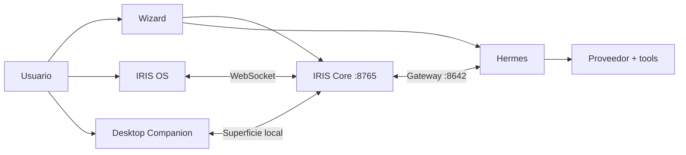

<p align="center">
  
</p>

<h1 align="center">IRIS OS</h1>

<p align="center"><strong>Una presencia visual, configurable y habitable para Hermes Agent.</strong></p>

<p align="center">
  <a href="core/version.py"></a>
  <a href="#estado"></a>
  <a href="pyproject.toml"></a>
  <a href="scripts/runtime_sources.json"></a>
  <a href="LICENSE"></a>
</p>

IRIS OS es una experiencia de asistente de IA local primero, impulsada por
[Hermes Agent](https://github.com/NousResearch/hermes-agent). Combina
instalación guiada, escritorio web, identidad, memoria, voz, avatar VRM y una
presencia flotante opcional.

**Fuente de Iris OS 0.9.3 beta (QA23).** Consulta el [estado actual](docs/estado-actual.md)
antes de probar una función o preparar un candidato. Con proveedores remotos,
el contenido autorizado sale del equipo; «local primero» no significa offline.

> IRIS no es una distribución Linux ni un fork de Hermes. Hermes ejecuta el
> trabajo del agente; IRIS aporta la interfaz, el contexto visual y la forma de
> convivir con él.

## IRIS en 30 segundos

- **Hermes** conecta modelos, tools, skills, sesiones y proveedores.
- **IRIS Core** coordina identidad, memoria, voz y superficies.
- **IRIS OS** convierte el agente en un escritorio visual con avatar.
- El **wizard** detecta el equipo y configura una ruta viable sin asumir que
  todos los usuarios tienen la misma GPU, proveedor o instalación.

La idea central es sencilla: **¿qué ocurre cuando un agente también tiene un
espacio, apariencia, voz, memoria e identidad?**

## Funcionalidades

| Área | Qué ofrece |
| --- | --- |
| [Instalación fácil](docs/guides/getting-started.md) | Detecta SO, CPU, RAM, GPU y el estado de Hermes; distingue instalación nueva, existente o dañada. |
| [Configuración](docs/guides/configuration.md) | Proveedores, catálogo de modelos, API keys, OAuth, Ollama/LM Studio, voz, tema e identidad. |
| Hermes Doctor | Diagnóstico separado de launcher, runtime, configuración, Gateway, credenciales e IRIS Core. |
| IRIS OS | Escritorio temático, chat, centro de comandos, memoria, estado, apps y comandos slash de Hermes. |
| [Continuity Center](docs/guides/continuity-center.md) | Perfiles y sesiones administrados mediante la CLI y API oficiales de Hermes, sin duplicar memoria ni leer su base de datos. |
| [IRIS Player](docs/guides/iris-player.md) | Reproductor local por carpeta autorizada, favoritos e historial; funciona sin Hermes y admite control estructurado mediante la skill `iris-os`. |
| Personalidad | Nombre, perfil, plantillas, rasgos combinables, instrucciones y backstory opcional. |
| [Voz y privacidad](docs/guides/privacy-security.md) | STT/TTS intercambiables y wake word nativo de Hermes, apagado por defecto. |
| Avatar | VRM, emociones, visemas, animaciones, cámara/mocap opcional y acciones de escena. |
| [Desktop Companion](docs/guides/desktop-companion.md) | Presencia flotante opcional para Windows con instalación recuperable, estados y animaciones adaptadas. |
| Capacidades Hermes | Skills, MCP, herramientas, rutinas y delegación negociadas en tiempo de ejecución. |
| [Modelos](docs/guides/models.md) | Selección por conversación, predeterminado separado y modelo auxiliar de visión. |
| [Automatizaciones](docs/guides/automations.md) | Reglas por inactividad de Iris, historial y Bandeja; observación opcional de la sesión de Windows y resúmenes por voz con consentimientos separados, incluidos en QA16. |
| [Conexiones Google](docs/guides/google-connections.md) | Varias cuentas, permisos de lectura y cliente OAuth propio importado/pegado, protegido por perfil. |
| [Calendario](docs/guides/calendar.md) | Día, Semana, Mes y Agenda, caché compartida y recordatorios visuales opcionales. |
| [Correo](docs/guides/mail.md) | Bandeja y cuerpo en texto, sin imágenes remotas; clasificación opcional con consentimiento separado. |
| [Iris Store y SDK 2](docs/guides/community-apps-python.md) | Instalar paquetes locales con interfaz, widgets, Python estándar y skill opcional; no hay catálogo remoto ni sandbox de Windows. |

Conexiones, Calendario, Correo y el SDK 2 están incluidos en QA16. La QA de ese
candidato no acredita automáticamente los cambios posteriores de esta fuente.
El [kit de apps](docs/guides/contributing-apps.md) distingue las apps externas
instaladas por la persona de los servicios integrados mediante revisión.

Las funciones que dependen de hardware, cuentas o servicios externos se
muestran como opcionales. IRIS no instala Ollama o LM Studio ni descarga
modelos locales sin indicarlo.

## Inicio rápido

Este inicio rápido es **desde el código fuente**. Requiere Python 3.11+ y
[`uv`](https://docs.astral.sh/uv/). El paquete Windows incluye sus propios Python
y Hermes; no requiere instalarlos globalmente.

```bash
uv sync
uv run python -m wizard.app
```

El wizard se abre en `http://127.0.0.1:8000/ui/`. Desde allí puedes instalar o
reparar Hermes mediante su instalador oficial, elegir proveedor/modelo y
configurar la experiencia.

Después del wizard:

```bash
uv run python -m core.agent
```

IRIS OS queda disponible en `http://127.0.0.1:8765/face/`.

¿Ya tienes Hermes o necesitas reparar una instalación parcial? Consulta la
[guía completa de instalación](docs/guides/getting-started.md). También existe
una [alternativa con `venv` y `pip`](docs/guides/getting-started.md#instalar-dependencias-de-iris).

Para revisar las fuentes y generar tu propio instalador Windows x64, usa
**[COMPILAR.cmd](COMPILAR.cmd)**. La [guía de compilación](docs/guides/build-from-source.md)
explica requisitos, comprobación previa, registros y hashes. La receta construye
desde una copia separada del código; no necesita descargar el instalador de Iris.

## Arquitectura



| Componente | Responsabilidad |
| --- | --- |
| `wizard/` | Instalación, reparación y configuración inicial. |
| `core/` | Bridge de Hermes, memoria, voz, API y superficies. |
| `face/` | IRIS OS, avatar, temas y aplicaciones web. |
| `apps/` | Manifiestos, módulos propios y plantillas del kit de apps; exportados a Face. |
| `desktop/` | Aplicación principal Windows y su instalador versionado. |
| `companion/` | Ventana flotante opcional basada en Tauri. |

La [documentación de arquitectura](docs/guides/architecture.md) explica puertos,
persistencia, flujos de conversación y límites de confianza.

## Compatibilidad

| Componente | Política actual |
| --- | --- |
| Python | 3.11 o superior; declarado para 3.11–3.13. |
| Hermes del paquete Windows | `0.21.6` fijado por revisión, con Python privado `3.14.8`; Iris usa Python privado `3.11.16`. |
| Hermes externo en desarrollo | Compatibilidad base mínima `0.19.0`, con capacidades negociadas; no garantiza los contratos avanzados de cualquier versión. |
| Instalador de Iris | Windows 10/11 **x64**, en QA. No se acredita ARM64 por la matriz de Hermes. |
| Linux/WSL2 y macOS | Desarrollo sujeto a dependencias y pruebas; el instalador integral de esas plataformas queda pendiente. |
| GPU | Opcional; sin aceleración se recomienda proveedor remoto o un modelo acorde al equipo. |
| Companion | Paquete actual para Windows x64. |

Consulta la
[matriz oficial de Hermes](https://hermes-agent.nousresearch.com/docs/getting-started/installation)
antes de preparar una distribución.

## Documentación

| Tema | Guía |
| --- | --- |
| Instalar, reparar o arrancar | [Instalación y primeros pasos](docs/guides/getting-started.md) |
| Proveedores, modelos, voz e identidad | [Configuración](docs/guides/configuration.md) |
| Inventario de capacidades | [Funcionalidades](docs/guides/features.md) |
| Código, candidato y QA pendiente | [Estado actual](docs/estado-actual.md) |
| Modelos, reglas y cuentas conectadas | [Modelos](docs/guides/models.md), [Automatizaciones](docs/guides/automations.md), [Google](docs/guides/google-connections.md) y [Calendario](docs/guides/calendar.md) |
| Perfiles, sesiones y límites de continuidad | [Continuity Center](docs/guides/continuity-center.md) |
| Componentes y flujos | [Arquitectura](docs/guides/architecture.md) |
| Micrófono, cámara, claves y LAN | [Privacidad y seguridad](docs/guides/privacy-security.md) |
| Ventana flotante | [Desktop Companion](docs/guides/desktop-companion.md) |
| Música local y control mediante Hermes | [IRIS Player](docs/guides/iris-player.md) |
| Pruebas, repositorio y releases | [Desarrollo y publicación](docs/guides/development.md) |
| Crear un instalador personal desde el código | [Compilar Iris](docs/guides/build-from-source.md) |
| Copias del producto, kit de apps y kit de transiciones | [Repositorios de publicación](docs/guides/publication-repositories.md) |
| Alice, IRIS e influencias | [Historia e inspiración](docs/guides/project-history.md) |

El [índice de documentación](docs/README.md) también enlaza el documento
maestro, auditorías, investigación y planes técnicos.

## Estado

IRIS OS está en **desarrollo y QA de beta**. A08.9 sigue abierto: las pruebas de
un checkout, las de un instalador y la aprobación de publicación son hechos
distintos. Hay QA real documentada de candidatos y de Google; no cubre por sí
sola cada cambio posterior, dispositivo o proveedor.

El candidato privado actual es QA22 (informe interno no distribuido):
Iris 0.9.2, ID ddd205bd, con Companion 0.1.8. Incluye voz en vivo y gestos
corregidos; la QA manual de esa versión y la publicación siguen separadas.
Consulta la [matriz vigente](docs/estado-actual.md) antes de usar un informe anterior.

Para ejecutar las pruebas:

```bash
uv sync --extra dev
uv run pytest -q
node --test tests/js/*.test.mjs apps/*/tests/*.test.mjs
```

Consulta [Desarrollo y publicación](docs/guides/development.md) para pruebas del
Companion, `IRIS_WEB_ASSETS_ROOT`, política de archivos y checklist de release.

## Historia del nombre

**Alice** fue el nombre provisional del asistente original. Al crecer hacia un
sistema con identidad, escritorio y varias superficies, el proyecto adoptó
IRIS. El comando `alice` permanece temporalmente como alias de compatibilidad,
no como identidad vigente.

La IA/NPC **I.R.I.S.** de Lahai-Roi en *Wuthering Waves* fue una referencia
creativa posterior para la idea de una inteligencia visible dentro de un
entorno. IRIS OS desarrolló diseño, historia y propósito propios y no está
afiliado con Kuro Games. La [historia completa y sus atribuciones](docs/guides/project-history.md)
explican esa transición.

El nombre también tiene un significado propio: el iris como visión y
percepción, y la Iris mitológica como puente entre mundos.

## Contribuir

Los cambios deben ser enfocados, incluir pruebas pertinentes y mantener
actualizada la documentación. No confirmes credenciales, modelos descargados,
avatares (salvo el de IRIS, ya incluido), archivos de Blender ni salidas de compilación.

Consulta la [guía de desarrollo](docs/guides/development.md) y el
[documento maestro](docs/iris_os_master.md) antes de modificar contratos
centrales.

## Licencia

El código propio de IRIS OS se distribuye bajo la [licencia MIT](LICENSE).
El avatar de IRIS (`face/animations/iris.vrm`) tiene su propia licencia y no es
MIT: [LICENSE-IRIS-VRM.txt](face/animations/LICENSE-IRIS-VRM.txt).
Dependencias, fuentes, modelos, avatares y animaciones de terceros conservan sus
licencias respectivas. Las referencias a otros proyectos describen inspiración
o dependencias y no implican afiliación ni aprobación.
