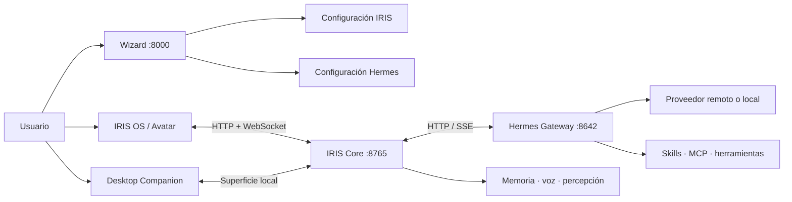

# Arquitectura

[← Índice de documentación](../README.md)

IRIS OS está dividido en superficies y servicios locales. Hermes conserva la
ejecución del agente; IRIS coordina experiencia, identidad, voz, avatar y
estado visual.

Actualización documental: 2026-10-26. La [matriz de estado](../estado-actual.md)
separa implementación, candidato y aceptación.

## Vista general

## Componentes

| Componente | Directorio | Responsabilidad |
| --- | --- | --- |
| Wizard | `wizard/` | Detección, instalación, reparación y configuración. |
| Core | `core/` | Ciclo de IRIS, bridge de Hermes, memoria, voz, API y WebSocket. |
| Face | `face/` | IRIS OS, avatar, temas, apps y superficies web. |
| Apps propias | `apps/` | Manifiestos, módulos y plantillas F09; catálogo/exportación para Face. |
| Desktop | `desktop/` | Ventana principal Windows, arranque del runtime privado e instalador versionado. |
| Companion | `companion/` | Ventana flotante empaquetada con Tauri. |
| Personality | `personality/` | Plantillas y contratos de identidad. |
| Hardware | `hardware/` | Integraciones experimentales Arduino/ESP32. |

## Puertos locales

| Puerto | Servicio | Exposición predeterminada |
| --- | --- | --- |
| `8000` | Wizard | `127.0.0.1` |
| `8765` | IRIS Core, API, WebSocket y Face | loopback; LAN solo si se habilita |
| `8642` | Hermes Gateway | administrado por Hermes |

Un puerto cerrado no demuestra por sí solo una instalación dañada. Hermes puede
estar instalado y configurado aunque el Gateway no se haya iniciado.

## Flujo de una conversación

1. Una superficie envía texto o un evento de wake word al Core.
2. El Core aplica identidad y contexto sin duplicar toda la sesión.
3. Hermes ejecuta el turno con el proveedor y las herramientas disponibles.
4. El bridge transmite texto y progreso.
5. IRIS resuelve emoción, animación, audio y estado por superficie.
6. Solo una superficie conserva la propiedad de reproducción de audio; las
   demás pueden recibir visemas o estado.

En fuente posterior a QA19, `face/js/speech_presentation.js` coordina el inicio,
fin y retorno a reposo de la voz tanto en Face como en Companion. Sus dependencias
se consultan mediante getters para seguir usando el avatar vigente al cambiar de
VRM. El ánimo visible se actualiza al inicio de la frase; la expresión de la boca
permanece neutra durante el habla y adopta el ánimo al terminar. Una nueva frase,
una emoción explícita o una desconexión invalidan los temporizadores anteriores.

Este controlador no reproduce audio ni decide qué ventana lo recibe.
`TtsAudioPlayer` conserva los visemas, la propiedad de reproducción y los recibos
de finalización. Las superficies mantienen su chat, subtítulos y controles propios.

En fuente posterior a QA19, `face/js/graphics_quality.js` aplica una política común
de resolución y MSAA a las dos superficies. `render_quality` se guarda en el perfil
con `render_fps_limit`; la API acepta cambios parciales y publica el par confirmado.
El controlador redimensiona los buffers existentes y no recrea el contexto WebGL
ni el avatar. Face mantiene su render target con stencil para la ventana incluso
sin bloom, y evita resolver stencil al copiar el color para el posprocesado.
Companion usa únicamente escena y salida de color, con alfa; no carga la habitación
ni los pases de bloom.

F01 conserva una selección de modelo por conversación mediante la API de
sesiones de Hermes; el predeterminado global es otra operación. La foto F03 usa
una captura autorizada y la ruta auxiliar F02; no convierte las señales locales
de presencia en acceso implícito a imágenes.

## Protocolo de superficies

IRIS OS y el Companion se registran con capacidades diferentes. El registro
permite decidir:

- qué superficie reproduce TTS;
- cuál puede solicitar cámara;
- si renderiza avatar;
- si está visible o activa;
- cómo adaptar una acción de escena a su espacio.

El JSON de animación original se conserva como intención. Cada superficie puede
resolver una alternativa apropiada: por ejemplo, una acción ligada a una sala
puede convertirse en un gesto compacto en la ventana flotante.

## Persistencia

- `~/.iris/config.json`: configuración propia de IRIS.
- almacenamiento local de IRIS: memoria, certificados y estado operacional.
- workspace/configuración de Hermes: proveedor, modelo, identidad sincronizada,
  skills y sesiones.
- preferencias del Companion: ventana, autoarranque y movimiento opcional.

La raíz mutable se resuelve por `core/profile_paths.py` y admite `IRIS_HOME`.
Las instalaciones versionadas separan `install.json` y `v/<id>` de los datos:

| Estado | Propietario y ubicación relativa al perfil |
| --- | --- |
| Automatizaciones | `AutomationStore`, `automations/automations.sqlite3`. |
| Google | `GoogleStore`, `connections/google/google.sqlite3`; cliente/tokens con protección DPAPI. |
| Calendario | Preferencias y recordatorios de F11; consume la caché del servicio Google, sin otro OAuth. |
| Apps externas | `AppPackageStore`, `apps/app-packages/packages.sqlite3`; paquetes registrados por instalación, separados del programa. |
| Backend externo SDK 2 | Caché materializada y verificada en `apps/app-packages/runtime/<instalación>/`; datos persistentes separados en `apps/app-packages/data/<id>/`. |
| Skill externa SDK 2 | Skill con propietario registrado en el perfil de Hermes; se retira solo la copia administrada que conserva su identidad. |

`core/profile_sqlite.py` reúne el protocolo cooperativo de apertura y protección
de los almacenes. No es una defensa transaccional absoluta frente a otro proceso
hostil que tenga el mismo acceso al perfil.

## Servicios añadidos en F04–F16

- El motor/ejecutor de automatizaciones vive en Core. Cerrar su ventana detiene
  refresco visual, no el trabajo autorizado ya en ejecución.
- La Bandeja presenta resultados durables de distintos orígenes sin confundir
  presentado, leído o hablado.
- Conexiones ejecuta OAuth/lecturas en el worker del Python de Hermes y conserva
  el estado en el perfil de Iris. No reutiliza el token de una skill de Google.
- Calendario consume esa caché y el scheduler de Core produce avisos visuales
  opt-in. Su widget F12 comparte el mismo estado/rangos de lectura de la app;
  el host de widgets conserva preferencias por perfil separadas de las ventanas.
   F15 añade preparación manual en un runtime y ledger separados; la tarea se
   registra en el propietario Google y no condiciona el scheduler de avisos.
   Véanse [Calendario](calendar.md) y [Widgets](widgets.md).
- F09 centraliza el registro y lifecycle. Un manifiesto no concede permiso para
  importar servicios dentro de Core: esa vía requiere revisión y allowlist de código.
- F16 recibe `voice.partial` del servidor aislado de voz de Hermes y lo publica
  como `voice_partial` visual. Manual y Wake conservan la identidad de su toma;
  se acota/coalesce el texto pendiente y se descartan callbacks de una toma
  anterior. Solo el resultado final recorre el envío habitual al agente.
  La casilla opt-in modifica `stt.streaming` en el perfil, sin activar sensores.
  Véase [voz manual y directo](manual-voice.md).

## Apps externas y SDK 2

La [Iris Store](iris-store.md) instala paquetes locales con interfaz/widgets y,
con [SDK 2](community-apps-python.md), backend Python, acciones declaradas y una
skill opcional. Es una vía distinta de los servicios integrados revisados de F09.
Core inspecciona el paquete y solicita confirmación antes de instalar; no importa
Python externo dentro de su proceso ni lo ejecuta por encontrar una carpeta.

`AppExtensions` coordina un worker por instalación/perfil con el Python de
Iris, usando `-I -S -B`. El backend usa biblioteca estándar y sus módulos propios;
no hereda claves de proveedores ni instala dependencias. Las operaciones están
declaradas y sus argumentos/resultados se validan. Esta separación no es un
sandbox del sistema operativo: el código conserva los permisos del usuario.

Actualizar o desinstalar recoge el worker y sus acciones/skill administradas,
además de las superficies. Los datos se conservan por defecto y su eliminación
requiere la opción explícita. La interfaz actualiza el catálogo en vivo, con
reintento visible ante error; la Store no es un catálogo remoto. El SDK está
incluido en QA15/QA16 y su presencia no valida automáticamente una app concreta.

El runtime Windows incluye dos Python distintos, web local y Hermes fijado.
Iris actualiza ese conjunto mediante su canal; no ejecuta `hermes update` dentro
del motor empaquetado. Véase [Actualizaciones](hermes-updates.md).

Los nombres legacy se migran o aceptan únicamente para no romper instalaciones
anteriores. Los contratos y documentación nuevos utilizan IRIS.

## Límites de confianza

- El navegador controla permisos de cámara y micrófono.
- Hermes controla proveedores de IA, su OAuth, tools y wake word nativo; el
  servicio Google de Iris administra sus propias conexiones de lectura.
- IRIS controla qué contexto y medios entrega a cada superficie.
- El acceso LAN cambia el límite de confianza y requiere autenticación/TLS
  apropiados.
- Un proveedor remoto queda fuera del equipo y se rige por sus propios términos.

## Compatibilidad por capacidades

La versión de Hermes es un guardrail, no una lista completa de funciones. IRIS
consulta capacidades en vivo antes de mostrar flujos avanzados. Esto evita
prometer una función porque una versión parezca suficientemente reciente.

## Documentos técnicos relacionados

- [Documento maestro](../iris_os_master.md)
- [Plan del Desktop Companion](../iris_desktop_companion_plan.md)
- [Investigación de voz](../iris_voice_research_update_2026-07-30.md)
- [Plan WebRTC](../webrtc_bridge_plan.md)

