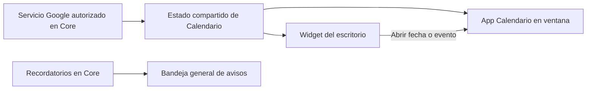

# Iris OS — Base de apps, widgets y futura Iris Store

Fecha original: 2026-09-29. Actualización documental: **2026-10-18**.
**F09, F11 y F12 implementados en fuente; candidatos/QA y futura Store pendientes.**
Consulta [Estado actual](estado-actual.md) para integración y QA.

El orden y el estado de ejecución se centralizan en el plan coordinador de A08 (informe interno no distribuido), entregas F09–F15 según sus dependencias. Las áreas descritas aquí conservan requisitos de diseño y pruebas; no constituyen una petición de implementarlas todas ni habilitan la Store posterior.

El plan detallado de F09 (informe interno no distribuido) desarrolla el registro, lifecycle, servicios Python opcionales y uso por IA. La [guía de contribución](guides/contributing-apps.md) describe la API implementada en fuente y sus límites, no una carga libre de plugins externos.

El usuario quiere una pantalla principal personalizable con widgets, empezando por Calendario, y una forma sencilla de crear más programas propios para una futura Iris Store. Este documento conserva los requisitos de diseño; la implementación vigente de F12 está en el informe (informe interno no distribuido) y la [guía de widgets](guides/widgets.md). La Store sigue fuera de alcance y A08 continúa abierto.

## Experiencia inicial

El diseño inicial partió solo de Calendario. En la fuente actual, **Widgets** añade Calendario o IRIS Player y **Editar inicio** los ordena junto a accesos, con el mismo límite de cuatro instancias. El [inicio personalizable](guides/desktop-home.md) reemplaza la ubicación lateral inicial por una cuadrícula compartida. En pantallas estrechas permite desplazamiento por encima del dock.

El widget muestra mes actual, día elegido y los próximos 2–3 eventos cuando exista una cuenta conectada. «Abrir Calendario» abre su ventana completa; seleccionar un evento abre esa misma ventana enfocando su detalle. La preparación IA, filtros extensos y configuración viven en la app, no se comprimen en el widget.

«Hoy» y «seleccionado» son estados distintos. Navegación de mes, fecha completa, eventos y controles tienen nombres accesibles. Se puede ordenar mediante controles de teclado; arrastrar y tamaños adicionales son mejoras posteriores, no el único medio de personalizar.

La app y el widget adoptan el tema vigente: Sakura, Cyber, Classic, Hacker o personalizado. El mockup aporta dirección visual, no obliga a mantener sus tres columnas ni un tamaño fijo.

## Estado vigente y corte de diseño

- F09 centraliza manifiestos en `apps/`, catálogo generado y host de módulos.
  Automatizaciones, Conexiones y Calendario consumen ese contrato; la entrada
  de un servicio Python requiere revisión y la allowlist de código.
- F10 aporta las conexiones Google y su caché. F11 ya implementa la app
  [Calendario](guides/calendar.md) y estado compartido preparado para F12.
- F12 implementa el host, preferencias por perfil y widget Calendario con estado
  compartido F11. Por decisión del usuario, cada app declara `widgets` en su
  propio `app.json`; el catálogo de Face y los metadatos de Core se generan desde
  ahí. La guía describe el contrato vigente, no una instalación de terceros.
- La integración empaquetada F09.6 y la QA de F11 siguen abiertas. La Store
  pública, descarga de apps y ejecución libre de terceros no forman parte del kit.
- Desde el 2026-10-18, [Player](../apps/player/README.md) es el ejemplo local de
  app, widget y skill sin cuentas externas. Comparte un solo audio y su widget
  no autoriza carpetas ni reproduce al añadirse. Informe (informe interno no distribuido).

### Base inspeccionada el 2026-09-29 (histórica)

Las observaciones siguientes explican el diseño original; los archivos que se
indicaban como nuevos pueden existir ya. Para implementar, partir del código
actual y de la guía de contribución, no de este inventario inicial.

- `face/js/hermes_activity.js` registra metadatos en `OS_WINDOW_APPS`, pero también mantiene manualmente vistas, iconos, accesos, allowlists y loaders. Una app nueva requiere cambiar varios puntos del monolito.
- Hay módulos independientes aprovechables: Player, Continuity, Capability Center y Notification Center. El shell mueve la misma vista a una ventana y conserva layout/foco; no hace falta reemplazar ese gestor.
- `.os-home-screen` contiene escritorio, launcher, capa de ventanas y dock. Es el lugar para un host de widgets detrás de las ventanas.
- El rail derecho actual contiene Connected Services, está oculto en home y desaparece bajo 920px. No es un sistema de widgets; colocar allí Calendario sin otra adaptación lo haría inaccesible.
- `_hasVisibleAppSurface()` conoce ventanas y pestañas, pero no widgets. Hay que representar los nuevos consumidores sin fingir que la ventana Calendario está abierta.
- IRIS Marketplace reúne Skills y MCP. No es una tienda de apps de Iris. El App SDK ya aparece como objetivo pendiente P3-002 en `docs/iris_os_master.md`.
- No existe todavía la app Calendario, su sincronización Google ni su widget. Los datos del mockup no son una agenda real.

## Una app y varias vistas, con datos compartidos



App y widget consumen los mismos eventos normalizados, cuenta, zona horaria, caché y estado de sincronización. No copian credenciales ni hacen dos sincronizaciones independientes. Un registro de consumidores permite refresco de la vista si hay app o widget visible; sus peticiones se coalescen.

Cerrar la app no elimina el widget. Quitar el widget libera su consumidor/listeners, sin borrar datos ni detener rutinas. Ocultar ambos pausa sus actualizaciones visuales; los recordatorios configurados y la sincronización de fondo autorizada pertenecen a Core y no dependen de la ventana.

Sin cuenta, mostrar «Conectar Calendario». Distinguir carga, sin eventos, error, permisos revocados y datos guardados de una sincronización anterior, con su fecha. Un fallo de conexión no se convierte en «No hay reuniones». No incluir eventos inventados en la versión funcional.

Las preferencias de widgets se separan del layout `irisOsWindows.v1`. Propuesta versionada: instancia, ID de widget, versión de configuración, orden/posición lógica, variante de tamaño y calendarios elegidos. Para continuidad Face/Desktop, persistir en el perfil backend; `localStorage` puede actuar como caché, pero distintos orígenes no comparten automáticamente sus datos.

## Kit mínimo para crear apps propias

Primero un registro común para **apps integradas y controladas por el proyecto**, con un adaptador que conserve las actuales. No reescribir todas las apps a la vez. F09 valida antes el kit con una muestra de desarrollo y una app existente; Calendario será la primera app nueva de producto en F11, y su widget verificará el consumidor compartido en F12.

El kit reúne:

| Pieza | Propósito |
| --- | --- |
| Manifiesto | ID estable, nombre, versión, icono, capacidades requeridas, tamaño inicial y compatibilidad del kit. |
| Factory/loader | Crear la vista propia una sola vez, cargarla cuando haga falta y reportar errores de forma local. |
| Lifecycle | Montaje, visibilidad, navegación hacia una fecha/objeto y destrucción de listeners/requests. |
| Contexto de app | Abrir ventanas mediante el shell, acceder a servicios permitidos, tema y estado, sin crear otro shell ni otro almacén de tokens. |
| Widgets opcionales (F12) | Una o más vistas compactas asociadas a la app, con configuración y lifecycle independientes. F09 prepara servicios reutilizables, sin implementar su host. |
| Registro derivado | Generar metadatos de launcher/dock/ventanas y rutas válidas desde una fuente común. |
| Plantilla de desarrollo | App mínima con estilos encapsulados, estados y pruebas de lifecycle; se añade cuando el contrato ya esté implementado. |

Ejemplo conceptual histórico previo a F12; la lista simple de IDs de abajo no es
el contrato actual. Para aportar una app, usa los objetos `widgets` de
[`calendar/app.json`](../apps/calendar/app.json) y la [guía](guides/widgets.md),
con módulo/estilo locales y versión de configuración. No autoriza cargas remotas.

```json
{
  "schema": "iris.app-manifest/v1",
  "id": "calendar",
  "name": "Calendario",
  "version": "0.1.0",
  "sdkVersion": 1,
  "icon": "calendar",
  "window": { "width": 920, "height": 620 },
  "requestedCapabilities": ["calendar.read"],
  "widgets": ["calendar.month"]
}
```

Las dimensiones iniciales se limitan al espacio disponible. IDs existentes no se renombrarán, para conservar layout y navegación. Validar duplicados, schema/versiones y metadatos antes de registrar; las referencias de widgets se verifican cuando se implemente F12. Un error en una app no bloquea todo el escritorio.

Los módulos ejecutables de apps propias se resuelven mediante factories/imports conocidos en el build. El manifiesto no acepta una URL arbitraria como autorización para importar código. `requestedCapabilities` describe necesidades; no concede permisos por declararse. Los servicios de Core verifican acceso, cuenta y consentimiento.

El registro nuevo debe alimentar o adaptar los loaders/allowlists del shell; crear una lista de manifiestos sin conectar esos consumidores no resuelve el problema actual. Migrar progresivamente metadatos de apps existentes, manteniendo compatibilidad con sus módulos y eventos.

## Conexiones reutilizables entre apps

El usuario propone un kit específico de conectores, con manifiesto/adaptador y
guía de contribución propios, ampliando la app Conexiones actual. El
[plan de conexiones](iris_connections_sdk_plan_2026-10-17.md) distingue servicio,
cuenta/espacio y consumidores: una conexión puede alimentar varias apps/widgets
sin duplicar credenciales, OAuth o sincronización. Google es la base existente;
Notion es un ejemplo futuro, no una integración disponible. El contrato de
dependencias de `app.json` aún debe versionarse; no concede permisos por declararse.

## Relación con la futura Iris Store

El kit y el manifiesto facilitan un catálogo futuro con ficha, versión, requisitos y compatibilidad. En el primer alcance no habrá descargas remotas, pagos, cuentas de tienda ni instalación de programas de terceros.

Iris Store podrá distinguir apps de Iris, widgets y, en otra sección, recursos de Hermes (Skills/MCP/plugins). Compartir presentación del catálogo no mezcla sus contratos de ejecución o instalación.

Antes de admitir paquetes externos se necesita una entrega propia: formato de paquete, integridad/origen, aislamiento de código, broker de permisos, revisión de compatibilidad y ciclo instalar/actualizar/desinstalar/revertir. Un manifiesto o firma por sí solos no aíslan una app. La actualización de extensiones no puede modificar el runtime incluido ni eludir el canal conjunto de A08.

Mantener assets de fábrica inmutables, datos/configuración de cada app en el perfil y recursos de paquetes fuera de credenciales. Retirar una app no borra sus datos personales sin una decisión explícita del flujo. El primer kit puede aportar organización sin prometer todavía extensibilidad segura por terceros.

La [personalización del inicio](iris_desktop_personalization_plan_2026-10-17.md)
concreta la decisión posterior del usuario: ocultar iconos sin desactivar apps,
sin restablecer el layout y con desinstalación futura solo de paquetes externos
administrados por Iris. Define procedencia en Core, separación código/datos,
registro y retirada recuperable. No hay todavía instalador externo; F09 aporta
host y registro de acciones, pero no un desinstalador completo de servicios.

## Entregas y archivos previstos

Los nombres nuevos son propuestas, no archivos ya implementados. Esta tabla agrupa áreas; el orden de ejecución sigue el coordinador y el plan F09. La muestra/plantilla se valida en F09 antes de Google, Calendario y widgets reales; no depende de cerrar F11/F12.

| Entrega | Archivos previstos | Criterio de aceptación |
| --- | --- | --- |
| 1. Contrato y registro | Nuevos `face/js/os_app_manifest.js`, `os_app_registry.js`; adaptaciones acotadas del shell. | Fuente común realmente usada por apertura/registro; apps actuales e IDs persistidos conservados. |
| 2. Host de widgets | Nuevos `face/js/os_widgets.js`, `face/css/os_widgets.css`; `hermes_activity.js`, `iris_os_responsive.css`; preferencias de perfil. | Añadir/quitar/ordenar y restaurar layout sin tapar dock/launcher ni perder widgets al reducir pantalla. |
| 3. Estado Calendario | Nuevos `face/js/calendar_state.js` y servicio/broker Google del plan compartido. | Cuenta/permisos/caché/eventos normalizados y errores reales, sin consultas duplicadas. |
| 4. App + primer widget | Nuevos `face/js/calendar_app.js`, `calendar_widget.js`, CSS de Calendario y registro. | Dos vistas de los mismos datos; abrir fecha/evento reutiliza la ventana existente. |
| 5. Plantilla de app | Ejemplo mínimo y documentación del contrato que ya funciona. | Añadir una segunda app de prueba mediante el registro, sin extender cadenas de `if`/allowlists por toda la UI. |
| 6. Store posterior | Catálogo/paquetes/ciclo de extensión en una entrega independiente. | Contratos, compatibilidad, permisos y aislamiento verificados antes de habilitar terceros. |

La base de distribución A08 mantiene prioridad. El contrato del kit puede prepararse en paralelo; la integración Google necesita el registro del desarrollador y una cuenta de prueba autorizada. Un widget visual no acredita recordatorios, OAuth ni un instalador distribuible.

## Pruebas necesarias

- Registro: manifiesto inválido/duplicado, versión incompatible, widget de app ausente, factory fallida, loader concurrente y apertura de app desconocida sin importar código arbitrario.
- Regresiones de ventanas: mismas IDs, restauración minimizada, foco/Escape, dock, launcher, requests tardías, polling y módulos existentes. Ampliar `tests/js/os_app_lifecycle.test.mjs`.
- Widgets: preferencias corruptas/versiones desconocidas, app ausente/incompatible, restauración fuera de espacio útil, orden por teclado, quitar/volver a añadir, limpieza de listeners y varios tamaños de escritorio. Ocultar el icono de una app no elimina sus widgets.
- Calendario compartido: app cerrada/widget visible actualiza, ambos visibles hacen una sola lectura, ambos ocultos pausan refresco visual y recordatorios siguen activos; error/sin cuenta/caché antigua diferenciados.
- Navegación: abrir desde widget conserva evento/fecha, no duplica la ventana ni cambia silenciosamente de cuenta.
- Fechas: mes/año bisiesto, zona horaria, todo el día, recurrencias y eventos reprogramados/cancelados, junto a las pruebas Google del plan existente.
- Visual/accesibilidad: Sakura y tema alternativo, fondo personalizado, contraste, tamaño de contenedor, zoom, nombres de fechas y foco estable durante actualización.

La redacción original de este diseño solo inspeccionó código y preparó documentación.
Sus tests eran requisitos, no resultados ejecutados. La implementación posterior
F12 y su evidencia se registran en el informe enlazado al principio; no convierte
por sí sola los requisitos de Store o QA instalada en aprobados.
