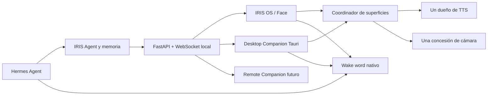

# IRIS Desktop Companion — plan de implementación

> **Estado documental: 2026-10-28.** Fuente/manifiesto de Companion: `0.1.4`; incluido en QA18 (informe interno no distribuido). QA nativa del candidato pendiente.
> Los registros 0.1.0–0.1.2 conservan sus revisiones. La distribución conjunta
> de Iris y su QA siguen en A08.9: [Estado actual](estado-actual.md),
> [guía de Companion](guides/desktop-companion.md) y [Desktop](../desktop/README.md).

Estado: **Fases 0–5 locales verificadas en Windows; BUG-029 fue corregido el 26 de agosto de 2026.** Firma, métricas físicas y macOS/Linux siguen pendientes.

### Registro de implementación

La base compartida ya está operativa:

- `core/surface_registry.py` registra rol, visibilidad, interacción y capacidades;
- `surface_ready` reemplaza al handshake del Face actual, conservando compatibilidad
  de servidor con clientes `face_ready` anteriores;
- un único propietario recibe `tts_audio`; los demás avatares reciben solo visemas;
- si el propietario se desconecta durante el envío, se selecciona el siguiente o se
  conserva el fallback de altavoces del servidor;
- la concesión exclusiva de cámara está conectada a Face y Desktop Companion, con
  revocación, limpieza de señales derivadas y liberación al ocultar/desconectar;
- alias, reintento y fallbacks salieron de `app.js` hacia `AnimationDirector`;
- las adaptaciones por superficie viven en `face/animations/contexts.json`;
- `TtsAudioPlayer` es compartible y corta audio en `speech_end`/barge-in;
- rutas de animación son inyectables y los paquetes Pixiv usan imports resolubles
  por import map o bundler;
- se corrigió la detección histórica de `FALLBACK_FAILED`: el marcador tiene 15
  bytes, no 16.

Validación del checkpoint del 12 de agosto:

- `271 passed` en la suite Python completa, incluidos ciclo de instalación,
  integridad, firma, versiones y autoinicio;
- `19 passed` en las pruebas JavaScript del resolver/director/audio/cámara/políticas Companion;
- `5 passed` en Rust para clamp, dirección, área útil y monitores con coordenadas negativas;
- bundle Vite offline, `cargo fmt --check`, `cargo check --locked` y `cargo test --locked` correctos;
- QA visual del panel avanzado y del Companion a su viewport nativo `400×520`, sin
  errores de consola; se corrigió durante esa prueba un botón Guardar que no se
  habilitaba después de editar una preferencia.

Auditoría y corrección del 26 de agosto:

- el paquete 0.1.0, WebView2 y Core se detectan correctamente;
- se normalizan las comillas de `InstallLocation` y la recuperación exige que
  producto, arquitectura y versión coincidan exactamente con el journal;
- `/D=` se entrega como último segmento sin comillas, incluso con espacios en la
  ruta del perfil, y el ejecutable posterior se verifica antes de prometer éxito;
- el registro real dejó de contaminar los tests unitarios del ciclo de vida;
- la suite focal aprobó 72 pruebas Python, la completa 404 con 3 skips, las 7
  pruebas Rust y las 38 pruebas JavaScript aprobaron;
- QA real aprobado con `APP READY`, abrir y autoinicio habilitados y sin errores
  de consola. Causa y evidencia: [BUG-029](iris_os_master.md#bug-029-el-instalador-del-desktop-companion-termina-pero-iris-no-reconoce-el-ejecutable).

Cierre de interacción nativa 0.1.1 del 26 de agosto:

- la barra superior mueve la ventana mediante un único comando Tauri nativo,
  validado manualmente sobre la instalación real;
- el botón interno `Ocultar` libera cámara/audio local y oculta sin terminar el
  proceso; `Mostrar ventana` recupera la misma instancia;
- `Cierra el Companion` usa `/api/companion/stop`, solicita primero el cierre
  cooperativo `--iris-exit` y solo aplica fallback a procesos cuya ruta exacta ya
  fue validada;
- el arranque dejó de abortar por una consulta prematura de posición de WebView2:
  mostrar, recuperar área visible y enfocar son operaciones recuperables;
- el release NSIS 0.1.1, el manifiesto y las versiones de Cargo/Tauri/npm están
  sincronizados. Aprobaron 409 pruebas Python con 3 skips, 39 JavaScript y 7 Rust.

La superficie web de la Fase 1 está disponible en `/face/companion/`:

- escena Three.js transparente y aislada, sin habitación, bloom ni cámara orbital;
- mismo `AvatarManager`, `IdleSystem`, emoción, labios, movimiento de habla y director
  contextual que IRIS OS;
- registro real como `desktop_companion`, chat de la misma sesión y comandos `/`;
- barra compacta con wake nativo de Hermes, cámara local, chat e IRIS OS;
- colores sincronizados con `irisOsTheme.v1` o con el preset del instalador;
- estado offline explícito, reconexión automática y borrador de chat preservado;
- deduplicación probada entre el evento `animation` y la instantánea de
  `speech_start.animacion_virtual`;
- cámara manual con vista local, `audio: false`, concesión exclusiva y liberación al
  ocultar, desconectar o recibir una revocación. Face usa ahora la misma concesión.
- percepción opcional empaquetada: MediaPipe Face Landmarker produce mocap y emoción
  dentro del WebView; solo se envía una instantánea derivada limitada a 1 Hz y Core
  la acepta únicamente del dueño actual de la concesión;
- el runtime WASM y el modelo oficial están fijados, verificados por SHA-256 y
  empaquetados, por lo que activar análisis no necesita CDN;
- preferencias avanzadas reales para mantener encima, tamaño del avatar, movimiento
  reducido y visibilidad de la barra; se guardan en IRIS y se aplican en vivo;
- locomoción nativa separada y apagada por defecto: conserva `animacion_virtual`,
  desplaza solo la ventana ante `window-walk`, respeta el área útil del monitor y se
  cancela con hover, quiet mode, estados operativos ocupados, ocultación o reduced motion;
- la barra no puede ocultarse mientras wake o cámara estén activos, preservando el
  acceso al apagado explícito y al indicador de privacidad.

La URL `/face/companion/?preview=1` agrega únicamente un fondo cuadriculado de QA.
Sin ese parámetro el documento y el renderer conservan alfa real para el futuro shell.

Este documento define la presencia flotante local de IRIS sobre el escritorio del
sistema operativo. No debe confundirse con **IRIS Remote Companion**, que seguirá
siendo la experiencia para móvil o un segundo equipo.

## 1. Objetivo

Permitir que el mismo avatar de IRIS acompañe al usuario fuera de la habitación 3D
mediante una ventana transparente, ligera y opcional, sin crear un segundo agente ni
una segunda identidad.

La primera versión útil debe ofrecer:

- avatar VRM o procedural sobre fondo transparente;
- ventana movible, posición persistente y opción de mantener encima;
- controles compactos para wake word de Hermes, cámara, chat e IRIS OS;
- estados visibles de conexión, escucha, procesamiento, habla y error;
- las mismas emociones, visemas y animaciones emitidas por el runtime actual;
- adaptación contextual de las animaciones que dependan de la habitación;
- bandeja del sistema para mostrar, ocultar, abrir IRIS OS y salir;
- funcionamiento degradado honesto cuando IRIS/Hermes no estén activos.

## 2. Decisiones cerradas

1. **Un agente, varias superficies.** El compañero no inicia otro Hermes Agent ni
   mantiene otra memoria. Se conecta al proceso local de IRIS ya existente.
2. **El JSON del modelo no cambia.** `animacion_virtual` conserva nombre y significado.
   La adaptación ocurre en el cliente después de recibir el evento.
3. **La animación solicitada manda.** Los estados ligeros `listening`, `thinking`,
   `speaking` y `error` solo cubren los intervalos en los que todavía no existe una
   animación explícita o no se pudo reproducir.
4. **Hermes sigue siendo dueño del wake word.** El botón de escucha llama al runtime
   nativo existente; el compañero nunca sube audio continuamente por WebSocket.
5. **Un único dueño por recurso.** Solo una superficie reproduce TTS y solo una puede
   mantener la cámara abierta. Las demás reciben estado y animación, no duplican el
   dispositivo.
6. **Apagado por defecto.** El compañero, su autoinicio, la cámara y el wake word son
   opt-in independientes.
7. **Implementación propia.** Los repositorios externos son referencias de arquitectura.
   No se copiará código o assets de OpenPet por su licencia GPL-3.0.

## 3. Auditoría de la base actual

### 3.1 Elementos reutilizables

| Capacidad actual | Fuente | Uso en el compañero |
|---|---|---|
| Avatar procedural/VRM | `face/js/avatar.js` | Reutilizar `AvatarManager` en una escena transparente mínima. |
| VRMA y poses | `face/js/idle_system.js`, `face/js/vrm_animation_loader.js` | Reutilizar reproducción, crossfade y retorno a idle; desacoplar rutas y poses de habitación. |
| Catálogo | `face/animations/manifest.json`, `core/animations.py` | Mantener como fuente de clips válidos para el modelo y las superficies. |
| Emociones y boca | `face/js/avatar.js`, `face/js/lipsync.js` | Reproducir los mismos eventos `emotion`, `lip_sync` y `tts_audio`. |
| Movimiento al hablar | `face/js/speech_animator.js` | Compartir sin crear una segunda interpretación del habla. |
| Eventos de turno | `core/websocket_server.py` | Conectar el compañero al mismo flujo `animation` → `speech_start` → audio → `speech_end`. |
| Wake word | `core/hermes_wake.py` y su API | El botón del compañero refleja y cambia el mismo estado nativo. |
| Chat | mensaje WebSocket `user_text` | Enviar al pipeline existente de memoria, Hermes, TTS y animación. |
| Temas | configuración y tokens visuales actuales | Aplicar color/acento de IRIS, con contraste propio para fondo transparente. |

### 3.2 Acoplamientos que deben resolverse primero

- `face/js/app.js` contiene dentro del monolito el aliasing y fallback de
  `animacion_virtual`; copiarlo haría divergir ambas superficies.
- `IdleSystem` contiene posiciones absolutas de muebles (`ROOM_SPOTS`) y acciones como
  `go_computer`, `go_bed` o `touch_books` que no existen sobre el escritorio real.
- `IdleSystem` descarga el manifiesto desde una ruta fija `/face/animations/manifest.json`.
- `avatar.js` importa `@pixiv/three-vrm` directamente desde un CDN. Un ejecutable
  empaquetado debe incluir esa dependencia y poder iniciar sin Internet.
- el servidor guarda clientes WebSocket en un conjunto sin rol ni capacidades;
  `face_clients_connected()` supone que **todos** reproducen TTS.
- `tts_audio` se difunde actualmente a todos. Abrir IRIS OS y el compañero a la vez
  produciría audio doble.
- la cámara del panel es un `MediaStream` propiedad de cada navegador. No existe aún
  una concesión exclusiva entre superficies.
- el origen WebSocket permitido está diseñado para navegador local/LAN. La aplicación
  Tauri necesitará identificación local y autenticación explícita, no una excepción
  amplia de CORS/origin.

Estos puntos forman la fase inicial; no son mejoras opcionales del prototipo.

## 4. Referencias y decisión de shell

Se usará [Tauri 2](https://tauri.app/) para el shell nativo opcional:

- [**OpenPet**](https://github.com/X-T-E-R/OpenPet) demuestra una ventana pequeña de 320×320, transparente, sin bordes,
  `alwaysOnTop`, fuera de la barra de tareas y acompañada por bandeja/configuración.
  Es una referencia de producto y configuración, no una fuente de código reutilizable
  debido a GPL-3.0.
- [**Convai Desktop Pet**](https://github.com/AkshitIreddy/convai-desktop-pet) demuestra el modelo de overlay único, regiones interactivas,
  coordinación nativa y permisos temporales. Su overlay de pantalla completa es útil
  como referencia para una fase avanzada, pero no es el punto de partida porque una
  ventana grande puede interceptar clics y aumentar consumo.
- [**Buddy Desktop**](https://github.com/d-wwei/buddy-desktop) sirve como referencia conceptual para sincronizar estados de un
  agente con una mascota, pero su madurez actual no justifica usarlo como base.

La primera versión empleará una **ventana pequeña que se mueve**, no un overlay que
cubra todo el monitor. Así el área transparente no bloquea aplicaciones ajenas y se
puede añadir movimiento por el escritorio después sin rehacer el runtime visual.

## 5. Arquitectura propuesta



### 5.1 Capas

1. **Core IRIS**: sesión, memoria, Hermes, TTS, wake word, configuración y eventos.
2. **Coordinador de superficies**: registra rol/capacidades, presencia, visibilidad,
   actividad reciente, propietario de TTS y concesión de cámara.
3. **Runtime visual compartido**: selección de animación, alias, fallback, emoción,
   labios, movimiento de habla e idle.
4. **Superficie Companion**: escena Three.js transparente, controles y burbuja compacta.
5. **Shell Tauri**: ventana, monitores/DPI, posición, bandeja, autoinicio y permisos.

### 5.2 Estructura prevista

```text
face/js/
  animation_director.js          # lógica compartida extraída de app.js
  animation_context_resolver.js  # adaptación por superficie, pura y testeable
  tts_audio_player.js             # reproducción/limpieza compartida
  surface_protocol.js             # mensajes y capacidades del cliente
face/animations/
  contexts.json                   # mapa de compatibilidad por superficie
core/
  surface_registry.py             # registro, elección de audio y cámara
companion/
  package.json
  vite.config.js
  src/
    main.js
    companion_app.js
    companion.css
    controls.js
  src-tauri/
    Cargo.toml
    tauri.conf.json
    capabilities/default.json
    src/lib.rs
tests/
  test_surface_registry.py
  test_companion_contract.py
  test_companion_assets.py
  js/animation_context_resolver.test.mjs
```

Los nombres pueden ajustarse al crear el scaffold, pero las responsabilidades no
deben volver al monolito `face/js/app.js`.

## 6. Protocolo de superficies

### 6.1 Registro compatible

Se añadirá un mensaje `surface_ready`. No modifica el JSON de respuesta del modelo:
es metadato de transporte entre interfaces y el backend.

```json
{
  "type": "surface_ready",
  "payload": {
    "role": "desktop_companion",
    "surface_id": "uuid-local",
    "visible": true,
    "capabilities": {
      "renders_avatar": true,
      "plays_tts": true,
      "captures_camera": true,
      "accepts_chat": true
    }
  }
}
```

Roles iniciales:

- `face`: interfaz principal/habitación;
- `desktop_companion`: ventana flotante local;
- `remote`: móvil o segundo equipo futuro;
- `legacy_face`: cliente anterior que solo envía `face_ready`.

`face_ready` seguirá funcionando durante la migración y se registrará como
`legacy_face` con las capacidades actuales. Esto evita romper una pestaña en caché.

### 6.2 Estado y actividad

Cada superficie notificará:

- visible/oculta;
- foco e interacción reciente;
- capacidad real de reproducir audio;
- cierre o pérdida de conexión;
- estado local de cámara.

El servidor seguirá difundiendo texto, emoción, animación, actividad de tools y estado
de wake a todas las superficies. El audio binario/base64 no se difundirá indiscriminadamente.

### 6.3 Propiedad de TTS

Regla de elección:

1. superficie local visible que haya tenido la interacción más reciente;
2. si no hay interacción reciente, IRIS OS visible;
3. si IRIS OS está oculto/cerrado, Desktop Companion;
4. si ningún cliente puede reproducir, `sounddevice` del servidor.

Solo el propietario recibe `tts_audio`. Las demás superficies que renderizan avatar
reciben los visemas sin bytes de audio para que sus bocas también se muevan. Si el
envío al propietario falla antes de empezar, el backend usa el fallback de servidor y
actualiza el registro.

### 6.4 Concesión de cámara

La cámara nunca se abre al arrancar. Una pulsación explícita solicita una concesión:

```json
{
  "type": "camera_lease_request",
  "payload": { "surface_id": "uuid-local", "purpose": "mocap_and_emotion" }
}
```

- solo existe una concesión activa;
- el propietario anterior recibe `camera_lease_revoked` y detiene todas sus pistas;
- el indicador visible permanece activo mientras exista una pista;
- ocultar/cerrar la superficie libera la concesión;
- una caída de WebSocket tiene un timeout corto y liberación automática;
- no se envían fotogramas al proveedor por activar el control local.

No se intentará transferir un `MediaStream` entre WebViews. La superficie propietaria
captura localmente y solo comparte señales derivadas ya previstas por IRIS.

### 6.5 Autenticación local

El ejecutable se conectará solo a loopback. Para producción se generará un secreto
local de emparejamiento con permisos restringidos y se validará durante el handshake.
No se aceptará cualquier origen Tauri ni se abrirá el WebSocket a LAN por defecto.

## 7. Resolución contextual de animaciones

### 7.1 Flujo

```text
evento animation.payload.name
  → conservar requestedName para diagnóstico
  → normalizar alias legado
  → comprobar compatibilidad con desktop_companion
  → reproducir clip directo, movimiento nativo o fallback declarado
  → si todo falla, gesto procedural seguro
```

El compañero reaccionará al evento dedicado `animation`. El campo
`speech_start.animacion_virtual` es una instantánea de diagnóstico y solo actuará como
fallback si no llegó el evento dedicado; así no se reproduce dos veces la misma orden.

### 7.2 Datos, no condicionales dispersos

`face/animations/contexts.json` contendrá reglas explícitas y testeables. Ejemplo:

```json
{
  "desktop_companion": {
    "go_computer": { "animation": "think", "reason": "no-room-desk" },
    "pc_seated_idle": { "animation": "think", "reason": "no-chair" },
    "go_bed": { "animation": "idle_casual", "reason": "no-room-bed" },
    "lie_bed": { "animation": "idle_casual", "reason": "no-bed" },
    "touch_books": { "animation": "look_around", "reason": "no-bookshelf" },
    "walk_tour": { "animation": "walk_in_place", "movement": "window-walk" }
  }
}
```

Las equivalencias concretas se validarán visualmente con el avatar final antes de
marcarlas estables. Las reglas iniciales son seguras, no una promesa estética final.

### 7.3 Prioridad de reproducción

1. clip literal compatible y existente;
2. pose local compatible;
3. regla contextual de `contexts.json`;
4. alias conocido (`saludar_feliz` → `wave`, etc.);
5. fallback procedural seguro;
6. idle, con aviso de diagnóstico no intrusivo.

Los clips universales (`wave`, `think`, `nod`, `shake`, `dance`, `shy`, emociones e
idles) se mantienen sin reinterpretación cuando el asset exista.

## 8. Ventana y experiencia

### 8.1 Ventana inicial

- tamaño aproximado: 340–420 px de ancho y 440–560 px de alto, escalable;
- transparente, sin decoración, sin sombra nativa y fuera de la barra de tareas;
- `always_on_top` configurable, no obligatorio;
- arrastre desde una región deliberada del avatar/base, no desde los botones;
- límite a la zona útil del monitor para que no quede irrecuperable;
- restauración por monitor, escala/DPI y posición relativa;
- 30 FPS en idle, hasta 60 FPS durante gesto/habla, pausa cuando está oculto;
- perfil reduced motion que evita caminata y reduce microanimación.

### 8.2 Barra compacta inferior

Controles, de izquierda a derecha:

1. **Escucha Hermes**: estado apagado/preparando/escuchando/error; usa la API nativa.
2. **Cámara**: solicita/libera concesión y muestra un indicador persistente.
3. **Chat**: abre una burbuja compacta; `Esc` cierra sin perder el borrador.
4. **IRIS OS**: abre o enfoca la interfaz principal sin crear otra sesión.

Los colores salen de los tokens del tema actual. El fondo transparente tendrá un
pequeño halo/placa de contraste para conservar legibilidad sobre fondos claros u
oscuros. No se rediseñará Theme Studio.

### 8.3 Estados operativos

- `offline`: IRIS no está disponible; no simular conexión ni escucha;
- `idle`: microvida normal;
- `listening`: señal visual mientras Hermes captura después del wake;
- `thinking`/`tool_running`: animación ligera hasta recibir una animación explícita;
- `speaking`: speech animator, labios y emoción;
- `error`: feedback temporal y acción de diagnóstico/reintento.

La UI nunca dirá “escuchando” solo porque el botón esté seleccionado: debe reflejar
el estado confirmado por Hermes.

## 9. Configuración y ciclo de vida

Configuración IRIS propuesta:

- `companion_enabled = false`;
- `companion_autostart = false`;
- `companion_always_on_top = true`;
- `companion_scale = 1.0`;
- `companion_reduced_motion = false`;
- `companion_show_controls = true`;
- `companion_locomotion_enabled = false`;
- `companion_quiet_mode = false`.

La posición y el monitor se guardarán en el almacén nativo de Tauri; las preferencias
funcionales permanecen en la configuración de IRIS para que también puedan editarse
desde IRIS OS.

Al cerrar la ventana se oculta a bandeja. “Salir” detiene únicamente el compañero,
no Hermes Agent ni IRIS OS. Si el backend está apagado, el compañero entra en estado
offline y ofrece abrir IRIS; no afirma haber iniciado un servicio hasta confirmarlo.

## 10. Fases de implementación

### Fase 0 — contrato y extracción compartida — **completada**

Entregables:

- `SurfaceRegistry` con compatibilidad para `face_ready`;
- elección y envío dirigido de TTS;
- visemas para superficies no propietarias;
- extracción de `AnimationDirector` y `TtsAudioPlayer` desde `app.js`;
- resolver contextual puro con archivo de reglas;
- rutas de assets inyectables;
- import de `@pixiv/three-vrm` compatible con import map y bundler;
- pruebas unitarias y de regresión del Face actual.

Criterio de salida: dos clientes simulados no reproducen audio doble y Face mantiene
su comportamiento actual con un único cliente.

Resultado: cumplido mediante pruebas de propietario único, visemas secundarios,
reselección tras desconexión, handshake nuevo/legado y regresión completa de IRIS OS.

### Fase 1 — superficie Companion en navegador — **completada**

Entregables:

- escena transparente mínima sin habitación, postprocesado pesado ni cámara orbital;
- mismo avatar configurado, idle, emoción, labios y animaciones;
- barra inferior y chat compacto;
- conexión/reconexión/offline;
- prueba visual local en una página aislada.

Criterio de salida: el compañero puede conectarse junto a IRIS OS, recibe el mismo
turno y adapta acciones de habitación sin duplicar voz.

Resultado: cumplido mediante la superficie aislada `/face/companion/`, pruebas del
handshake/capacidades, propietario único de TTS, reglas contextuales y deduplicación.
El arranque visual del avatar procedural, los controles, el chat abierto y el modo
offline se verificaron en navegador sin errores de consola.

### Fase 2 — shell Tauri 2 — **completada en Windows (desarrollo)**

Entregables:

- scaffold independiente y dependencias JS/Rust fijadas;
- assets web empaquetados, sin CDN obligatorio;
- ventana transparente, arrastre, always-on-top opcional, bandeja y single-instance;
- persistencia multi-monitor/DPI;
- CSP limitada a assets propios y loopback IRIS;
- autenticación local del handshake;
- instalador de desarrollo para Windows.

Criterio de salida: iniciar, ocultar, restaurar y cerrar el compañero no deja procesos
huérfanos ni bloquea clics fuera de su ventana.

Resultado: scaffold Tauri 2 con versiones fijadas y `Cargo.lock`, bundle web sin
CDN, fuentes locales, CSP limitada, capabilities mínimas, ventana transparente,
bandeja, instancia única y persistencia de posición/tamaño. El canal Tauri usa un
token local persistente; cuando la UI LAN funciona con TLS, Core abre un segundo
listener HTTP exclusivamente en `127.0.0.1` para que el WebView no tenga que aceptar
certificados inválidos. La build release y el instalador NSIS x64 se generaron en
Windows. El smoke test confirmó modo offline honesto, cierre a bandeja, restauración
por segunda apertura y una sola instancia.

Durante el empaquetado se detectó que seis clips del Wonderful VRMA Set prohíben
redistribución sin modificar. El script nativo los excluye, filtra el manifiesto y
usa un `head_tilt` procedural seguro para `think` cuando ese clip no está presente.
Los assets propios del usuario pueden seguir usándose desde la superficie web local,
pero no se copian automáticamente al instalador.

### Fase 3 — controles exclusivos y privacidad — **completada en Windows**

Entregables:

- portar al shell el control web ya funcional de Hermes wake con estado confirmado;
- integrar la cámara concedida con mocap/emoción dentro del Companion nativo;
- conservar indicadores, revocación Face/Companion y liberación al ocultar/cerrar;
- apertura/enfoque de IRIS OS;
- configuración avanzada y reduced motion.

Criterio de salida: micrófono/cámara nunca se activan solos y dos superficies no
mantienen el mismo dispositivo abierto.

Resultado: el wake word del Companion controla exclusivamente el runtime nativo de
Hermes y nunca solicita audio al navegador. La cámara requiere clic, conexión a Core,
concesión exclusiva y permiso del WebView; usa `audio: false`, detiene pistas al
ocultar, cerrar, desconectar, revocar o perder el dispositivo y mantiene el indicador
visible. MediaPipe, su WASM y el Face Landmarker se cargan perezosamente desde el
bundle local para mocap/emoción. El WebSocket recibe únicamente `label`, `valence`,
`arousal`, `confidence` e `intensity`; rechaza señales de una superficie sin concesión
y limpia el contexto al transferir/liberar la cámara. Configuración avanzada persiste
y difunde `always_on_top`, escala, movimiento reducido y controles sin afirmar que
guardar pueda instalar, abrir o configurar autoinicio.

### Fase 4 — movimiento por escritorio — **completada en Windows**

Entregables:

- `walk_in_place` sincronizado con desplazamiento de ventana;
- límites por área útil, tarea y monitores;
- pausa al pasar el cursor o durante quiet mode;
- mapeos contextuales validados para caminar, sentarse, PC, cama y libros;
- opción para deshabilitar toda locomoción.

Criterio de salida: caminar no roba foco, no deja la ventana fuera de pantalla y no
intercepta una región grande del escritorio.

Resultado: `walk_tour` y `walk_in_place` conservan el contrato JSON y el resolver los
adapta a `window-walk` únicamente en Desktop Companion. Un comando Tauri mueve la
ventana en pasos acotados sin llamar a foco, alterna dirección según el espacio real y
limita inicio/destino al `work_area` del monitor, incluida la barra de tareas y
coordenadas negativas de monitores secundarios. Restaurar/mostrar la ventana usa el
mismo clamp estricto. Una generación atómica cancela recorridos anteriores y detiene
el hilo al ocultar o minimizar.

La política web exige opt-in nativo y pausa por hover, quiet mode, reduced motion,
ventana oculta y estados `listening`, `thinking`, `tool`, `speaking`, `error` u
`offline`. Configuración avanzada muestra `OFF`, `READY`, `QUIET` o `BLOCKED`, guarda
ambas preferencias y aclara que solo responde a animaciones compatibles. Sentarse,
PC, cama y libros permanecen como gestos estacionarios contextuales; no se inventan
muebles fuera de la habitación. La ventana continúa siendo la superficie compacta de
`400×520`, sin overlay de pantalla completa.

### Fase 5 — empaquetado y endurecimiento multiplataforma — **ciclo local implementado en Windows**

Entregables:

- integración opcional con instalación/actualización de IRIS;
- autoinicio explícito y reversible;
- diagnóstico de WebView2/Rust/backend;
- build firmado cuando exista infraestructura;
- validación Windows, luego macOS y Linux por separado.

No se prometerá soporte de una plataforma solo porque CI produzca un artefacto.

Resultado actual en Windows:

- el último paso del wizard y Configuración avanzada comparten un diagnóstico real
  de plataforma, paquete, instalación, WebView2, Core y autoinicio;
- el diagnóstico es de solo lectura y se ejecuta al abrir el apartado o bajo demanda,
  no mientras el usuario conversa con IRIS;
- instalar, reparar, abrir y cambiar autoinicio son operaciones POST separadas que
  exigen cliente loopback, Host loopback, origen exacto (esquema/host/puerto) e
  intención explícita;
- solo se ejecuta un NSIS local cuyo SHA-256 coincide con
  `companion/release-manifest.json`; nunca se compila ni descarga el Companion a
  escondidas;
- la instalación administrada es por usuario, bloquea downgrades y procesos cuyo
  estado no pueda comprobarse, ejecuta una copia privada del setup para evitar cambios
  entre verificación/ejecución y valida arquitectura, identidad, versión, tamaño y hash
  del ejecutable antes de registrarla;
- un journal deja cualquier timeout, salida no cero o resultado parcial en estado
  reparable; un registro administrado corrupto nunca puede recuperar confianza por el
  fallback del registro de Windows;
- una instalación NSIS externa puede descubrirse solo si su entrada, ruta local,
  versión, identidad de producto y binario x64 concuerdan;
- el autoinicio usa su propio script de Startup, independiente del gateway de Hermes,
  verifica el destino exacto, repara rutas obsoletas después de actualizar y puede
  desactivarse incluso si la app fue retirada manualmente;
- la compilación actual está marcada honestamente como **sin firma digital**. El modo
  NSIS de Tauri puede necesitar provisionar WebView2 si falta, por lo que ese caso
  todavía requiere red/QA manual y no se presenta como garantía offline;
- `python scripts/build_release.py` es el comando canónico de release: construye
  Tauri/NSIS, actualiza el hash, publica transaccionalmente solo el instalador vigente,
  construye wheel/sdist y falla si la wheel no contiene manifiesto + NSIS coincidentes.
  `stage_companion_release.py` queda como primitiva verificable de ese pipeline;
- una instalación anterior de ámbito máquina/no escribible no recibe una actualización
  silenciosa inviable: IRIS pide desinstalarla con permisos de administrador antes de
  migrar a la instalación por usuario.

Siguen pendientes la firma, métricas de hardware, desinstalación integrada y matrices
separadas de macOS/Linux. La existencia del router no se considera validación de esas
plataformas.

## 11. Plan de pruebas

### 11.1 Automáticas

- registro, actualización y eliminación de superficies;
- compatibilidad del cliente `face_ready` anterior;
- elección de audio con Face visible/oculto, Companion visible y desconexiones;
- solo un destinatario de `tts_audio` y visemas para los demás;
- fallback a servidor cuando no existe reproductor válido;
- solicitud, revocación, timeout y liberación de cámara;
- tabla completa de alias y reglas contextuales;
- clip ausente, manifiesto corrupto y avatar procedural;
- deduplicación entre `animation` y `speech_start.animacion_virtual`;
- configuración apagada por defecto y round-trip de persistencia;
- CSP/orígenes y rechazo de un handshake no autenticado;
- acciones privilegiadas con origen exacto y rechazo de DNS rebinding/otro puerto;
- downgrade directo, estado de proceso desconocido, lock interproceso y lanzamiento
  fuera de Windows;
- hash/PE/identidad del setup y payload, record corrupto, journal parcial y autoinicio
  obsoleto;
- versiones Tauri/npm/Cargo/manifiesto sincronizadas y staging de release;
- smoke test de build Tauri y verificación estática de permisos.

### 11.2 Visuales/manuales

- fondo transparente sobre wallpapers claros, oscuros y animados;
- VRM principal y avatar procedural;
- saludo, pensar, negar, bailar, caminar, sentarse/PC y fallback desconocido;
- labios y voz con IRIS OS abierto y cerrado;
- arrastre, DPI 100/125/150 %, múltiples monitores y cambio de resolución;
- always-on-top, pantalla completa, suspensión/reanudación y crash del backend;
- bandeja, single-instance, autoinicio y desinstalación;
- cámara concedida/revocada, sin dispositivo y permiso denegado;
- equipo sin micrófono, wake no compatible y Hermes detenido;
- consumo CPU/GPU/RAM en idle, habla y movimiento.

El micrófono/cámara físicos no pueden cubrirse completamente con mocks; se requiere
una matriz manual en al menos un equipo con ambos dispositivos y otro sin ellos.

## 12. Presupuesto de rendimiento inicial

Objetivos, sujetos a medición con el VRM final:

- idle: promedio menor a 3 % de CPU en un equipo medio y sin polling de cámara;
- memoria adicional: objetivo menor a 250 MB con WebView2 compartido por proceso;
- GPU: escena sin habitación, bloom ni partículas costosas por defecto;
- cámara: cero captura apagada; procesamiento solo durante concesión;
- movimiento nativo: suspendido al ocultar, pasar el cursor, entrar en un estado
  operativo ocupado o activar quiet mode/reduced motion.

Si el VRM final excede estos límites, se aplicará LOD/compresión desde el Asset
Pipeline antes de degradar silenciosamente la experiencia.

## 13. Riesgos abiertos

| Riesgo | Mitigación |
|---|---|
| `avatar.js` depende de CDN | Resuelto: import bare + import map en Face y paquete local en Tauri. |
| Audio doble o silencio al cambiar de dueño | Registro dirigido, ack/fallo y tests con dos clientes. |
| Autoplay bloqueado | Activación inicial del usuario, estado visible y fallback comprobado. |
| Dos cámaras o permiso persistente | Concesión exclusiva, revocación y tracks detenidos. |
| Ventana transparente roba clics | Ventana pequeña primero; hit regions solo en fase avanzada. |
| Posiciones rotas por DPI/monitor desconectado | Distancia escalada por DPI y clamp nativo al área útil al mover, mostrar o restaurar. Falta QA físico de desconexión en caliente. |
| Animaciones parecen flotar sin muebles | Reglas contextuales data-driven y QA con VRM final. |
| Backend apagado | Estado offline honesto y arranque confirmado, nunca simulado. |
| Licencias externas/assets | El build excluye clips no redistribuibles y valida que el manifiesto solo enumere archivos empaquetados. |
| macOS/Linux no validados | Releases etiquetadas experimentales hasta QA real. |

## 14. Definición de terminado para la primera release

La función se considera lista cuando:

- está desactivada por defecto y puede instalarse/omitirse sin romper IRIS OS;
- usa exactamente la misma sesión, identidad, avatar, personalidad, voz y memoria;
- no altera el JSON del modelo ni ejecuta dos veces `animacion_virtual`;
- IRIS OS y Companion pueden coexistir sin voz, cámara o micrófono duplicados;
- todos los controles reflejan estado confirmado y fallan con mensajes accionables;
- la ventana se recupera tras cambios de monitor/DPI y no bloquea el escritorio;
- funciona sin Internet cuando Hermes, modelo y assets elegidos son locales;
- las pruebas automáticas de contrato pasan y la matriz manual de Windows queda
  documentada;
- existe una ruta clara para deshabilitar, quitar del autoinicio y desinstalar.

## 15. Siguiente bloque de trabajo recomendado

El siguiente cambio debe cerrar lo que permanece pendiente en la **Fase 5**:

1. ejecutar una matriz manual de instalación limpia, actualización, reparación y
   desinstalación sobre Windows sin WebView2 preinstalado;
2. medir CPU/GPU/RAM en idle, habla, cámara y locomoción con hardware real;
3. validar DPI, bloqueo de sesión, suspensión y varios monitores físicos antes de
   anunciar la locomoción como completamente validada;
4. preparar firma y matrices separadas de macOS/Linux cuando exista infraestructura.

No se debe convertir aún el Companion en un overlay de pantalla completa. El
autoinicio existe únicamente como opt-in explícito y permanece apagado por defecto.
