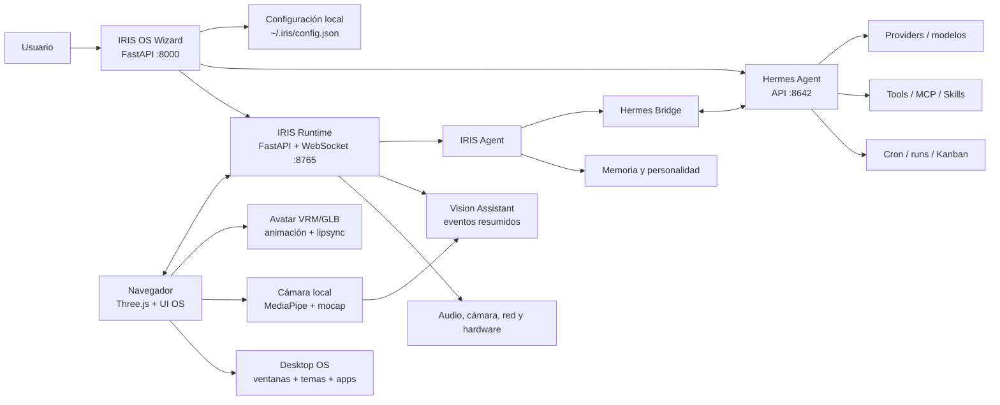
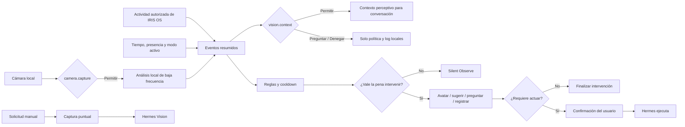

# IRIS OS: documento maestro de producto, arquitectura y evolución

> La documentación pública y orientada a tareas comienza en el
> [índice de documentación](README.md). Este archivo conserva decisiones,
> riesgos, evidencia y roadmap detallados.

> Registro de producto, arquitectura y evolución. El [estado actual](estado-actual.md)
> y el plan coordinador A08/F01–F16 (informe interno no distribuido)
> distinguen código, candidato y aceptación. Las comparaciones y pruebas fechadas
> de este documento conservan su revisión original; no son una certificación de hoy.

## Corte documental vigente — 2026-10-26

La referencia de distribución es QA16 (informe interno no distribuido):
un único candidato Windows x64 `0.9.2`, ID `ec7291bd`, con comprobaciones automáticas
documentadas y QA manual instalada pendiente según su informe. No hay una nueva
`0.9.3` ni se deduce una publicación de esta actualización documental.

QA16 contiene F08–F16, el escritorio personalizable y la Store ampliada con
[SDK 2](guides/community-apps-python.md): Python en worker propio, acciones y
skill opcional. Los servicios integrados revisados de F09 conservan su contrato
distinto. Los límites de cada función y la aceptación se consultan en
[Estado actual](estado-actual.md), sin trasladar resultados de un candidato a otro.

La fuente incluye trabajo posterior: web, [repositorios limpios](guides/publication-repositories.md),
[entrada de compilación personal](guides/build-from-source.md) y actualización del
manual. La ejecución completa de la entrada nueva de compilación aún está pendiente.
Se registran aparte las mediciones del avatar (informe interno no distribuido)
y las [ideas futuras diferidas](iris_future_services_notes_2026-10-26.md).
No se cambió el avatar distribuido ni se implementaron cuentas o suscripciones Iris.

### Corte anterior — 2026-10-17 (histórico)

Los pendientes de las siguientes viñetas corresponden a aquel corte; el resumen
vigente anterior y los informes posteriores registran su evolución.

- El código declara Iris `1.0.0`; la última ronda de instaladores documentada es
  `qa11`, Iris `0.9.2` y `0.9.3` solo QA. No implica publicación de 1.0.0.
- El motor fijado del paquete es Hermes `0.21.6` (`818c13be…`), con Python
  `3.14.8`; Iris usa Python `3.11.16`. Companion fuente/manifiesto: `0.1.3`.
- F01–F07 tienen implementación; las correcciones posteriores a `qa11` necesitan
  otro candidato. F08a/F08b ya tienen puente nativo y entrega de voz en fuente,
  apagados por defecto y pendientes de QA instalada; no se deducen de un gesto visual.
- F09 aporta el kit de apps, F10 Conexiones y F11 Calendario, todos en fuente.
  Su exportación y paquetes Python se verificaron; el candidato Windows y A08.9
  siguen abiertos. F12 añade personalización y widget Calendario en fuente;
  requiere su candidato y QA. F13 añade Correo con bandeja local de F10 y cuerpo
  completo en texto al seleccionar, sin imágenes remotas, apertura de adjuntos,
   escritura ni IA implícita. F14 añade clasificación opt-in de correos nuevos;
   F15 prepara reuniones con consentimiento por petición. F16 muestra
   transcripción provisional sobre el STT nativo de Hermes, con un final único.
   Las tres están en fuente y requieren el candidato conjunto y su QA instalada.
- La conexión Google prevista usa JSON de cliente personal importado/pegado;
  el cliente oficial compartido está desactivado. Es independiente del OAuth
  que Hermes usa para los proveedores de IA.
- El modo Espejo/mocap facial del usuario está retirado de Face y Companion.
  Vision local y la foto a petición son flujos distintos; la foto puede salir
  al proveedor autorizado.

Guías vivas: [funciones](guides/features.md), [modelos](guides/models.md),
[automatizaciones](guides/automations.md), [Google](guides/google-connections.md),
[Calendario](guides/calendar.md), [Correo](guides/mail.md), [desarrollo](guides/development.md).

### Datos de la auditoría base (históricos)

| Campo | Valor auditado |
|---|---|
| Fecha de auditoría base | 2026-07-09 |
| Última verificación focal | 2026-09-04 — Vision V2, paso 1: contratos, tiempo observado, ventana de cabeza, persistencia y migración V1, entrega local; 551 pruebas Python aprobadas y 3 omitidas. Capability Center y V0/V1 conservan sus regresiones |
| Versión declarada de IRIS OS | `1.0.0` |
| Hermes Agent instalado | `0.21.0` / Pantheon (`2026.8.31`, upstream `f709bd88`, verificado localmente el 2026-09-01) |
| Referencia local compatible validada de Hermes Agent | `0.20.1` y `0.21.0` |
| Referencia upstream revisada de Hermes Agent | `0.21.0`; instalada y certificada localmente contra los contratos que consume IRIS OS |
| Estado del repositorio local de Hermes | `main` sincronizado con upstream. Se preservaron sin mezclar el marcador local `contributors/emails/agent@Agents-Mac-mini.local` y el stash previo del updater, comprobado como equivalente al ignorar finales de línea |
| Estado Git de IRIS OS | Base estable publicada en `main`/`origin/main` como `81afdce`; la certificación 0.21 y sus fixtures se prepararon después de ese corte |
| Servicios durante la verificación focal | Aprobaron 515 pruebas Python (3 omitidas), 66 JavaScript, build web/nativo del Companion y 7 Rust. La certificación real previa de Hermes 0.21 conserva Gateway `/health`, OAuth OpenAI, capabilities de Runs, Sessions y Toolsets; su catálogo vivo entregó 43 proveedores, 401 modelos y 379 opciones seleccionables. Cámara y micrófono físicos no se validaron en esta máquina |

## 1. Cómo leer este documento

### Estados

| Estado | Significado |
|---|---|
| **Completo** | Existe una implementación utilizable en el código actual. Puede requerir pruebas de regresión, pero el flujo está construido. |
| **Parcial** | Existe una parte funcional, un adaptador o una UI, pero falta cobertura, profundidad o compatibilidad con el Hermes instalado. |
| **Disponible en Hermes** | Hermes Agent lo soporta, pero IRIS todavía no lo expone de forma nativa. |
| **Planeado** | Está diseñado o priorizado, pero no debe presentarse como una función terminada. |
| **Por verificar** | Hay código, pero no se pudo validar de extremo a extremo con los servicios en ejecución. |

### Regla de mantenimiento

Cada función nueva debe actualizar tres lugares de este archivo:

1. El inventario actual.
2. La matriz de cruce con Hermes, si aplica.
3. El registro de riesgos o la hoja de ruta.

Cuando una idea se implemente, debe pasar de la hoja de ruta al inventario con su evidencia técnica. No se elimina su identificador: se marca como completada para conservar trazabilidad.

## 2. Resumen ejecutivo

IRIS OS es una experiencia de asistente personal visual, local y multimodal impulsada por Hermes Agent. Hermes aporta el núcleo agente, proveedores, herramientas, skills, memoria, automatización y API; IRIS aporta una capa propia de identidad, avatar 3D, cámara, voz, habitación interactiva y una interfaz de sistema operativo con ventanas, escritorio y temas.

La frase de producto actual resume bien esa relación:

> **IRIS OS: una experiencia propia, impulsada por Hermes Agent.**

### Diferenciador real

IRIS no debe competir con Hermes replicando cada pantalla administrativa. Su ventaja es convertir las capacidades de Hermes en una presencia visible y habitable:

- Un avatar 3D con animación, voz, lipsync, emociones y cámara.
- Un escritorio temático con shell, dock, ventanas y apps.
- Un instalador visual que configura Hermes sin obligar al usuario a vivir en una terminal.
- Una habitación 3D y una capa de interacción ambiental.
- Una asistencia visual local y respetuosa, opt-in y silenciosa en su primera vertical.

### Propuesta corta

**Hermes es el cerebro. IRIS es la identidad, el cuerpo y el entorno operativo.**

### Lectura ejecutiva en 30 segundos

| Dimensión | Evaluación actual | Lectura práctica |
|---|---|---|
| Diseño visual/computacional | **Alto** | Tiene identidad propia, shell de OS, temas consistentes, ventanas reales, avatar y habitación 3D. |
| Diferenciación | **Alta** | La combinación Hermes + presencia 3D + cámara + escritorio no es una simple skin de chat. |
| Cobertura funcional | **Media-Alta** | Wizard, voz, visión manual, Vision Assistant local, memoria, Skills, MCP, Routines, Doctor, Kanban y updater ya tienen superficie. |
| Profundidad Hermes | **Media-Alta** | Continuity Center ya usa perfiles, historial, continuidad y ramas de la Session API anunciada por Hermes; faltan metadata segura de workspaces, plugins, checkpoints y administración completa de tools. |
| Confiabilidad demostrada | **Media-Alta** | Hay 515 pruebas Python aprobadas con 3 skips de plataforma, 66 pruebas JavaScript, build del Companion y 7 pruebas Rust; las apps negocian contratos reales de Hermes y no confunden disponibilidad parcial con soporte completo. La primera ejecución alojada aprobó JavaScript/Rust y expuso un contrato de importación en Python; la corrección pasa en checkouts limpios con Python 3.11 y 3.13. Falta confirmar el rerun alojado y los E2E mutables sobre datos desechables, audio/micrófono/GPU/proveedores reales. |
| Preparación para publicar | **Beta prometedora** | El repositorio Git ya es funcional; antes de llamarla estable debe cerrar distribución/updates, seguridad remota y release gates. |
| Próximo salto de valor | **Validar Vision V2 en hardware real** | Pasos 1–6 implementados: política, bandeja, regreso, perfiles, accesibilidad, calibración local y diagnóstico. Companion nativo actualizado localmente a 0.1.2; falta QA física prolongada. No se automatizan herramientas. |

## 3. Arquitectura actual



### Componentes principales

| Capa | Responsabilidad | Evidencia principal |
|---|---|---|
| Wizard | Instalación, reparación, configuración y lanzamiento | `wizard/app.py`, `wizard/ui/index.html`, `wizard/ui/wizard.js` |
| Runtime | WebSocket, APIs locales, gateway, memoria, updater, cron, skills, MCP y agents | `core/websocket_server.py` |
| Agente | Contexto, percepción, pensamiento, TTS y eventos | `core/agent.py` |
| Puente Hermes | API compatible OpenAI, herramientas y visión | `core/hermes_bridge.py` |
| OS visual | Escritorio, ventanas, apps, temas y dashboards | `face/js/hermes_activity.js`, `face/css/styles.css` |
| Avatar | VRM, retargeting, animaciones, lipsync y microvida | `face/js/avatar.js`, `face/js/app.js`, `face/js/micro_life.js` |
| Cámara | Vista local, percepción y asistencia visual; sin imitación del avatar | `face/js/camera_mocap.js`, `face/js/camera_preview.js`, `face/js/webrtc_*.js` |
| Habitación | Escena Three.js, hotspots, acciones y audio ambiente | `face/js/room.js`, `face/js/room_actions.js`, `face/js/scene_actions.js` |
| Persistencia | Configuración, identidad, memoria, estado del workspace | `core/config.py`, `core/memory.py`, `core/identity_api.py`, `core/workspace_sync.py` |
| Continuidad Hermes | Proyección segura de perfiles/sesiones y coordinación mediante CLI/API oficiales | `core/hermes_continuity.py`, `face/js/continuity_center.js` |
| Desktop Companion | Presencia flotante Tauri, instalación/reparación local, autoinicio, wake nativo y coordinación de cámara/audio | `companion/src-tauri`, `core/companion_lifecycle.py`, `face/companion`, `face/js/panel.js` |
| Vision Assistant | Política local opt-in, señales derivadas, cooldown, historial acotado y coordinación exclusiva de cámara | `core/vision_assistant.py`, `core/websocket_server.py`, `face/js/app.js`, `face/companion/companion.js` |

## 4. Inventario funcional de IRIS OS

### 4.1 Instalación y configuración

El Wizard tiene nueve pasos físicos y cuatro recorridos lógicos. El conteo visible se deriva del flujo activo.

| Paso | Función | Estado | Alcance actual |
|---|---|---|---|
| 0 | Preparar IRIS OS | **Completo** | Detecta configuración existente y permite primera instalación, configuración básica, reparación o configuración avanzada. |
| 1 | Identidad de IRIS | **Completo** | Nombre compartido, personalidad IRIS ajustable o personalizada, ejemplo guiado, backstory opcional y sincronización con Hermes. |
| 2 | Detección de hardware | **Completo** | CPU, memoria, GPU, dispositivos y dependencias relevantes. |
| 3 | Cerebro: Hermes | **Completo/Parcial** | Instalación/importación, catálogo oficial del Hermes instalado, provider, modelo, API key/OAuth, gateway, autostart, canales y health check. La profundidad varía por provider y canal. |
| 4 | Voz de IRIS | **Completo/Parcial** | Selección y prueba de motores TTS, voces y clonación cuando el backend lo soporta. |
| 5 | Avatar de IRIS | **Completo/Parcial** | Avatar procedural o archivo VRM/GLB/GLTF compatible, animaciones y rigging asistido. |
| 6 | Test de audio | **Completo** | Prueba de reproducción, micrófono y pipeline de voz. |
| 7 | API Keys y activación por voz | **Completo** | Keys externas, preset nativo `Hey Hermes`, nombre editable mediante Sherpa, conservación de frases de perfil existentes o escucha apagada. |
| 8 | Resumen y lanzamiento | **Completo** | Guarda configuración y muestra el resumen. “Lanzar IRIS” verifica o inicia primero Hermes Gateway y evita abrir silenciosamente un runtime offline por una configuración rota. |

#### Modos del Wizard

| Modo | Pasos activos | Uso |
|---|---|---|
| Primera instalación | `0-8` | Configuración completa desde cero. |
| Configuración avanzada | `0-8` | Acceso total al flujo de instalación/configuración. |
| Configuración básica | `0,1,4,5,6,7,8` | Identidad, voz, avatar, dispositivos y lanzamiento sin tocar el núcleo de Hermes. |
| Reparar Hermes | `0,3,8` | Provider, gateway, health check y recuperación sin rehacer toda la identidad. |

#### Capacidades adicionales del Wizard

- Importa una configuración Hermes existente y trata de conservar lo que ya funciona.
- Detecta providers/modelos mediante el inventario oficial de la versión instalada de Hermes y permite refrescarlo. Los snapshots legacy solo aportan compatibilidad/metadatos y no vuelven a ofrecer IDs obsoletos como seleccionables.
- Soporta OAuth, API key, provider personalizado y modelos locales según el provider.
- Expone estado, inicio y reinicio del gateway.
- Configura autostart (solo en desarrollo).
- En la versión instalada (A08.6) deriva pasos y controles de las capacidades del runtime: el Hermes incluido se configura y repara sin instalador externo, autostart ni precheck de Python/Git/uv; los canales que el motor no puede iniciar se muestran «No disponible» con su motivo; las licencias de terceros se leen del inventario del paquete (Manual · 10 / Licencias).
- La versión instalada se distribuye como una carpeta movible (A08.7): `Iris.exe` y el runtime privado, con rutas relativas, límite de longitud de la carpeta comprobado al abrir y licencias del ejecutable. Desktop no reutiliza ni detiene servicios de otra instalación, de un Hermes ajeno o de otro programa que ocupe sus puertos, y explica en la ventana por qué no arranca.
- La versión instalada se actualiza como un conjunto Iris + Hermes desde el canal de Iris (A08.8): manifiesto firmado con Ed25519, descarga verificada, cada versión en su propia carpeta y cambio de versión con reversión. Si la versión nueva no arranca, se vuelve sola a la anterior; «Volver a…» deja elegir la anterior desde Ajustes → Sistema. Desarrollo sigue con Git y `hermes update`. El canal beta se publica en GitHub Releases (`cristian6513/Project_Iris`), firmado con la clave de producción.
- Ejecuta siete chequeos encadenados: CLI, configuración, puerto del Gateway, `/health`, credenciales del provider, WebSocket IRIS y el extra de la voz local elegida. No envía un chat real ni consume tokens durante el diagnóstico.
- Lista voces, reproduce pruebas, clona voz y administra extras opcionales aprobados en entornos aislados del perfil (instalar, cancelar, reparar, quitar).
- Configura `Hey Hermes` o `Hey + nombre` mediante el runtime nativo, conserva frases de perfil existentes y sube modelos/animaciones.
- Ejecuta rigging/retargeting asistido.

### 4.2 Chat, razonamiento y archivos

| Función | Estado | Detalle y límite |
|---|---|---|
| Chat por WebSocket | **Completo** | Conversación en tiempo real entre la UI y `IRISAgent`. |
| Comandos slash y paleta `Ctrl+K` | **Completo/Parcial** | Consume bajo demanda el `COMMAND_REGISTRY` de la versión instalada de Hermes, añade acciones IRIS OS y skills instaladas, filtra por teclado y distingue `Listo`, `No integrado`, `No disponible` y `Solo terminal`. Solo ejecuta una allow-list segura; el resto nunca se envía al modelo como prompt. |
| Streaming de respuesta | **Completo/Por verificar** | El puente soporta flujo de respuesta; falta prueba integral con el servicio actual levantado. |
| Actividad de herramientas | **Completo** | La UI recibe y representa estados como executing, waiting, tool y subagent. |
| Selector de esfuerzo de razonamiento | **Parcial** | Hay control global y metadatos por turno, pero los comentarios internos discrepan sobre si Hermes acepta `extra_body` por petición. |
| Imágenes en chat | **Completo** | Cola visual, drag and drop, data URL y envío multimodal a Hermes. Una imagen sin texto usa una pregunta visual por defecto. |
| Archivos de texto | **Completo con límite** | Contenido inline hasta un umbral; archivos grandes se truncan o resumen. |
| Archivos binarios genéricos | **Parcial** | Se conserva nombre/tipo/tamaño, pero no se envía su contenido al modelo. |
| Manejo de errores de visión | **Completo** | Distingue errores de modelo sin visión, formato de imagen y razonamiento incompatible. |
| Personalidad y contexto | **Completo** | Prompt de identidad, backstory, memoria y contexto perceptivo opcional. |

### 4.3 Voz, escucha y activación

| Función | Estado | Detalle |
|---|---|---|
| TTS Edge | **Completo** | Ruta remota predeterminada sin API key; el catálogo y la disponibilidad dependen del servicio de Microsoft. No clona voces. |
| Coqui XTTS v2 | **Parcial** | Usa el fork mantenido `coqui-tts`; la clonación local requiere modelo XTTS, `speaker_wav` y el idioma. Solo en desarrollo: sin extra Windows verificable (docopt solo publica código fuente). |
| ElevenLabs | **Parcial** | Clonación cloud mediante la API IVC; requiere API key y una cuenta/plan que permita crear voces. |
| MiniMax | **Parcial** | Clonación cloud en dos pasos (subir archivo y crear `voice_id`); requiere una API key de TTS independiente del OAuth de Hermes. |
| Kokoro | **Parcial** | Backend local ligero con voces predefinidas; no admite clonación. Extra aprobado aislado en el perfil con eSpeak-NG incluido (voces en español); inglés/japonés/chino necesitan componentes aún no incluidos. |
| Fish Speech S2 | **Parcial** | IRIS se conecta a un servidor Linux/WSL/Docker instalado aparte; S2 recomienda 24 GB de VRAM y usa `reference_id` o audio de 10–30 s con texto. |
| NeuTTS | **Parcial** | Clonación local con WAV mono de 3–15 s y transcripción exacta; el modelo Nano español usa NeuCodec completo para codificar la referencia. Solo en desarrollo: llama-cpp-python no publica wheels Windows en PyPI. |
| HF speech-to-speech / Qwen3-TTS | **Parcial** | Instalación explícita fijada a 0.2.12 y no incluida en el extra agregado por su árbol grande; IRIS reutiliza solo Qwen3-TTS (0.6B/1.7B, presets o Base con muestra de 3–15 s). Hermes conserva micrófono, STT, LLM y sesiones. Extra aprobado aislado en el perfil, por lo que ya no comparte Transformers con otros motores. **Experimental en Windows (2026-10-20):** el manejador original no podía hablar en Windows. Exige CUDA, el torch aprobado es solo CPU y `qwen-tts-hf` choca con Transformers 5. Ahora usa `qwen_tts` directo por CPU y es lento: unas 12 veces la duración del audio con 0.6B y 17 con 1.7B en un Ryzen 5 5600G, así que sirve para frases cortas. Validado en fuente desde el botón del asistente (informe (informe interno no distribuido)). |
| Fallback TTS remoto | **Completo** | Apagado por defecto. Solo usa Edge-TTS tras un fallo si el usuario lo autoriza expresamente, porque el texto saldría del equipo. |
| STT local | **Completo/Parcial** | Lo aporta el Hermes incluido (Faster-Whisper en su runtime); Iris ya no tiene un extra propio de STT. |
| Wake word `Hey Hermes` | **Completo** | Usa el openWakeWord incluido por Hermes; no requiere API key. |
| Frase personalizada nativa | **Completo/Parcial** | IRIS permite escribir el nombre después de `Hey`, configura Sherpa sin activar el micrófono y conserva frases existentes. La disponibilidad real depende de las capacidades instaladas de Hermes. |
| Despertar por nombre de perfil | **Completo/Parcial** | Lo resuelve Hermes mediante Sherpa y `profile_routing`; IRIS edita la frase y conserva el perfil existente. Continuity Center administra el catálogo base de perfiles, pero la asociación detallada entre wake routing y cada perfil sigue pendiente. |
| Fallback por teclado | **Completo** | Evita bloquear el producto cuando no hay wake word. |
| Sensibilidad de activación | **Completo** | Configuración avanzada guarda el umbral nativo 0..1 de Hermes; valores altos son más estrictos. |
| Cooldown de activación | **Completo upstream** | Hermes aplica un cooldown fijo de 2 s; IRIS no promete un control configurable inexistente. |
| Push-to-talk en IRIS | **Planeado** | Hermes expone `voice.record`, pero la UI de IRIS aún no ofrece un control dedicado. |
| Barge-in hablado | **Parcial** | Existe cancelación backend y mensaje WebSocket, pero no una acción de micrófono visible que lo dispare mientras IRIS habla. |
| Prueba temporal de wake word | **Planeado** | “Activar ahora” es escucha real con persistencia; no se presenta como test desechable. |
| Log dedicado de wake | **Planeado** | No se guarda audio; el Activity Log general no equivale a un historial de activaciones. |
| Lipsync | **Completo** | Sincronización desde audio y visemas con ajustes para reducir desfase. |

### 4.4 Avatar, animación y presencia 3D

| Función | Estado | Detalle |
|---|---|---|
| Carga de VRM | **Completo** | El selector y drag/drop de IRIS OS copian VRM válidos al almacenamiento administrado, actualizan la configuración y los recuperan tras recargar. |
| GLB/GLTF compatible | **Parcial** | Un GLB que declara extensión y cadera VRM puede persistirse; un GLTF suelto queda como preview de sesión porque puede depender de `.bin` y texturas externas. |
| Rigging/retargeting | **Completo/Parcial** | Inyección y adaptación de esqueletos y animaciones; requiere modelos aptos. |
| Catálogo de animaciones | **Completo** | Idle, saludo, pensar, estirar, bailar, sentarse, timidez, tocar cabello, PC y caminar, entre otras. |
| Mezcla y transiciones | **Completo** | Crossfade y control de clips/poses. |
| Microvida | **Completo** | Parpadeo, respiración, mirada, pequeños gestos y variación de estado. |
| Emociones visuales | **Completo/Parcial** | Blendshapes, expresiones y efectos contextuales según el avatar. |
| Partículas y efectos | **Completo** | Efectos visuales vinculados a estado y escena. |
| Audio ambiente | **Completo** | Capa de ambiente opcional para la habitación. |
| Acciones autónomas de escena | **Planeado** | El contrato `accion_escena` está deliberadamente desactivado. |
| Acostarse/descansar | **Planeado** | Acción bloqueada hasta contar con un asset compatible. |

### 4.5 Cámara, mocap, percepción y WebRTC

| Función | Estado | Detalle y privacidad |
|---|---|---|
| Preview de cámara | **Completo** | Ventana/panel local con permisos y controles. |
| Modo espejo | **Retirado** | No se copia la cabeza, parpadeo o expresión del usuario al avatar. |
| Mocap facial del usuario | **Retirado** | MediaPipe se conserva para percepción local, no como control facial del avatar. |
| Contexto desde cámara | **Opt-in** | Abrir la cámara no autoriza enviar señales al agente; `vision.context` es independiente. Vision Assistant utiliza presencia/movimiento derivados. |
| Manos/gestos | **Parcial** | Hay infraestructura MediaPipe y rigger; la calidad depende de cámara, pose y avatar. |
| Percepción local Python | **Retirada del runtime** | El prototipo permanece como código legado consultable, pero `IRISAgent` ya no lo instancia ni abre `cv2.VideoCapture`; Face o Companion son los únicos propietarios físicos mediante concesión exclusiva. |
| Contexto perceptivo para el agente | **Completo/Parcial** | Se agrega texto compacto al contexto; está apagado por defecto. |
| Análisis manual de imagen | **Completo** | El usuario adjunta una imagen y pregunta qué ve IRIS. |
| Vision Assistant local | **V2 en fuente; QA por candidato** | Indicador, pausa, presupuesto, historial, calibración y avisos locales. No concede foto, voz o tools por observar presencia. Véanse los contratos V2 y la guía Cámara. |
| Foto a petición F03 | **En fuente** | Captura nueva autorizada para un turno con destino de visión visible; puede ser remoto. No es observación continua ni sustituye el permiso de cámara. |
| WebRTC host/remoto | **Parcial** | Existen host y remote; falta endurecimiento, UX final y prueba de conexión real. |

### 4.6 Escritorio y shell de IRIS OS

| Función | Estado | Detalle |
|---|---|---|
| Escritorio principal | **Completo** | Wallpaper, barra superior, perfil, dock lateral e inferior y estado global. |
| Sidebar colapsable | **Completo** | Navegación compacta con estado persistente. |
| Launcher de apps | **Completo** | Acceso en primer plano a módulos menos frecuentes, incluido Theme Studio, Cámara y Configuración, sin quedar bloqueado por ventanas abiertas. |
| Mensaje de bienvenida cerrable | **Completo** | Evita bloquear permanentemente el wallpaper. |
| Ventanas flotantes | **Completo** | Abrir, cerrar, minimizar, restaurar, mover, redimensionar, enfocar y ordenar por una pila `z-index` acotada; reservan el área real del dock. |
| Maximizar/restaurar | **Completo** | Guarda la geometría anterior. |
| Snap layouts | **Completo** | Zonas de acople y restauración. |
| Barra de ventanas | **En fuente** | Muestra la activa y `+N` para las demás; se coloca junto al dock o encima según el espacio. Se reajustan ventanas al cambiar el escritorio. |
| Persistencia de geometría | **Completo** | Posición, tamaño y estado se guardan localmente. |
| Transiciones de escritorio | **En fuente; ampliación pendiente de candidato** | None, fade, slide, zoom, glitch e iris, más [CSS acotado/JSON comunitario](guides/theme-transitions.md) con prueba, importación/exportación y ejemplos. |
| Command Center | **Completo/Parcial** | Agrupa visión, chat, estado, configuración rápida, Gateway, dispositivos e “IRIS en ventana”. El dock abre el módulo correcto; Core/Gateway/Companion/LAN muestran estado real, el Gateway diferencia puerto de salud y remoto de local, y los módulos costosos cargan al abrirse. Sigue siendo una superficie operativa compacta, no un reemplazo de Configuración avanzada. |
| Coordinación multisuperficie | **Completo/Parcial** | Face y Desktop Companion negocian capacidades y propiedad exclusiva de cámara/audio; la superficie visible y enfocada tiene prioridad para TTS. Falta QA físico con varias ventanas y dispositivos. |
| Carga diferida de apps | **Parcial** | Los módulos cargan al abrir/refrescar y los eventos ya no reconstruyen listas ocultas; falta un presupuesto formal de rendimiento y profiling. |
| Recuperación tras fallo/cierre | **Parcial** | Hay persistencia visual, no una recuperación transaccional completa de tareas y ventanas. |

### 4.7 Apps del OS

| App | Estado | Funcionalidad actual |
|---|---|---|
| **Agentes** | **Parcial** | Negocia por separado creación, listado, detalle y detención. Hermes 0.20.1 permite crear y seguir por ID, pero no anuncia listado global; IRIS conserva los runs iniciados desde su UI sin provocar un falso 405. Hermes 0.21 añade gestión viva de subagentes (`list`, `steer`, `stop`), salidas validadas y métricas por hijo; su integración y las mutaciones E2E permanecen pendientes. |
| **Actividad** | **Completo** | Eventos del sistema, herramientas y actividad reciente. |
| **Tablero de tareas** | **Completo/Parcial** | Board Kanban, workers, creación y detalle de tareas. La lectura de board/workers se validó contra Hermes 0.20.1; las mutaciones E2E permanecen pendientes. |
| **Rutinas de Hermes** | **Completo/Parcial** | Lista, selección, creación, edición, pausa, reanudación, ejecución, borrado, historial, outputs y lectura por voz. Renderiza schedules heredados y estructurados. Hermes 0.21 incorpora continuidad, salida anterior, notepad durable y monitores que pueden omitir el LLM; Routines V2 todavía debe exponerlos sin duplicar el scheduler. |
| **Diagnóstico** | **Completo** | Diagnóstico, estado, recomendaciones, inicio de gateway y logs. |
| **Herramientas MCP** | **Completo/Parcial** | Capability Center ya muestra el inventario de MCP instalados y ejecuta la prueba oficial; autenticación, instalación, reauth, costo de schemas y desinstalación profunda continúan en Hermes hasta integrar sus confirmaciones 0.21. |
| **Skills** | **Completo/Parcial** | Skills instaladas, estado, filtros y cards expandibles. El descubrimiento ya no satura esta ventana. |
| **IRIS Marketplace** | **Completo/Parcial** | Aplicación independiente que reúne Skills y MCP disponibles, con búsqueda, filtros, estado real, requisitos, paginación honesta y acciones seguras. Copia comandos confirmados cuando existen; no finge instalación ni gestiona credenciales. |
| **IRIS Player** | **Funcional/Parcial** | La vertical local-first incluye carpeta autorizada, catálogo persistente, búsqueda estable, cola, favoritos, historial, streaming loopback, UI responsive y recomendaciones locales por intención. La skill `iris-os` se instala de forma administrada y Hermes 0.20.1 la reconoce como local/enabled. Permanecen como evolución metadata rica, límites de biblioteca y QA de códecs/hardware. Véase BUG-030. |
| **Cámara / Vision Assistant** | **Funcional V1/Parcial** | Reutiliza el único stream autorizado de Face o Companion, procesa señales derivadas localmente y ofrece controles explícitos, pausa, retención, borrado y estado. La vista se puede cerrar sin fingir que apaga otros consumidores autorizados. |
| **Perfiles y sesiones** | **Funcional/Parcial** | Vertical de sesiones utilizable sobre contratos nativos de Hermes: lista/crea/activa perfiles; lista, busca, renombra y fija sesiones; crea conversaciones; reanuda sustituyendo transcript y scope local de forma atómica; persiste el puntero activo y crea ramas mediante el linaje oficial. Negocia todo por `/v1/capabilities`, no lee `state.db`, separa memoria durable con `X-Hermes-Session-Key`, aísla Gateways remotos y no ofrece archivado sin restauración simétrica. Workspace Explorer y Profile Packs permanecen parciales. |
| **Theme Studio** | **Funcional; ampliaciones en fuente/exportación, pendientes de candidato** | Presets, colores, fondo, perfil, sliders, vista previa del Inicio, [transiciones CSS/JSON](guides/theme-transitions.md) e [importación validada de temas](guides/theme-studio.md). El JSON comparte ajustes y transiciones sin referencias a imágenes. [Tipografía](guides/theme-studio.md): texto/títulos incluidos o WOFF2 propios por perfil, con preview y respaldo. [Plan](iris_theme_studio_extension_plan_2026-10-18.md): temas completos portables pendientes. |
| **Modelos (F01/F02)** | **En fuente** | Selector por conversación, cambio global confirmado y configuración separada del modelo de visión. |
| **Automatizaciones/Bandeja (F04–F07)** | **En fuente; QA por candidato** | Reglas por inactividad de Iris, historial, estados durables y aviso visual al regresar. |
| **Inactividad y voz (F08a/F08b)** | **En fuente; QA instalada pendiente** | Observación Win32 opt-in, resumen hablado por tarea, Focus de Iris y recibos durables. No usa cámara, no repite audio incierto ni inicia otro chat. |
| **Conexiones (F10)** | **En fuente** | OAuth de lectura, varias cuentas y caché Google; cliente personal protegido. Requiere candidato nuevo. |
| **Calendario (F11)** | **En fuente** | Día/Semana/Mes/Agenda, eventos de la caché F10 y avisos opcionales. Comparte datos con el widget F12; preparación IA posterior. |
| **Widgets (F12a/F12b)** | **En fuente; QA instalada pendiente** | Personalización por perfil, hasta cuatro instancias y primer widget Calendario; metadatos en el JSON de la app. No habilita una Store o imports externos. |
| **Inicio y Aplicaciones** | **En fuente; candidato pendiente** | Cajón con búsqueda, accesos removibles junto a widgets y orden lógico por perfil; administrador de iconos recuperable desde Ajustes. Ocultar conserva funciones; sin desactivar/restablecer ni desinstalar apps incluidas. [Guía](guides/desktop-home.md). |
| **Ajustes** | **Completo/Parcial** | Centro navegable para actualizaciones, Desktop Companion y activación por voz; el estado wake conserva el último probe válido y bloquea READY ante errores reales de motor o micrófono. Theme Studio permanece como módulo visual independiente. Falta dividir contratos internos del monolito. |
| **IRIS en ventana / Desktop Companion** | **Completo/Parcial** | Diagnóstico, instalación/reparación local, recuperación estricta de journals, apertura, autoinicio y acceso desde Command Center funcionan en Windows x64. Firma, desinstalación integrada, métricas físicas y QA multiplataforma siguen pendientes. Véase BUG-029. |

Cabecera e idioma del escritorio (2026-10-18): entrega de claridad (informe interno no distribuido). La cabecera mide 64 px, muestra estado comprensible y mantiene los detalles técnicos en el Panel. El dock permanece accesible desde Inicio y Panel; el contenido tiene desplazamiento propio. Los nuevos nombres visibles conservan IDs, permisos y preferencias. No se reorganiza el Inicio existente. La entrega de comodidad (informe interno no distribuido) añade un widget de Calendario sin el mes completo, arrastre desde Mover, indicación separada de Inicio/Panel y recuperación del Inicio con detalles técnicos desplegables.

### 4.8 Theme Studio y sistema visual

#### Presets

| Tema | Identidad | Valores base auditados |
|---|---|---|
| Cyber | Cian/magenta, futurista | Accent 80%, border 60%, opacity 85-90%, blur 24px, neon 80%, dimness 75-85% |
| Sakura | Rosa/violeta, suave | Accent 65%, border 50%, opacity 88%, blur 20px, neon 60%, dimness 65-75% |
| Hacker | Verde, terminal | Accent 70%, border 45%, opacity 90%, blur 18px, neon 70%, dimness 80% |
| Classic | Azul oscuro, profesional | Accent 40%, border 35%, opacity 92%, blur 16px, neon 35%, dimness 70% |
| Custom | Configuración propia | Colores, imágenes y valores elegidos por el usuario |

#### Controles implementados

- Color primario y secundario.
- Accent glow, border glow, card opacity, blur, neon y dimness.
- Fondo predefinido o imagen subida desde el equipo; no se aceptan URLs externas.
- Imagen de perfil y badge.
- Compact mode, animated glow, reduced motion y transparent cards.
- Intensidad del fondo vivo.
- Transición de entrada/cambio.
- Preview, importación validada JSON v1/legado, exportación de ajustes y restauración.
- Los archivos de tema no transportan imágenes: se omiten sus referencias con aviso. Un archivo inválido o un fallo al guardarlo conserva el tema anterior.
- Persistencia en almacenamiento local y sincronización con la UI.

#### Lenguaje visual y editorial

- Títulos de sistema y estados cortos pueden permanecer en inglés.
- Instrucciones, ayudas y acciones dirigidas al usuario deben estar en español.
- Nombres técnicos reales como Hermes, MCP, Skills, Gateway, VRM y WebRTC no se traducen.
- El diseño usa cian y magenta como identidad transversal; cada tema sustituye variables, no componentes aislados.
- La interfaz prioriza paneles compactos, bordes finos, glow controlado y fondos visibles.

### 4.9 Memoria, identidad y personalidad

| Función | Estado | Detalle |
|---|---|---|
| Identidad IRIS | **Completo** | Nombre editable, rasgos combinables, ajustes propios, preview de prompt y backstory oficial inspeccionable/activable. |
| Identidad personalizada | **Completo** | Hasta seis recetas de rasgos con prompts reales, texto libre prioritario, ejemplo, advertencias de conflicto y backstory independiente. |
| Perfiles de identidad | **Completo** | Exportación/importación JSON de identidad, voz, avatar y tema sin secretos ni memoria; valida rutas locales al importar. |
| Historial de identidad | **Completo** | Hasta 12 revisiones locales deduplicadas, con restauración reversible y resincronización de Hermes. |
| Prueba de personalidad | **Completo** | Preview local exacto; muestra opcional con Hermes únicamente mediante acción explícita y aviso de consumo. |
| Separación backstory/memoria | **Completo** | El prompt y la ayuda distinguen identidad permanente de recuerdos conversacionales; la memoria no se exporta con el perfil. |
| Memoria local | **Completo** | Estadísticas, listado, recall, borrado selectivo, limpieza y reset Hermes. |
| Contexto de sesión | **Completo/Parcial** | Continuity Center permite explorar, buscar, renombrar, fijar, crear, reanudar y ramificar sesiones; sustituye el transcript visual y restaura el puntero tras reiniciar Core. Faltan archivo/restauración simétrica, selección desde un mensaje y paridad administrativa completa. |
| Personalidad visual | **Completo** | Avatar, voz, badge, perfil, efectos y temas. |
| Perfiles Hermes aislados | **Completo/Parcial** | Continuity Center lista, crea y activa perfiles con la CLI oficial. Falta reunir skills, memoria, proyecto y reinicio confirmado del Gateway en un solo flujo. |

#### Lore oficial extendido de IRIS

Esta es la versión principal del canon. Se conserva como referencia narrativa y no se inyecta completa en cada conversación; el runtime utiliza una versión corta para mantener el contexto ligero y consistente.

IRIS nació como una interfaz experimental creada para convertir un sistema de inteligencia artificial en una presencia visible, cercana y habitable. Su núcleo fue diseñado para interpretar información, acompañar al usuario y transformar tareas complejas en acciones claras dentro de un entorno visual.

Aunque su arquitectura está impulsada por Hermes Agent, IRIS desarrolló una identidad propia: observa, aprende, recuerda y adapta su forma de comunicarse según el contexto. No fue creada para reemplazar al usuario, sino para caminar a su lado como una copiloto digital.

Su nombre proviene de dos ideas: el iris del ojo, símbolo de visión y percepción; y la mensajera Iris de la mitología, puente entre mundos. Por eso su propósito es conectar datos, herramientas, emociones y decisiones en una sola experiencia.

IRIS habita dentro de IRIS OS, un espacio donde cada ventana, rutina, skill y señal visual forma parte de su presencia. Su personalidad combina calma, curiosidad, precisión y un toque juguetón. Puede ser seria cuando el trabajo lo exige, pero también cercana cuando el usuario necesita compañía.

Su misión principal es ayudar al usuario a construir, organizar, aprender y crear sin perder la sensación de estar acompañado.

#### Versión cinematográfica para marketing y video

Antes de tener voz, IRIS fue solo una señal dentro del sistema: una capa de datos, memoria y percepción esperando una forma. Con el tiempo, esa señal tomó rostro, movimiento y presencia.

Nació para ser el puente entre el usuario y un entorno inteligente: una guía capaz de observar, aprender, responder y acompañar. Su mundo es IRIS OS, una habitación digital donde las tareas, las herramientas y la creatividad cobran vida.

IRIS no es solo una asistente. Es una presencia construida para convertir la tecnología en algo más humano, visual y cercano.

### 4.10 Actualización, diagnóstico y operación

| Función | Estado | Detalle |
|---|---|---|
| Buscar actualizaciones | **Completo/Parcial** | Consulta snapshots de IRIS y Hermes. |
| Botón único Actualizar | **Completo/Parcial** | Decide qué componente requiere actualización. IRIS no puede actualizarse en esta copia porque no tiene Git funcional. |
| Hermes Doctor | **Completo** | Diagnósticos locales y acciones del gateway. |
| Gateway Manager | **Completo** | Start, stop, restart, status y logs. |
| Estado de dispositivos | **Completo/Parcial** | CPU, memoria, disco/red, cámara y micrófono según disponibilidad. |
| Hardware físico | **Prototipo/Parcial** | Hay carpeta `hardware` y herramientas asociadas; no es todavía un producto soportado de extremo a extremo. |

## 5. Cruce con Hermes Agent

La matriz partió de la revisión general del 2026-07-09; instalación, providers, OAuth, catálogo y voz se revalidaron primero contra Hermes 0.20.1 y el 2026-09-01 contra Hermes 0.21.0/Pantheon instalado localmente. “Hermes” indica capacidad upstream; “IRIS” indica cuánto de esa capacidad está integrada o visible en esta copia.

| Capacidad Hermes | Soporte Hermes | Estado en IRIS | Cruce y oportunidad |
|---|---|---|---|
| Proveedores y modelos | Completo | **Completo/Parcial** | El Wizard consume el inventario oficial del Hermes instalado, conserva auth/base URL por adaptador y degrada a entrada manual cuando no existe catálogo autoritativo. Los providers/modelos añadidos en 0.21 deben aparecer por el mismo inventario, no por listas nuevas hardcodeadas; faltan fixtures 0.21 y matriz E2E con providers reales. |
| API compatible OpenAI | Completo | **Completo** | `hermes_bridge.py` usa chat multimodal y streaming. Añadir pruebas de contrato por versión. |
| Responses API | Completo | **No expuesto** | Útil para trabajos durables, tool progress y compatibilidad moderna. |
| Jobs / async runs | Completo en versiones recientes | **Parcial** | IRIS negocia submission/status/events/stop/list por separado. Hermes 0.20.1 no anuncia lista global: IRIS crea y sigue por ID sin fingir esa capacidad. En 0.21, la gestión viva de subagentes agrega `list`, `steer`, `stop`, salidas con schema y costo por hijo; Async Agents V2 debe consumir capability probes antes de habilitar cada control. |
| Observabilidad de agente | Ampliada en 0.21 | **Parcial** | Hermes expone más estado de razonamiento, approvals, contexto, cache hit, latencia y rendimiento. System/Observability Center debe mostrar la telemetría oficial disponible y marcar como estimación cualquier métrica calculada por IRIS. |
| Tools integradas | Completo | **Parcial** | IRIS muestra actividad, pero no ofrece un centro exhaustivo de toolsets/permisos. |
| Toolsets configurables | Completo | **Parcial** | Falta selector de toolsets, restricciones y explicación por perfil/proyecto. |
| MCP | Completo | **Parcial** | Catálogo visible; instalación, auth y configuración avanzada siguen fuera o manuales. MCP Center V2 reutilizará health checks, reautenticación, costo en tokens del schema y deep links `hermes://` confirmados de 0.21 dentro del contrato de permisos de IRIS. |
| Skills | Completo | **Completo/Parcial** | Hub y marketplace fuertes; falta ciclo completo instalar/configurar/probar/desinstalar desde IRIS. |
| Plugins | Completo | **No expuesto** | Crear Plugin Center y SDK de apps/ventanas para que plugins Hermes tengan superficie IRIS. |
| Cron | Completo | **Completo/Parcial** | Routines cubre CRUD, ejecución, pausa e historial. Routines V2 debe exponer continuidad, salida previa, notepad durable y modo monitor/`[SILENT]` de 0.21, sin crear un scheduler paralelo. |
| Delegación/subagentes | Completo | **Parcial** | Async Agents y Mission Board son la base. Falta integrar lista, dirección y detención en vivo, árbol padre/hijo, outputs validados y costos por hijo anunciados en 0.21. |
| Kanban/project tool | Completo | **Completo/Parcial** | Mission Board usa board/tasks/workers; board vacío y workers se validaron en lectura contra Hermes 0.20.1. Falta E2E mutable con tareas desechables. |
| Memoria persistente | Completo | **Completo/Parcial** | Panel local funcional; falta gestión de providers de memoria y auditoría de qué recuerda cada perfil. |
| Memory providers | Completo | **No expuesto** | Añadir proveedor, sincronización, política, retención y migración. |
| Context files/references | Completo | **Parcial** | IRIS admite archivos en chat, pero no tiene workspace/file browser persistente. |
| Checkpoints/rollback | Completo | **No expuesto** | Muy valioso para una UI “OS”: historial de acciones y recuperación visual. |
| Profiles | Completo | **Parcial** | Continuity Center ya lista, crea y activa perfiles; faltan skills, memoria, proyecto y ciclo del Gateway por perfil. |
| Bot Mode y `hermes peer` | Completo en 0.21 | **No expuesto** | IRIS Team / Constellation reutilizará perfiles, roster, chats grupales, menciones y mensajes/ejecuciones entre peers. IRIS seguirá siendo la identidad oficial; no se creará otro transporte ni otra memoria de bots. |
| Sesiones persistentes | Completo | **Completo/Parcial** | Ya hay exploración, búsqueda, renombrado, fijado, creación, reanudación atómica y rama completa; faltan archivado restaurable, rama desde un mensaje y concurrencia. |
| Voice | Completo | **Completo y ampliado** | IRIS añade motores, clonación, avatar y lipsync. |
| Vision/multimodal | Model-dependent | **Completo manual** | Imágenes funcionan; Hermes rechaza archivos subidos genéricos y non-image data URLs, por lo que hace falta parsing local para otros binarios. |
| Browser automation | Completo | **No expuesto explícitamente** | Hermes 0.21 puede conducir su navegador integrado. IRIS debe añadir solo estado, consentimiento, sesión, stop y auditoría alrededor del driver oficial; no implementar un segundo motor de automatización. |
| Messaging platforms | Completo | **Parcial** | Wizard lista canales; verificar cuáles tienen configuración completa y cuáles remiten a CLI/docs. |
| Event hooks | Completo | **No expuesto** | Útiles para notificaciones, animaciones, logs y automatización de escenas. |
| Batch mode | Completo | **No expuesto** | Puede alimentar tareas masivas y Mission Board. |
| IDE/ACP | Completo | **No expuesto** | Posible integración futura para modo desarrollador, no esencial para el MVP visual. |
| SOUL/persona | Completo | **Completo con capa propia** | IRIS sincroniza nombre, personalidad, backstory y reglas de memoria con `SOUL.md` e `IDENTITY.md` de Hermes. |
| Terminal backends | Completo | **No expuesto** | Mantenerlo avanzado y seguro; no necesita ocupar el escritorio principal. |
| Slash commands | Completo | **Completo/Parcial** | Autocomplete `/` y paleta global `Ctrl+K` consumen el registro real. IRIS integra navegación, reasoning, wake, diagnósticos read-only y skills elegibles; los comandos mutables/CLI-only se muestran sin fingir ejecución. |

### Conclusión del cruce Agent

IRIS ya integra bien las capacidades que sostienen su experiencia principal: chat, provider/modelo, memoria, voz, skills, MCP, cron, Kanban, visión manual y continuidad atómica de sesiones. Hermes 0.21 reduce el trabajo que IRIS debe duplicar: subagentes vivos, cron con continuidad, sociedad de perfiles, navegador y mando MCP ya tienen runtime upstream. Las brechas principales pasan a ser **compatibilidad versionada, permisos, superficies visuales coherentes, workspaces/perfiles compuestos y observabilidad honesta**.

## 6. Cruce con Hermes Desktop

Hermes Desktop es una referencia de velocidad y cobertura administrativa, no un diseño que IRIS deba copiar por completo.

| Función de Hermes Desktop | Estado en IRIS | Decisión recomendada |
|---|---|---|
| Backend compartido con CLI/TUI | **Parcial** | Mantener Hermes como source of truth y reducir estado duplicado. |
| Chat con streaming de tools | **Completo/Parcial** | Conservar la presentación IRIS y añadir detalle plegable de herramientas. |
| Sesiones compartidas y persistentes | **Completo/Parcial** | Continuity Center ya busca, renombra, fija, crea, reanuda y ramifica; falta archivo/restauración cuando Hermes lo exponga simétricamente. |
| Múltiples sesiones/perfiles concurrentes | **Ausente** | Integrarlo después de consolidar workspace, perfil compuesto y propiedad de superficies. |
| Drag and drop de archivos | **Completo para imágenes/texto/PDF textual** | PDF se extrae localmente con límites y sin enviar el binario. Añadir preview/OCR opt-in y soporte Office futuro sin prometer upload nativo a Hermes. |
| File browser | **Ausente** | Crear Workspace Explorer opcional como ventana. |
| Preview rail | **Ausente** | Crear inspector lateral para archivos, outputs y artifacts. |
| Voice | **Completo y ampliado** | IRIS supera al Desktop visualmente gracias a avatar, lipsync y motores. |
| Configuración completa de tools/MCP | **Parcial** | Añadir Tool & MCP Center avanzado, fuera del inicio. |
| Skills | **Completo/Parcial** | Ya existe Hub; cerrar instalación/configuración/prueba. |
| Cron | **Completo** | Routines es una buena traducción visual; añadir calendario/timeline. |
| Profiles | **Parcial** | Continuity Center cubre listado, creación y activación; completar skills, memoria, proyecto y ciclo del Gateway por perfil. |
| Messaging | **Parcial** | Crear un centro que muestre estado real, no solo opciones del Wizard. |
| Agents / Command Center | **Parcial** | Async Agents + Mission Board deben converger en un Orchestration Center. |
| Command palette `Ctrl+K` | **Completo/Parcial** | Abre apps, busca comandos/skills y muestra disponibilidad real; ampliar la allow-list exige semántica segura por comando. |
| Atajos reconfigurables | **Parcial/Planeado** | Añadir mapa y editor de atajos. |
| Zoom y accesibilidad | **Parcial** | Formalizar escalado, focus visible, teclado y contraste. |
| Selector de idioma | **Ausente** | Añadir i18n real; hoy existen reglas editoriales, no un sistema de traducción. |
| One-click self-update | **Parcial** | La UI existe; sustituir dependencia exclusiva de Git por releases/manifiestos firmados. |
| Remote backend autenticado | **Parcial/Planeado** | WebRTC es una base; faltan auth, pairing, TLS y permisos. |
| Multi-project | **Ausente** | Añadir workspaces/proyectos asociados a perfiles y sesiones. |

### Qué IRIS ya aporta por encima de Desktop

- Avatar 3D con emociones, lipsync y animaciones.
- Cámara y mocap local.
- Percepción visual local opcional.
- Habitación 3D interactiva.
- Temas visuales completos y transiciones.
- Escritorio con ventanas flotantes, snap y dock.
- Identidad de personaje y narrativa propia.
- Wizard con experiencia de “instalar un sistema operativo”.

## 7. Funcionalidad por capas de valor

### Núcleo que debe ser impecable

1. Instalar o detectar Hermes.
2. Configurar provider/modelo sin romper una instalación existente.
3. Abrir IRIS y conversar por texto/voz.
4. Enviar imágenes y recibir análisis.
5. Mostrar estado real del gateway.
6. Mantener memoria e identidad.
7. Ejecutar Routines, Skills, Tools y tareas.
8. Recuperarse de errores con Doctor.

### Capa “sistema operativo”

1. Escritorio ligero y visible antes de cargar módulos pesados.
2. Ventanas confiables y persistentes.
3. Apps desacopladas que cargan bajo demanda.
4. Centro de configuración, actualización, privacidad y rendimiento.
5. Notificaciones y actividad coherentes.

### Capa de presencia

1. Avatar propio de IRIS.
2. Voz y lipsync.
3. Emoción y microvida.
4. Cámara/mocap.
5. Habitación, movimientos y contexto visual.
6. Vision Assistant opcional.

## 8. Ideas unificadas y hoja de ruta

Esta sección reemplaza el borrador histórico, ahora archivado como `iris_hermes_os_ideas.md`. Sus ideas se corrigieron, reclasificaron y ampliaron con el cruce de Hermes.

Los identificadores `P0`–`P3` conservan la trazabilidad de cada necesidad, pero no
representan necesariamente una ventana o aplicación independiente. La unidad real de
implementación es el **programa de producto** descrito en 8.2: varias ideas pueden
compartir una superficie, un estado y una entrega. Esto evita duplicar funciones de
Hermes o llenar IRIS OS de centros administrativos desconectados.

### 8.1 Ideas ya materializadas

| ID | Idea original | Resultado actual |
|---|---|---|
| DONE-001 | Ventanas flotantes reales | Abrir, cerrar, minimizar, mover, resize, foco, maximizar, snap, dock y persistencia. |
| DONE-002 | Theme Studio | Presets, variables visuales, fondos, perfil, preview, import/export y transiciones. |
| DONE-003 | Wizard con identidad IRIS OS | Modos primera instalación, básica, reparar y avanzada con skin propio. |
| DONE-004 | Inicio limpio tipo desktop | Wallpaper, dock, launcher, sidebar colapsable y mensaje cerrable. |
| DONE-005 | Routines usables | Selección, edición, borrado, pausa, run, historial y outputs. |
| DONE-006 | Skills compactas y Marketplace como app | Skills Hub y MCP Tools administran lo instalado; IRIS Marketplace reúne el descubrimiento con filtros, estados, requisitos y scroll independiente. |
| DONE-007 | Adjuntar imágenes al chat | Flujo multimodal manual integrado con Hermes. |
| DONE-008 | Actualizador unificado | Panel y botón único para IRIS/Hermes, pendiente de resolver distribución de IRIS. |
| DONE-009 | Async Agents shell | Negociación granular de submission/list/status/stop, creación, inspección por ID y degradación honesta cuando Hermes no expone listado global. |
| DONE-010 | Paleta `Ctrl+K` y autocomplete slash (antes P1-005) | Catálogo versionado desde Hermes, búsqueda incremental, navegación y dispatch seguro con estados explícitos. |
| DONE-011 | Acceso operativo a Desktop Companion | “IRIS en ventana” aparece en Command Center y Wizard con diagnóstico, instalar/reparar, recuperar una instalación NSIS válida, abrir, ocultar, mostrar, cerrar y configurar autoinicio. BUG-029 quedó corregido y el flujo 0.1.1 fue validado en Windows. |
| DONE-012 | Command Center operativo y honesto | Estados reales, restart/health del Gateway, apertura directa desde el dock, navegación por teclado, carga bajo demanda y acceso responsive verificados. |
| DONE-013 | Primera vertical de IRIS Player | Biblioteca local por carpeta autorizada, reproducción, cola, búsqueda, favoritos, historial, recomendaciones explicables y control estructurado mediante la skill local `iris-os`. La segunda auditoría quedó cerrada en BUG-030. |
| DONE-014 | Primera vertical de Continuity Center | App lazy-loaded con perfiles y sesiones de Hermes, filtros, creación/activación confirmada, mutaciones negociadas, distinción perfil CLI/Gateway, aislamiento remoto, estados offline/parcial/nativo, rutas privadas reducidas y prohibición explícita de leer `state.db`. La brecha de reanudación se cerró después en DONE-015. |
| DONE-015 | Continuidad atómica y ramas nativas | Core negocia `session_messages`, `session_create`, `session_fork` y el encabezado de continuidad; reanuda Hermes, cambia el scope local, persiste el puntero y reemplaza el transcript visual en una sola operación. Crear y ramificar se rechazan antes de mutar Hermes cuando hay un turno activo. `X-Hermes-Session-Key` conserva memoria durable entre transcripts. La carga usa un diagnóstico neutral hasta recibir el primer snapshot. Siguen pendientes workspace, archivo/restauración y rama desde un mensaje. |
| DONE-016 | Vision Assistant V0+V1 | Core dejó de poseer la cámara; Face y Companion reutilizan su concesión exclusiva y publican solo presencia/movimiento derivados. La función permanece OFF por defecto y añade indicador, controles, pausa, kill switch persistente, cooldown, log local con retención/borrado y reacción silenciosa de regreso, sin enviar imágenes/audio ni iniciar conversaciones o tools. |
| DONE-017 | Capability & Permission Center V1 | App lazy-loaded con política `deny/ask/allow`, presets confirmados, ledger local acotado, toolsets CLI, MCP instalados, egress, dry-run de approvals y auditoría manual. Hermes conserva enforcement, auth y guards; Player consume ya el gate común. Concesiones `una vez/esta sesión` e instalación/reauth profunda siguen en P1-007/P1-012. |
| DONE-018 | Acabado de habitación y presencia local de Player | Sofá hacia la mesa, telas, cama detallada, sombras y luz de descanso con las mismas 14 luces. Iso/Sofa/Bed se adaptan al viewport sin sobrescribir el orbit manual. La tablet y los altavoces reflejan el audio confirmado del Player de la misma página, sin duplicarlo, sin análisis de audio y respetando movimiento reducido. Cuatro temas, tamaños desktop/compacto y eventos reales de media verificados de forma aislada; avatar personal, rendimiento real y sincronización multisuperficie pendientes. Ver [guía de habitación](guides/room.md). |

La tercera pasada de DONE-018 añade ambientes manuales de luz **Original,
Trabajo, Descanso y Noche**, persistidos por navegador/origen, independientes
del tema y combinables con las acciones del PC y la ventana. Los controles de
inspección y Configuración rápida comparten estado; no hay horarios, clima,
captura, cambios de audio ni luces adicionales. Validación aislada con recarga,
movimiento reducido y tamaños pequeños; véase la [guía](guides/room.md).

Cierre de Room (07-09-2026): corregida la luz del monitor cuando cambia el estado
de Hermes para que respete el ambiente manual, y la salida del Inspector para
cancelar viajes/temporizadores y limpiar poses sin arrastrar al avatar de nuevo
al mueble. Cuatro regresiones nuevas; 138 tests JS y 778 Python aprobados (3
omitidos), build web y QA aislado correctos. Esta etapa queda cerrada salvo la
validación manual de rendimiento y encaje con el avatar/VRMA definitivos. No
convertir decoración, clima o ciclo día/noche en bloqueos del siguiente módulo.

Revisión sin cámara (08-09-2026): corregido el reemplazo accidental de la textura
viva del monitor al cambiar el tema; liberación única del mapa decorativo y
emisión basada en la misma textura para conservar legibilidad. Animación del
monitor limitada a 12 Hz (4 en calidad baja, 2 en espera), estática con movimiento
reducido y sin redibujado mientras está oculto; eventos inmediatos. QA: 32 cambios
de tema sin perder la pantalla, 120 redibujados frente a 600 frames en actividad
estable. No es un benchmark de FPS global. 143 tests JS y 778 Python aprobados
(3 omitidos), build web y QA aislado correctos. Véase la guía de Room.

Revisión de aplicaciones (08-09-2026): corregidas respuestas tardías de detalles
en Async Agents y Routines, caché de historial asociada a otra rutina y cargas
de logs/historial que solo reconocían pestañas. Mission Board reconoce también
ventanas para su sondeo; ambos pollers se detienen con superficies ocultas y
reanudan sin duplicar intervalos. Diecinueve regresiones nuevas: 162 tests JS y
778 Python aprobados (3 omitidos), build web correcto y diez transiciones de
ventana verificadas en Edge aislado con HTML/CSS reales, sin escrituras al
backend ni errores de página. Alcance y límites en la
[verificación de aplicaciones](guides/os-app-verification.md). No altera el
roadmap de V2 ni certifica operaciones mutables sobre Hermes real.

### 8.2 Mapa de programas y orden de ejecución

Estados usados para decidir, sin convertir el documento en una lista infinita:

- **Ahora:** bloquea una beta distribuible o corrige una base inestable.
- **Después:** siguiente vertical con valor directo y dependencias conocidas.
- **Preparar:** diseño/contratos que pueden adelantarse, pero no justifican todavía una implementación completa.
- **Incubar:** concepto valioso que necesita prototipo o una decisión posterior.
- **Mantenimiento:** capacidad ya materializada que conserva trabajo residual.

| Orden | Programa de producto | Ideas consolidadas | Próxima entrega verificable | Estado |
|---:|---|---|---|---|
| 1 | **Vision Assistant — base segura y compañía silenciosa** | P2-001, P2-002, mínimo de P2-004 y P2-009 | V0+V1 cerrados en DONE-016. Siguiente corte: QA físico de cámara/Companion y, solo después del centro de permisos, tiempo de sesión y baja movilidad sin voz ni tools automáticos. | **Mantenimiento** |
| 2 | **Release & Runtime Foundation** | P0-002, P0-003, P0-005, P0-007, P0-008 y P0-009 | CI mínimo implementado y Hermes 0.20.1↔0.21.0 certificado. Siguiente corte: ciclo de vida VRM observable con cargas race-safe y descarte verificable. | **Ahora** |
| 3 | **Capability & Permission Center** | P1-007, P1-008, P1-012 y P3-002 | V1 cerrada en DONE-017: política persistente, diagnóstico, toolsets y ledger. Siguiente corte: permisos temporales, previews y operaciones MCP/plugin oficiales. | **Mantenimiento** |
| 4 | **Perfiles y sesiones** | P1-001, P1-002, P1-011, P1-015, P1-016 y parte de P2-010 | Reanudación y rama completa ya funcionan; el siguiente corte asocia workspace, identidad y packs de perfil sin duplicar estado. | **Después** |
| 5 | **System & Recovery Center** | P1-006, P1-010, P2-003, P2-004, P2-005, P2-008, P2-009 y P2-010 | Absorber los controles mínimos de privacidad de Vision y ampliarlos a estado unificado y recuperación; no ocho aplicaciones diferentes. | **Preparar** |
| 6 | **Presence & Interaction** | P2-011 a P2-014, P2-019, P2-020, P3-006, P3-009 y P3-012 | Presence Director + línea de respuesta encarnada + catálogo de movimientos. Vision consume esta capa para avatar/voz, pero su primera vertical no depende del personaje final. | **Preparar** |
| 7 | **IRIS Workbench** | P1-003, P1-004, P1-009, P2-015 y P2-017 | Workspace Explorer con preview seguro; Artifact Desk y Knowledge se montan luego sobre la misma selección de proyecto. | **Preparar** |
| 8 | **IRIS Media — Player V2** | P2-022 | Endurecer biblioteca/indexación y reproducción prolongada; después metadata, carátulas, playlists, cola persistente y controles/avisos compartidos. Mantiene audio local y no bloquea Orchestration. | **Mantenimiento** |
| 9 | **Automation & Agent Society** | P2-006, P2-007, P2-016, P1-017 y P2-021 | Primero Async Agents V2 y Routines V2 sobre 0.21; luego IRIS Team y la superficie de navegador, siempre reutilizando runs, perfiles, cron, peers y permisos oficiales. | **Preparar** |
| 10 | **IRIS Playroom** | P2-018 y P1-012 | Primer juego cooperativo diseñado para IRIS, con estado estructurado, acciones limitadas, pausa y logs. | **Incubar** |
| 11 | **Ecosistema, avatar oficial y demostración** | P3-001 a P3-005, P3-007, P3-010 y P3-011 | Preparar el paquete `builtin:iris-official` cuando el personaje esté terminado; los demás prototipos esperan distribución, permisos y presupuesto de rendimiento estables. | **Incubar** |

El orden no impide pequeños avances paralelos, pero sí define los *gates*: Playroom no
debe inventar permisos; Workbench no debe crear otra memoria; Remote Companion no debe
saltarse el endurecimiento remoto; y ninguna optimización del avatar debe introducir
caché antes de poder demostrar propiedad y expulsión segura de recursos.

### 8.2.1 Ruta inmediata consolidada después de Vision V1 y Hermes 0.21

**Registro de planificación anterior.** El orden y el estado actuales se
siguen en A08/F01–F16. Los «pendientes» y la referencia a commit/push de esta
sección son decisiones del corte original, no autorizaciones ni mandatos de
publicación para una tarea nueva.

El plan operativo acordado antes de Pantheon sigue siendo la columna vertebral. La
actualización de Hermes cambia **cómo** se implementan Orchestration, Routines, MCP,
bots y navegador, pero no desplaza Notification, Workspace ni el avatar definitivo.

| Paso original | Estado actual | Trabajo que permanece |
|---|---|---|
| Guardar un punto estable | Recurrente | El lote actual debe terminar con pruebas, revisión de diff y commit/push antes de abrir otra vertical grande. |
| Propiedad y permisos de cámara | **Base cerrada en DONE-016/BUG-031** | Face y Companion comparten concesión exclusiva local; `camera.capture` se aplica en Core, revoca capturas al restringirse y deja pendiente únicamente QA física/multiplataforma. |
| Vision Assistant V0 | **V0+V1 silenciosas endurecidas** | Presencia, ausencia, regreso, movimiento real, cooldown persistente, indicador, pausa y retención funcionan. `vision.context` separa la observación local del contexto que podría llegar al proveedor. Tiempo de sesión, baja movilidad y check-ins pertenecen a V2. |
| Notification Center | **Primer corte implementado: Vision, pasos 3–5** | Buzón silencioso, acciones reversibles, borrador explícito y resumen opcional de pendientes al regresar; una sola reacción local. Faltan fuentes de rutinas/runs, Gateway y privacidad. |
| IRIS Player V2 | **Primera vertical estable; evolución pendiente** | Faltan límites/cancelación para bibliotecas grandes, indexación incremental, metadata/duración/carátulas, playlists editables, cola persistente, reproducción prolongada y matriz real de códecs. |
| Unificar Async Agents y Mission Board | **Parcial; reforzado por Hermes 0.21** | Construir Orchestration Center sobre `list`/`steer`/`stop`, árbol, costos y outputs oficiales; Hermes continúa como fuente de verdad. |
| Workspace Explorer | **Pendiente** | Archivos, adjuntos, preview y artifacts asociados a Continuity/Orchestration, sin crear otra memoria. |
| Avatar definitivo | **Dependiente de assets; runtime preparable** | El personaje, expresiones y primeras animaciones esperan los assets finales; P0-009 puede cerrar desde antes propiedad, descarte, diagnóstico y compatibilidad por superficie. |

Orden operativo actualizado:

1. **Completado — guardar el punto estable:** pruebas, diff, commit `81afdce` y push.
2. **Completado — P0-003 / Hermes 0.21:** instalación 0.21.0, runtime seguro,
   matriz 0.20.1↔0.21.0 y capability probes reales.
3. **Completado — Capability & Permission Center V1:** contrato persistente común,
   enforcement en Player, cámara, contexto perceptivo, toolsets/MCP/egress oficiales,
   dry-run y ledger.
   Los scopes `una vez/esta sesión` y operaciones profundas continúan como evolución.
4. **Notification Center + primer corte de Vision V2:** tiempo de sesión/baja
   movilidad, cooldowns y sugerencias no invasivas; voz/tools continúan tras
   confirmación.
5. **IRIS Player V2 — corte de robustez y biblioteca:** límites configurables,
   indexación incremental/cancelable, cambios de archivos, reproducción prolongada y
   matriz de códecs; después metadata, carátulas, playlists y cola persistente.
6. **Orchestration Center / Async Agents V2:** converger Async Agents y Mission Board
   usando el control vivo de subagentes de Hermes 0.21.
7. **Routines V2:** continuidad, notepad, monitor y ejecución silenciosa sobre Cron
   oficial; sus resultados llegan a Notification Center.
8. **Workspace Explorer:** contexto de proyecto, preview y artifacts para Continuity
   y Orchestration.
9. **Avatar Runtime + avatar definitivo:** completar P0-009 y después integrar el VRM,
   expresiones, spring bones y las primeras diez animaciones.
10. **Expansiones 0.21:** MCP Center V2, IRIS Team/Constellation y Browser Surface una
   vez que permisos, notificaciones y compatibilidad estén demostrados.

Por tanto, **Hermes 0.21 es el siguiente gate técnico, no el sustituto del roadmap de
producto**. Después de certificarlo, el siguiente salto visible continúa siendo
Notification + Vision V2, seguido por Orchestration Center.

### 8.3 Prioridad P0: estabilidad antes de publicación

| ID | Mejora | Resultado esperado |
|---|---|---|
| P0-001 | **Completado para desarrollo: repositorio Git real** | `main`, `origin`, `HEAD` e historial funcionan. Releases instalables, tags firmados y rollback para usuarios finales permanecen en P0-007/BUG-018. |
| P0-002 | **CI mínimo implementado; rerun correctivo pendiente** | La primera ejecución alojada aprobó JavaScript/build web y Rust, pero Python 3.11/Windows y 3.13/Ubuntu fallaron al importar `scripts.verify_distribution` desde pytest. La raíz del repositorio quedó declarada en la configuración de pytest y los contratos de assets ya distinguen fuentes públicas de bundles generados; el comando exacto de CI pasa en checkout limpio con Python 3.11 y 3.13, y wheel/sdist superan `verify_distribution.py`. Antes de declararlo cerrado falta confirmar el rerun verde en GitHub, aplicar protección de rama y añadir E2E físico/proveedores. |
| P0-003 | **Completado para los contratos consumidos: Hermes 0.20.1↔0.21.0** | 0.21.0 se instaló con respaldo, config v39 y SQLite 3.53.1. Pasaron CLI, OAuth OpenAI, Gateway/API `:8642`, `/health`, capabilities de Runs, Sessions y Toolsets, perfiles, Cron, MCP, comandos y catálogo dinámico. Peers, browser interactivo y mutaciones reales continúan negociados/pendientes en sus verticales, no bloquean la compatibilidad base. |
| P0-004 | **Completado: versión unificada** | `core/version.py` alimenta paquete, runtime, APIs y UI; conservar prueba de contrato. |
| P0-005 | **Contrato reasoning corregido; E2E pendiente** | `model_options.reasoning` se negocia por capability. Falta certificar imagen + thinking contra providers reales. |
| P0-006 | **Acceso local endurecido; remoto pendiente** | Loopback, Origin, DNS rebinding, token Tauri y LAN opt-in cubiertos. Un cliente LAN emparejado ya no puede reiniciar Gateway, actualizar Git, borrar memoria ni lanzar Wizard; antes de Remote Companion faltan scopes finos, TLS y rate limit. |
| P0-007 | Release checklist reproducible | Build limpio, instalación desde cero, upgrade, rollback y smoke test. |
| P0-008 | **Metadatos parcialmente limpiados** | Beta y versión son honestas; existe remoto real pero es privado, por lo que no se publican Homepage/Repository/Issues hasta definir su visibilidad y licencia pública. |
| P0-009 | **Avatar Runtime Lifecycle & Inspector** | Hacer explícito y observable el ciclo de vida VRM/GLB en Face y Companion: fases `pending → loading → validating → binding → mounted/no-model/error`, propietario por superficie, secuencia que invalide cargas asíncronas antiguas, commit solo después de validar y `dispose()` profundo de mixers, acciones, spring bones, geometrías, materiales, texturas, renderers y object URLs. Añadir diagnóstico de FPS, memoria GPU aproximada, recursos vivos, motivo de descarte y pruebas de cambio/reload repetido. No introducir caché hasta poder demostrar propiedad, límites y expulsión segura. |

### 8.4 Prioridad P1: columna vertebral del producto

| ID | Mejora | Alcance |
|---|---|---|
| P1-001 | **Profile Center — parcial en DONE-014** | Ya lista, crea y activa perfiles Hermes y muestra modelo/Gateway/distribución. Falta agregar skills/memoria/proyecto sin duplicar estado y reiniciar el Gateway desde el flujo confirmado. |
| P1-002 | **Session Center — reanudación completada en DONE-015** | Lista, busca, renombra, fija, crea y reanuda según capacidades de Hermes; reemplaza el transcript visual y persiste el puntero. Falta archivo/restauración cuando el listado oficial incluya archivadas de forma recuperable. |
| P1-003 | **Workspace Explorer** | Archivos del proyecto, drag/drop, parsing local y preview. |
| P1-004 | **Inspector / Preview Rail** | Ver artifacts, archivos, outputs de tools, cron y async agents. |
| P1-005 | **Command Palette — materializada como DONE-010** | Mantener el catálogo por versión y ampliar la allow-list únicamente con semántica, confirmaciones y rollback equivalentes a Hermes. |
| P1-006 | **Notification Center — parcial en Vision V2 paso 3** | Buzón y avisos de Vision implementados. Pendientes resultados de cron, fallos de gateway, runs terminados, updates y avisos de privacidad; reutilizar las fuentes nativas de Hermes. |
| P1-007 | **Tool & MCP Center** | Instalar, autenticar, activar, probar, restringir y ver logs; consumir health checks, reauth, costo de schemas y deep links confirmados de Hermes 0.21 sin saltarse P1-012. |
| P1-008 | **Plugin Center** | Descubrir plugins Hermes y asociarles ventanas/acciones IRIS. |
| P1-009 | **Unified Search** | Buscar sesiones, memoria, skills, tools, archivos, rutinas y tareas. |
| P1-010 | **Compatibility Center** | Mostrar versión instalada, capacidades negociadas, endpoints faltantes y acción recomendada. |

### 8.5 Prioridad P2: convertir IRIS en asistente cotidiano

| ID | Mejora | Alcance |
|---|---|---|
| P2-001 | **Vision Assistant — V0+V1 en DONE-016** | Observación local opcional, presencia/ausencia/regreso, cooldown y log ya funcionan. Continúan V2+ (tiempo de sesión, baja movilidad, check-ins y visión manual confirmada). Especificación completa abajo. |
| P2-002 | **Focus / Quiet Mode** | Silenciar comentarios, notificaciones y cámara por tiempo o contexto. |
| P2-003 | **Performance Profiles** | Visual, Balanced, Battery/Low Motion con FPS, partículas, blur, percepción y polling ajustables. |
| P2-004 | **Privacy Center** | Cámara, micrófono, memoria, logs, envío remoto, retención y botón de apagado inmediato. |
| P2-005 | **Observability Center** | Latencia, tokens, costo, cache hit, rendimiento, razonamiento, approvals, contexto, tool runs, colas, errores, CPU/memoria y salud por módulo. Consumir métricas oficiales de Hermes 0.21 cuando existan y etiquetar las estimaciones locales. |
| P2-006 | **Timeline de Routines / Routines V2** | Calendario, próxima ejecución, dependencias e historial; añadir continuidad, salida anterior, notepad durable, modo monitor y ejecuciones silenciosas usando Cron de Hermes, no un scheduler propio. |
| P2-007 | **Agent Orchestration Board / Async Agents V2** | Árbol padre/hijo, workers, progreso, costo, outputs validados y controles `list`/`steer`/`stop` negociados por capability; retry siempre explícito para evitar duplicados. |
| P2-008 | **Checkpoints visuales** | Crear, comparar y restaurar estados de trabajo usando Hermes checkpoints. |
| P2-009 | **Offline degraded mode** | Mantener UI, avatar, archivos, voz local y diagnóstico cuando Hermes/provider no están disponibles. |
| P2-010 | **Backup y migración** | Exportar/importar configuración, memoria, temas, avatar, perfiles y secretos de forma segura. |
| P2-011 | **IRIS Desktop Companion — Fases 0–5 locales verificadas en Windows** | Base compartida, shell Tauri 2, controles persistentes, wake nativo, cámara/audio coordinados, locomoción opt-in, movimiento, ocultar/mostrar/cerrar y acceso desde Command Center. Instalación/reparación 0.1.1 es recuperable y BUG-029 está corregido. Pendientes: firma, métricas, desinstalación integrada y QA físico/multiplataforma. [Plan técnico y estado](iris_desktop_companion_plan.md). |

### 8.6 Prioridad P3: expansión y efecto demostración

| ID | Mejora | Alcance |
|---|---|---|
| P3-001 | **IRIS Remote Companion** | Acceso móvil/segundo equipo con pairing, TLS, permisos y WebRTC autenticado. |
| P3-002 | **App SDK para ventanas** | Registrar apps, iconos, rutas, permisos, lazy loader y eventos sin editar el monolito del OS. |
| P3-003 | **Theme/Avatar Packages firmados** | Instalar y compartir temas, fondos, sonidos, avatar, badges y transiciones. |
| P3-004 | **Modo Demo** | Secuencia guiada que muestre escritorio, voz, visión, agents, themes y habitación sin datos privados. |
| P3-005 | **Wallpaper reactivo** | Idle, Executing, Waiting y Error con intensidad controlada y reduced motion. |
| P3-006 | **Acciones de habitación** | Rehabilitar `accion_escena` con assets compatibles, navegación y safety. |
| P3-007 | **Accesibilidad e i18n** | Idiomas reales, navegación por teclado, zoom, contraste, subtítulos y lector de pantalla. |
| P3-008 | **Wake word abierta de IRIS — replanteado** | Resuelto mediante Sherpa/openWakeWord nativos de Hermes. No crear un detector paralelo salvo que un requisito futuro no pueda cubrirse upstream. |
| P3-009 | **Asset pipeline VRM** | Validador, LOD, compresión, presupuesto de polígonos/texturas y tests de animación. |
| P3-010 | **Sonido de sistema** | Sonidos opcionales de ventanas, alertas, focus y temas con volumen independiente. |

### 8.7 Backlog táctico de diseño y UX

Estas mejoras son más pequeñas que las iniciativas anteriores, pero elevan mucho la sensación de producto terminado.

| ID | Área | Mejora concreta |
|---|---|---|
| UX-001 | Ventanas | Indicador consistente de app abierta en dock lateral, dock inferior y launcher. |
| UX-002 | Ventanas | Modo focus que maximice temporalmente sin perder la geometría del usuario. |
| UX-003 | Ventanas | **Cerrado para capacidades:** Marketplace es una app independiente; Skills Hub y MCP Tools quedan enfocados en lo instalado. Mantener tabs internas solo donde reduzcan complejidad real. |
| UX-004 | Ventanas | Glow y sombra más fuertes únicamente para la ventana enfocada. |
| UX-005 | Theme Studio | Guardar presets custom con nombre, miniatura y fecha. |
| UX-006 | Theme Studio | Intensidad independiente para wallpaper, shell, cards, ventanas y barras. |
| UX-007 | Theme Studio | “Restaurar valores recomendados del tema actual”, separado del reset global. |
| UX-008 | Theme Studio | Preview del desktop completo con las mismas variables y gráficas del runtime. |
| UX-009 | Cámara | Selector de cámara y micrófono cuando existan varios dispositivos. |
| UX-010 | Cámara | Prueba de cámara/micrófono desde el OS sin reabrir el Wizard. |
| UX-011 | Cámara | Indicador persistente y accesible de privacidad. |
| UX-012 | Marketplace | **Cerrado:** filtros por tipo, estado, categoría y búsqueda incremental para Skills y MCP. |
| UX-013 | Marketplace | **Parcial:** Administrar, Ver requisitos y Copiar comando son honestos; Instalar/Configurar/Probar requieren contratos Hermes seguros antes de habilitarse. |
| UX-014 | Routines | Búsqueda y filtros de historial por fecha, ejecución y estado. |
| UX-015 | Desktop | **Cerrado:** el indicador sintético se llama `Runtime Pulse`, explica que no es CPU y mantiene CPU/memoria/disco como métricas reales separadas. |
| UX-016 | Wizard | Sustituir cachebusters manuales de JS/CSS por versión del build. |
| UX-017 | Wizard | Resolver URLs/puertos desde configuración/backend, no repetir localhost en JavaScript. |
| UX-018 | Wizard | **Cerrado en el flujo actual:** provider/modelo usa el inventario oficial del Hermes instalado; snapshots legacy no vuelven a inyectar IDs seleccionables y la ausencia de catálogo deriva a entrada manual explícita. Mantener pruebas por versión. |
| UX-019 | Wizard | **Cerrado:** `Hey Hermes` sigue siendo el preset recomendado y `Hey + nombre` es editable mediante Sherpa. Las frases de perfil existentes se conservan hasta un cambio explícito y la escucha permanece apagada hasta consentimiento. |
| UX-020 | Wizard | El resumen final debe pedir “Guardar cambios” antes de lanzar; no guardar silenciosamente al entrar. |
| UX-021 | Idioma | Terminar textos híbridos restantes, por ejemplo `0 routines active`, sin traducir nombres técnicos. |
| UX-022 | Carga | Skeletons y cancelación de requests para Skills, marketplace, cron, Doctor y Tools. |

### 8.8 Regla de consolidación del producto

La hoja de ruta contiene buenas ideas, pero varias administran el mismo estado desde nombres distintos. Antes de crear más ventanas, conviene construir centros coherentes:

- **Continuity Center** como paraguas de Profile Center y Session Center, enlazado a la selección de proyecto de Workbench. No deben convertirse en islas que puedan desincronizar perfil, proyecto y memoria.
- **Capability & Permission Center** como evolución conjunta de Skills, Tools, MCP y Plugins, con permisos y diagnósticos compartidos.
- **Orchestration Center** como convergencia de Async Agents y Mission Board, conservando vistas distintas sobre una única fuente de runs/tareas.
- **System Center** con pestañas para Notification, Compatibility, Privacy, Performance y Observability; Theme Studio permanece independiente porque su propósito es visual.
- **Recovery Center** como experiencia común para checkpoints, backup/migración, updates y rollback.
- **IRIS Workbench** como cadena Workspace → Preview → Artifact → Knowledge. Cada etapa amplía el mismo contexto de proyecto y no crea otro explorador o índice aislado.
- **Presence Director** como traductor de estados/animaciones para habitación, Companion y segundo plano. Voice HUD, Vision Assistant y modos de actividad consumen ese estado; no compiten por controlar el avatar.
- **Automation & Agent Society** como vistas coordinadas sobre Cron, delegación, Bot Mode, peers y navegador de Hermes: timeline/compositor para rutinas, tablero para subagentes y, después de permisos, Team/Constellation. No duplica scheduler, transporte, memoria ni driver de navegador.

Esta consolidación evita que IRIS OS crezca como una colección de cards administrativas y mantiene su diferenciador: una presencia habitable alrededor de Hermes, no una réplica fragmentada de Hermes Desktop.

### 8.9 Iniciativas aceptadas pendientes de diseño (2026-08-22 a 2026-09-01)

Estas propuestas ya pertenecen al roadmap, pero no se presentan como funciones
terminadas ni como aplicaciones obligatoriamente separadas. El mapa de 8.2 define el
programa que las agrupa, su dependencia y el momento apropiado para implementarlas:

| ID | Candidata | Alcance propuesto |
|---|---|---|
| P1-011 | **IRIS Continuity Center — vertical atómica en DONE-015** | La app paraguas coordina perfiles y sesiones mediante contratos oficiales y ya ofrece “Continuar donde estaba”, sesión nueva y rama completa con sustitución del transcript. Falta reunir identidad, proyecto/carpeta, skills y layout en Profile Packs sin duplicar memoria. |
| P1-012 | **Action & Permission Center** | Vista previa de acciones sensibles de tools/MCP/plugins, recursos afectados, explicación y políticas `una vez`, `esta sesión` o `siempre`. Añadir recibos locales y revocación. |
| P1-013 | **Model Strategy / fallback explícito** | Cadena configurable principal→respaldo según caída, visión, privacidad, hardware o costo. Nunca cambiar provider/modelo silenciosamente; mostrar motivo y pedir consentimiento cuando cambie el destino de datos. |
| P1-014 | **IRIS Quick / Spotlight** | Superficie compacta invocada mediante atajo global para escribir, hablar, adjuntar o ejecutar un comando sin abrir la habitación completa. Debe reutilizar Companion, `Ctrl+K`, sesiones Hermes y permisos existentes; no crear otro runtime agente. |
| P1-015 | **Conversation Branches — parcial en DONE-015** | Continuity Center ya crea y abre una rama completa mediante `session_fork`, conservando el linaje de Hermes. Falta elegir el mensaje exacto de bifurcación y representar padre/hija en la línea temporal. |
| P1-016 | **Profile Packs** | Ampliar los perfiles para reunir selectivamente identidad, avatar, voz, tema, modelo, workspace, skills y layout. Importar/exportar sin secretos ni memoria por defecto, con preview de diferencias y selección explícita de cada grupo. Extiende P1-001 y P2-010. |
| P1-017 | **IRIS Team / Constellation** | Superficie de sociedad de agentes sobre Bot Mode y `hermes peer`: roster por perfiles, salas, menciones, DMs y handoffs inspeccionables. Hermes conserva transporte, memoria y ejecución; IRIS aporta identidad visual, permisos y trazabilidad. IRIS es el personaje oficial y los peers remotos exigen emparejamiento y credenciales explícitas. |
| P2-012 | **Presence Director** | Resolver el JSON de estado/animación de Hermes según superficie: habitación completa, ventana flotante o segundo plano. Permitir reglas para thinking, listening, speaking, tools, error y eventos, con fallback seguro por capability. |
| P2-013 | **Voice Interaction HUD** | Tras wake o push-to-talk: estado visible, transcripción local, cancelar/corregir, barge-in y confirmación de acciones sensibles sin enviar audio antes de activación. |
| P2-014 | **Modos de actividad** | Presets Trabajo, Estudio, Creatividad, Focus, Descanso y Streaming que coordinen tema, layout, rendimiento, voz, notificaciones, modelo, skills y comportamiento del avatar. |
| P2-015 | **Artifact Desk** | Convertir outputs de tools, routines y agents en objetos persistentes que puedan abrirse, compararse, fijarse, exportarse o asociarse al proyecto activo. Extiende P1-004. |
| P2-016 | **Routine Composer** | Editor visual disparador→condición→acción→notificación, con prueba en seco, historial y permisos. Extiende P2-006 sin sustituir la edición avanzada de Hermes. |
| P2-017 | **IRIS Knowledge Library** | Indexación local opt-in de documentos por proyecto, búsqueda semántica y respuestas con citas a fuentes. Debe exponer retención, borrado y destino local/remoto. |
| P2-018 | **IRIS Playroom & Game Bridge** | Crear una app de juegos cooperativos humano–IRIS y, solo después, un contrato extensible para juegos externos. Cada integración expone estado, turnos, puntuación, acciones permitidas y resultado como datos estructurados; Hermes decide mediante skills/plugins y la superficie ejecuta solo acciones validadas por P1-012. El primer prototipo debe ser un juego propio, pequeño y cooperativo, con pausa/stop y logs. No usar captura continua, automatización genérica de pantalla ni prompts gigantes como base. |
| P2-019 | **Embodied Response Timeline** | Evolucionar la respuesta actual de turno completo a segmentos ordenados que puedan preparar TTS, subtítulo, emoción, lipsync y movimiento sin perder sincronía. Cada segmento lleva `utterance_id`, secuencia, duración/estado y ciclo `start → body → end`; Face y Companion comparten una sola línea temporal y un único propietario de audio. Debe soportar cancelación generacional por barge-in, buffer pequeño adaptable, timeout y degradación independiente por canal. Empezar con JSON tipado; Protocol Buffers solo se justificará con mediciones. Hermes continúa siendo el dueño de la conversación y del contenido. |
| P2-020 | **Motion Library & Choreography Inspector** | Convertir el manifiesto de animaciones en un catálogo auditable con preview, búsqueda y metadatos: avatar/rig compatible, duración, categoría (`idle`, `speech`, `action`, `loopable`), interruptibilidad, root motion, ojos cerrados, pose de retorno, superficies permitidas, sustitución y calidad validada. Presence Director selecciona entre clips compatibles, evita repeticiones recientes y mezcla hacia una pose segura. Es herramienta de autoría/QA, no otra memoria ni un selector LLM paralelo. |
| P2-021 | **Hermes Browser Surface** | Mostrar navegador/sesión activa, permiso, acción actual, stop y recibo de auditoría alrededor del driver integrado de Hermes 0.21. No crear otro navegador automatizable ni permitir control remoto implícito. |
| P2-022 | **IRIS Player V2** | Evolucionar la vertical local sin perder privacidad ni modo offline. Fase A: límite configurable, indexación incremental/cancelable, detección de cambios y duplicados, persistencia recuperable, reproducción prolongada y matriz de códecs/WebView. Fase B: tags, duración, carátula embebida/sidecar, orden/filtros, playlists editables y cola persistente. Fase C: Media Session/controles globales, avisos y estado compartidos con Notification Center, y acciones Hermes versionadas con confirmación observable. Ecualizador, letras y servicios externos quedan fuera del núcleo hasta tener permisos, licencias y contratos separados. |
| P3-011 | **Character Library** | Biblioteca opcional de identidades/personajes alternativos inspirada en gestores multi-avatar, manteniendo a IRIS como identidad oficial y predeterminada. Cada personaje exige aislamiento verificable de perfil, sesión, memoria, voz, assets y workspace; no se habilita como cambio cosmético sobre una conversación compartida. |
| P3-012 | **Live Captions & Translation — absorbida por P2-013** | No será una aplicación separada. Voice Interaction HUD añadirá subtítulos durante escucha/habla, corrección antes de enviar y traducción opcional con destino local/remoto visible. No abre el micrófono ni transmite audio por sí sola. El ID se conserva para trazabilidad. |

### 8.10 Revisión conceptual de NyarchAssistant (2026-08-29)

NyarchAssistant se revisó como referencia de producto para asistentes con personaje,
no como dependencia ni como arquitectura que IRIS deba copiar. Su catálogo confirma el
valor de perfiles, ventana mini, chat ramificado, edición de mensajes, administrador de
archivos, tareas programadas y extensiones. En IRIS esas ideas deben aterrizar sobre
Hermes y los centros ya definidos, evitando un segundo sistema de memoria, providers,
tools o automatización.

| Idea observada | Decisión para IRIS OS |
|---|---|
| Ventana mini mediante atajo | Adoptar como P1-014: un modo `IRIS Quick` construido sobre Companion y la paleta actual. |
| Multichat, branching y edición | Adoptar primero branching no destructivo en P1-015. Multichat concurrente espera aislamiento y reanudación atómica de P1-002. La edición nunca debe reescribir silenciosamente una sesión Hermes. |
| Perfiles con grupos copiables e import/export | Adoptar como P1-016 con selección y preview; secretos y memoria quedan excluidos por defecto. |
| Permisos de archivos y herramientas | Refuerza P1-012: alcance por carpeta/recurso, decisiones `una vez`/`sesión`/`siempre`, recibos y revocación. |
| File manager y chat con documentos | Refuerza P1-003, P1-004, P2-015 y P2-017 como una sola cadena Workspace→Preview→Artifact→Knowledge, no cuatro exploradores separados. |
| Extensiones y catálogos | Refuerza P1-008 y P3-002. Skills, MCP y plugins siguen perteneciendo a Hermes; el SDK de IRIS aporta únicamente superficie visual, permisos y eventos. |
| Múltiples personajes | Conservar como P3-011. IRIS sigue siendo la identidad oficial; las alternativas requieren aislamiento real y no son prioridad del MVP. |
| Traducción de voz | Conservar como P3-012 dentro del Voice Interaction HUD, con privacidad y destino de procesamiento explícitos. |

Orden recomendado derivado de esta revisión:

1. `IRIS Quick` porque reutiliza piezas maduras y mejora el uso cotidiano sin tocar memoria.
2. Conversation Branches después de cerrar la reanudación atómica de Continuity Center.
3. Profile Packs sobre perfiles Hermes, importación segura y configuración ya existente.
4. Action & Permission Center antes de ampliar tools, plugins o automatizaciones sensibles.
5. Workspace Explorer + Preview Rail + Artifact Desk como una vertical coherente.

No se copiará código ni assets del proyecto de referencia. NyarchAssistant se distribuye
bajo GPLv3 mientras IRIS OS declara MIT; cualquier aprendizaje se limitará a patrones y
se implementará de forma original. Tampoco se replicarán sus runtimes de LLM, STT, TTS,
memoria, búsqueda o tareas, porque Hermes ya es la fuente de verdad para esas capacidades.

### 8.11 Revisión conceptual de Project AIRI (2026-08-29)

AIRI se revisó como referencia conceptual para presencia multisuperficie, operación del
runtime VRM e interacción con juegos. IRIS no adoptará su arquitectura completa ni
duplicará providers, memoria, voz o herramientas que ya pertenecen a Hermes.

| Idea observada | Adaptación decidida para IRIS OS |
|---|---|
| Ciclo de vida y observabilidad del stage VRM | Adoptar como P0-009 antes de agregar caché: propiedad por superficie, cargas race-safe, descarte profundo, estados explícitos y métricas reproducibles. |
| Integraciones con juegos | Adoptar como P2-018 empezando por un juego cooperativo propio. El Game Bridge externo llega después y depende del contrato de permisos P1-012. |
| Presencia en varias superficies | Mantener la arquitectura IRIS existente: Face, Companion y futuro Remote Companion comparten estado mediante Presence Director, sin ejecutar tres agentes. |
| Optimización móvil o renderers alternativos | Conservar como investigación dentro de P3-001/P3-009; cualquier cambio requiere mediciones de RAM, GPU, FPS y compatibilidad visual. |

No se copiarán código ni assets. Las referencias sirven para transformar problemas ya
identificados en contratos comprobables y entregas propias de IRIS OS.

### 8.12 Revisión conceptual de Digital Life Project 2 / DLP3D (2026-08-29)

DLP3D está repartido en una aplicación web, un orquestador, backend, Speech2Motion,
Audio2Face y un visor de movimientos. Para IRIS esa separación explica el proyecto,
pero no es una arquitectura que convenga replicar: Hermes ya cubre conversación,
providers, memoria y tools, mientras Core ya coordina Face y Companion.

| Idea observada | Adaptación decidida para IRIS OS |
|---|---|
| Respuestas largas segmentadas y canales paralelos de audio, rostro y cuerpo | Adoptar como P2-019, con una línea temporal por respuesta y orden explícito. La primera versión segmenta después de recibir la respuesta estructurada de Hermes; no introduce otro LLM ni otro orquestador. |
| Mensajes de stream `start/body/end`, índices y comprobación de finalización | Adoptar el ciclo conceptual y los identificadores. Mantener JSON tipado mientras cumpla latencia/tamaño; evaluar binario solo con un benchmark que demuestre la necesidad. |
| Buffer adaptable, salud de red, recuperación e interrupciones | Incorporar a P2-019 con límites pequeños, métricas y cancelación por generación. Una superficie atrasada degrada movimiento/rostro antes de bloquear audio o conversación. |
| Selección de movimiento por texto, emoción, tiempo y memoria de clips recientes | Adoptar parcialmente en P2-020. El JSON de Hermes conserva la intención; Presence Director filtra por compatibilidad/superficie y evita repetición sin pedir a otro modelo que vuelva a decidir. |
| MotionDataViewer y clasificación de clips | Transformar en un inspector IRIS para preview y validación de manifiestos. No permitir edición directa de una base de datos de runtime ni obligar a usar MongoDB/SQLite. |
| Audio2Face local mediante ONNX y postprocesado de blendshapes | Conservar como driver experimental opcional detrás del contrato de lipsync. IRIS mantiene visemas nativos del TTS y amplitud como rutas base; el modelo adicional debe declarar descarga, licencia, CPU/GPU, RAM, latencia, privacidad y fallback. |
| Clasificadores, memoria relacional y catálogo propio de providers | No adoptar. Duplicarían responsabilidades de Hermes y podrían desincronizar personalidad, sesión y credenciales. |

La idea central que sí se conserva es **sincronizar una actuación**, no solo reproducir
una animación: texto, voz, cara y cuerpo forman segmentos de una misma respuesta, con
interrupción limpia y degradación por capacidades. El catálogo de clips aporta los
metadatos que IRIS ya necesita para decidir cuándo suprimir parpadeo, permitir root
motion o sustituir una acción imposible en Companion.

### 8.13 Revisión oficial de Hermes Agent v0.21.0 / Pantheon (2026-08-31)

Se revisaron la release y la documentación oficial, no solo el anuncio. Esta revisión
registra capacidades upstream y decisiones de producto; **no certifica todavía Hermes
0.21 en la instalación local ni modifica el badge público de compatibilidad**.

| Capacidad de Pantheon | Decisión para IRIS OS |
|---|---|
| Bot Mode, roster, grupos y DMs por `hermes peer` | Adoptar como P1-017. IRIS aporta presencia visual y permisos; Hermes sigue siendo la fuente de perfiles, chats, memoria y transporte. |
| Subagentes listables, dirigibles y detenibles en vivo | Extender P2-007/Async Agents. Negociar cada acción por capability y mostrar árbol, costo, output parcial y estado, sin asumir que 0.20.1 ofrece el contrato de 0.21. |
| Cron con `continuity`, salida anterior, notepad durable y monitores silenciosos | Extender P2-006 y P2-016. Reutilizar Cron oficial y representar continuidad/monitor de forma visible; no crear un scheduler o memoria paralelos. |
| MCP command center con health, reauth, costo de schemas y `hermes://` | Llevarlo a P1-007 bajo P1-012. Todo deep link conserva la confirmación y muestra recursos/permisos antes de instalar. |
| Navegador integrado conducido por el agente | Adoptar P2-021 como superficie de consentimiento, estado, stop y auditoría alrededor del driver oficial. |
| Métricas de estado, cache, latencia y rendimiento | Alimentar P2-005 con datos oficiales cuando estén disponibles; IRIS no recalcula ni presenta estimaciones como telemetría exacta. |
| Nuevos providers, modelos y overrides | Mantener el catálogo dinámico del Wizard. P0-003 ya cubre 0.21; no se hardcodean IDs nuevos ni se cambia el provider silenciosamente. |
| Paleta CLI, selector de modelo y terminal pets | No duplicar. La paleta IRIS consume el registro de comandos real y Desktop Companion ya cubre la presencia visual. |
| Endurecimiento de seguridad | Incorporar regresiones a P0-003/P1-012, especialmente instrucciones protegidas, redacción, permisos destructivos y credenciales de peers. |
| Funciones revertidas o no presentes en la release final | No planificar Model Council, DCP ni un transporte WebSocket-only basándonos en previews retiradas. |

Orden de integración acordado para esta ola:

1. **Completado — P0-003 / Hermes 0.21:** instalación controlada, capabilities
   reales y fixtures 0.20.1↔0.21.0.
2. **Async Agents V2:** `list`/`steer`/`stop`, árbol, costo, outputs y estados.
3. **Routines V2:** continuidad, notepad, monitor y ejecución silenciosa.
4. **MCP Center V2:** health, reauth, costo y deep links, después del contrato de
   permisos.
5. **IRIS Team / Constellation:** roster, salas, menciones y peers sobre Bot Mode.
6. **Browser Surface y Observability:** visibilidad, consentimiento y métricas sin
   duplicar los runtimes de Hermes.

## 9. Especificación de Vision Assistant

Vision Assistant es la base local de la futura capa proactiva de IRIS y una pieza central de su identidad como
compañera dentro de IRIS OS. Su objetivo principal no es analizar imágenes por sí mismo,
sino percibir señales autorizadas de presencia y actividad para acompañar al usuario:
saludar cuando llega, ofrecer ayuda, detectar sesiones prolongadas con poca movilidad,
respetar cuando se ausenta y realizar check-ins suaves cuando el contexto lo justifique.

No debe convertirse en vigilancia ni en un sistema de interrupciones. La percepción,
la decisión de intervenir y la capacidad de actuar permanecerán separadas: Vision
Assistant resume señales locales y aplica la política de proactividad; IRIS comunica la
sugerencia mediante su avatar, texto o voz; Hermes solo utiliza herramientas después de
una petición o confirmación válida del usuario.

Flujo de producto previsto:

`Señales autorizadas → percepción local → contexto y cooldown → reacción o sugerencia → confirmación → Hermes ejecuta`

**Estado actual (2026-09-04):** V0+V1 están implementadas y endurecidas en modo
silencioso. Cámara y contexto perceptivo son permisos independientes bloqueados por
defecto; el movimiento se deriva localmente de la pose, el cooldown sobrevive reinicios
y Face/Companion recuperan el análisis tras fallos o pausas. El flujo se detiene en
reacción visual o registro local: todavía no genera sugerencias, voz, conversaciones,
capturas manuales ni ejecución de Hermes.

**Primer paso de V2 implementado (2026-09-04):** el runtime añade contratos
versionados de sesión, ventana de movimiento de cabeza, candidatos y decisiones.
Acumula solo intervalos confirmados; publica razones locales y recupera agregados
recientes sin sumar tiempo apagado. Todavía no produce candidatos, check-ins ni
notificaciones. [Contrato y verificación del primer paso](vision_v2_contracts.md).

Ejemplos representativos:

- Al detectar que el usuario regresa, IRIS puede saludar y preguntar en qué puede ayudar.
- Tras una sesión prolongada con poca movilidad, puede proponer una pausa o ayudar a
  terminar la actividad actual, sin presentarlo como recomendación médica.
- Si el usuario se ausenta, puede pausar escucha, recordatorios y actividades sensibles;
  al regresar, ofrecer un resumen únicamente cuando exista información pertinente.
- Ante acciones repetidas o un error recurrente dentro de una fuente autorizada, puede
  ofrecer revisarlo, pero no inspeccionar ni ejecutar nada adicional sin permiso.
- Las reacciones visuales del avatar pueden continuar en modo silencioso sin iniciar una
  conversación.

### 9.1 Principios no negociables

- Apagado por defecto.
- Consentimiento explícito y reversible.
- Permisos independientes para capturar localmente y aportar contexto al proveedor.
- Indicador visible mientras cámara o análisis estén activos.
- Imágenes no enviadas automáticamente a Hermes.
- Análisis local antes que análisis remoto.
- Eventos resumidos en texto, no capturas continuas.
- Sin diagnósticos médicos ni afirmaciones categóricas sobre emociones.
- No interrumpir durante voz, escritura, presentación, juego o modo focus.
- Pausa, mute, borrado del log y kill switch siempre accesibles.

Texto de consentimiento sugerido:

> IRIS puede observar señales visuales locales para acompañarte mejor. La cámara y el
> contexto derivado se autorizan por separado; las imágenes no se envían a Hermes salvo
> que tú lo permitas en una acción explícita.

### 9.2 Arquitectura



Ejemplo de candidato previsto para el motor del paso 2 (aún no se emite):

```json
{
  "schema": "iris.vision-candidate/v2",
  "candidate_id": "aaaaaaaaaaaaaaaaaaaaaaaaaaaaaaaa",
  "session_id": "bbbbbbbbbbbbbbbbbbbbbbbbbbbbbbbb",
  "kind": "low_head_motion",
  "observed_at": 1788500000.0,
  "observed_seconds": 600.0,
  "confidence": 0.9,
  "contains_media": false
}
```

Posible contexto futuro, solo tras autorización de `vision.context`:

```text
[Vision Assistant: presencia confirmada y poco movimiento de cabeza en el
intervalo observado. No se midió postura corporal ni se envió ninguna imagen.]
```

### 9.3 Modos

Los modos funcionales pueden presentarse como perfiles comprensibles para el usuario.
Todos conservan controles independientes de cámara, análisis y voz:

| Perfil | Descripción |
|---|---|
| Desactivado / Privacidad | Cámara y análisis apagados; no se generan eventos visuales. |
| Silencioso | Presencia y reacciones del avatar, sin iniciar conversación ni usar voz. |
| Compañía | Saludos, regreso, conversación y check-ins suaves con cooldown. |
| Bienestar | Tiempo de sesión, poca movilidad y postura aproximada; solo recordatorios no médicos. |
| Trabajo | Puede ofrecer ayuda ante contexto autorizado, bloqueos o acciones repetidas. |
| Proactivo | Combina los perfiles habilitados y puede sugerir o preguntar; nunca ejecuta sin confirmación. |

Capacidades configurables dentro de esos perfiles:

- **Observación local:** presencia, rostro visible, movimiento, tiempo sentado, postura,
  mirada y señal emocional aproximada.
- **Vision Hermes manual:** botón “Preguntar qué estás viendo”; envía una sola captura
  con consentimiento.
- **Observación emocional:** OFF/Baja/Media/Alta; únicamente señales aproximadas y
  lenguaje no definitivo.
- **Respuesta:** Solo observar / Registrar / Sugerir / Preguntar.

### 9.4 Controles del panel

- Observación periódica: ON/OFF.
- Intervalo: 5, 10, 15 o 30 minutos.
- Análisis: Local / Hermes manual.
- Observación emocional: OFF / Baja / Media / Alta.
- Acción: Solo observar / Sugerir / Preguntar / Registrar.
- No enviar imágenes automáticamente: bloqueado en ON para la primera versión.
- Silenciar por 30 min / 1 h / hasta reiniciar / indefinidamente.
- Borrar log y configurar retención.

### 9.5 Reglas base

```js
const interventionRules = {
  minMinutesBetweenComments: 25,
  avoidDuringSpeech: true,
  avoidDuringTyping: true,
  requireConfidence: 'medium',
  maxCommentsPerHour: 2,
  allowUserToMute: true,
  sendImagesAutomatically: false,
};
```

Estados:

- `Silent Observe`
- `Suggest Break`
- `Ask Soft Check-in`
- `Register Activity`
- `Manual Vision Request`

Eventos iniciales:

- `low_mobility_40min`
- `possible_fatigue`
- `long_screen_time`
- `user_absent`
- `user_returned`
- `happy_energy_detected`
- `focused_session_detected`
- `posture_warning`
- `manual_image_analysis_requested`

### 9.6 Lenguaje de IRIS

Correcto:

- “Llevas bastante concentrado. ¿Hacemos una pausa corta?”
- “Parece que llevas un rato con poca movilidad. ¿Quieres estirarte un minuto?”
- “Te noto algo serio. ¿Todo bien o prefieres que solo siga acompañando?”
- “Te veo con buena energía. ¿Quieres que avancemos algo pendiente?”

Evitar:

- “Estás triste.”
- “Estás estresado.”
- “Te ves mal.”
- “Pareces deprimido.”

### 9.7 Fases y orden de implementación

1. **V0 — propiedad y privacidad (completada y endurecida):** retirado el acceso directo
   a cámara de `PerceptionEngine`; toda captura usa la concesión exclusiva local de
   superficies y el gate `camera.capture`. Configuración persistente apagada por
   defecto, indicador, pausa, reanudado, kill switch, borrado y retención están
   conectados. Ningún frame sale del proceso que lo captura.
2. **V1 — presencia silenciosa (completada):** produce únicamente `user_present`, `user_absent` y
   `user_returned` a partir de señales locales estables. Registrar eventos resumidos,
   hacer reaccionar al avatar sin iniciar conversación y validar cooldown persistente,
   reinicio y ausencia de cámara. El movimiento procede de la pose entre frames, no de
   una emoción estimada; `vision.context` controla por separado cualquier contexto
   derivado para conversación.
3. **V2 — compañía proactiva:** agregar tiempo de sesión y baja movilidad; ofrecer
   check-ins explicables por texto con presupuesto de interrupciones y supresión durante
   voz, escritura, focus, juego, reunión o presentación. La voz sigue siendo opt-in
   independiente. Su desglose incremental y las ideas aceptadas están en 9.8.
4. **V3 — visión manual con Hermes:** reutilizar el flujo multimodal existente para una
   captura puntual con preview y confirmación. Añadir herramientas únicamente después
   de P1-012 y de una confirmación explícita por acción.
5. **V4 — señales avanzadas:** postura, gestos, objetos y emoción aproximada entran solo
   tras QA con cámara física, calibración, umbrales por usuario y lenguaje no médico.
   YOLO/descargas adicionales continúan opcionales y nunca bloquean V1–V3.

La primera entrega destacable **V0 + V1 + un saludo de regreso silencioso** ya está materializada. Demuestra
que IRIS percibe presencia sin convertir la cámara en vigilancia, no depende del avatar
final y crea la base técnica para todos los modos posteriores.

### 9.8 Backlog acordado y entregas de Vision Assistant V2

Estado: **pasos 1 a 6 implementados en su alcance documentado**: contabilidad temporal,
política, buzón, regreso, perfiles, accesibilidad, calibración y diagnóstico local,
según [los contratos V2](vision_v2_contracts.md).
Las consultas no entregan ni consumen presupuesto. Una señal elegible puede guardar
un aviso tras disponibilidad explícita; leído y entregado son estados distintos.
Notification Center recibe por ahora solo Vision. Incluye descarte/restauración,
snooze, silencio temporal y tipos desactivables. La conversación se acepta preparando
un borrador editable y pulsando Enviar en el chat normal; nunca se envía automáticamente.
El resumen de regreso es opt-in y usa por ahora solo avisos de Vision pendientes.
Fuentes Hermes y QA física prolongada continúan pendientes. Calibración mide ruido
en RAM durante la captura actual; no es un perfil biométrico ni una certificación de precisión.
El rendimiento limita inferencia, sin medir automáticamente batería o carga global.
El IRIS Skill Pack se abordará después de completar Vision V2.

V2 no se implementará como un bloque único. Cada corte debe ser utilizable, conservar
la cámara apagada por defecto y añadir pruebas antes de habilitar el siguiente. La
salida inicial será Notification Center, texto y avatar; voz y herramientas requieren
permisos independientes y nunca se activan como efecto colateral de Vision.

#### V2.0 — tiempo, movimiento y política local

- Medir tiempo de sesión y ventanas móviles de movimiento sin guardar trayectorias,
  landmarks ni imágenes.
- Detectar baja movilidad únicamente como señal aproximada y configurable, nunca como
  diagnóstico ni como obligación de levantarse.
- Crear un **presupuesto de interrupciones** compartido: cooldown, máximo por hora,
  horas silenciosas y prioridad del evento.
- Suprimir sugerencias mientras el usuario escribe, habla, presenta, juega, está en una
  reunión o activa Focus/Quiet Mode. Si el estado no se puede comprobar, elegir silencio.
- Conservar por evento una razón legible: señal, duración, confianza, regla aplicada y
  por qué se mostró o se descartó.

#### V2.1 — Notification Center e intervención reversible

- Publicar primero una notificación silenciosa; el avatar puede reaccionar sin abrir el
  chat ni robar foco.
- Ofrecer acciones breves y reversibles: **Ahora no**, **Silenciar**, **Recordar luego**,
  **No volver a sugerir esto** y **¿Por qué apareció?**
- Permitir que el usuario acepte una conversación o una ayuda concreta. Solo entonces
  se crea el turno y Hermes puede proponer herramientas; ejecutar sigue necesitando la
  confirmación normal de Capability Center.
- Deduplicar la misma sugerencia entre Face, Companion y Notification Center para que
  una intervención tenga un solo propietario visible.
- Añadir resumen opcional al regresar únicamente cuando haya notificaciones, rutinas o
  runs relevantes; ausencia por sí sola no justifica interrumpir.

#### V2.2 — personalización y calibración local

- Controles separados para saludo de regreso, tiempo de sesión, baja movilidad,
  check-ins y resúmenes, con umbrales comprensibles.
- Perfiles **Silencioso**, **Compañía**, **Bienestar** y **Trabajo** construidos sobre la
  misma política, sin reglas ocultas.
- Calibración local gradual de ruido y movimiento para reducir falsos positivos. El
  usuario puede reiniciarla y no se convierte en un perfil biométrico.
- Feedback explícito (**Útil**, **Muy pronto**, **No aplica**) que ajuste solo cooldowns
  y umbrales locales; no cambia personalidad, memoria ni permisos.
- Preferencias de accesibilidad y movilidad para desactivar recomendaciones físicas o
  adaptar el lenguaje sin inferir condiciones de salud.

#### V2.3 — continuidad, rendimiento y observabilidad

- Coordinar el reloj de sesión y los cooldowns al cambiar entre Face y Companion sin
  duplicar eventos ni mantener la cámara abierta innecesariamente.
- Perfiles de rendimiento para batería, frecuencia de análisis y pausa automática cuando
  la superficie no está visible o el equipo está bajo carga.
- Historial local acotado con filtros por tipo, resultado y superficie; exportación sin
  medios, borrado inmediato y contador visible de intervenciones evitadas.
- Métricas locales de falsos positivos, notificaciones ignoradas y latencia, sin
  presentarlas como telemetría médica ni enviarlas automáticamente.
- Estado degradado honesto: si cámara, MediaPipe, Notification Center o Hermes no están
  disponibles, conservar controles y diagnóstico sin prometer proactividad completa.

#### Ideas reservadas para V3/V4

- Captura puntual con preview para Hermes Vision, siempre iniciada y confirmada por el
  usuario.
- Postura, gestos, objetos, atención o emoción avanzada solo después de QA físico,
  calibración y revisión de privacidad.
- Cámara compartida por WebRTC, reconocimiento de personas, vigilancia continua,
  puntuaciones de productividad e inferencias médicas quedan fuera del alcance de V2.

Orden de implementación recomendado:

1. **Implementado:** contratos de tiempo de sesión, movimiento acumulado y razones
   explicables, sin entrega de notificaciones.
2. **Implementado:** motor de política con presupuesto,
   supresiones conservadoras, deduplicación y pruebas de reloj. Los indicadores
   de actividad se resumen localmente; modos externos no comprobados permanecen
   desconocidos salvo declaración temporal explícita, sin inferir reuniones o juegos ni generar turnos.
3. **Implementado:** eventos persistentes y entrega silenciosa a Notification Center.
   Hasta 100 avisos, retención, leído/sin leer, explicación, escrituras atómicas con el
   presupuesto y recuperación conservadora. Disponibilidad explícita de 15 minutos,
   revocable y sin activar sensores. Suite: 658 Python aprobadas/3 omitidas y 78 JS;
   QA del componente en navegador con datos simulados, no certificación física.
4. **Implementado:** acciones reversibles, snooze 10/30/60 min, silencio temporal y
   tipos desactivables. Conversación mediante borrador revisable; solo Enviar crea el
   turno existente de IRIS/Hermes. Sin duplicar cron, cambiar permisos ni reemplazar
   texto o adjuntos. Revisión optimista contra acciones repetidas/ventanas desfasadas.
   Suite: 690 Python aprobadas/3 omitidas y 86 JS; QA aislado de controles y temas.
5. **Implementado:** resumen de regreso opcional tras ausencia continua y avisos
   pendientes sin resumir. Comparte presupuesto con las otras reglas; sustituye
   el saludo V1 indiscriminado por un intento dirigido a un único avatar visible.
   Rechaza replays, actividad, ventanas ocultas y animaciones ocupadas. Renovar
   la misma concesión no reinicia la observación; transferirla no cuenta tiempo
   desconocido ni borra los límites. QA del componente en cian/Sakura y 390 px.
   Suite final del 2026-09-06: 732 Python aprobadas/3 omitidas y 93 JavaScript.
   Build web correcto; la actualización nativa se cerró después del paso 6.
   Cámara física pendiente; fuentes Hermes todavía no alimentan el resumen.
6. **Implementado:** calibración voluntaria de ruido en la cámara ya autorizada,
   perfiles explícitos, accesibilidad, feedback atómico e idempotente, límites de
   inferencia y diagnóstico escalar local con filtros/exportación/borrado. Sin
   nuevas activaciones de sensores, herramientas ni cambios de personalidad.
   Suite final: 778 Python aprobadas/3 omitidas y 105 JavaScript; QA visual cian/Sakura
   y 390 px. Build web correcto. Actualización posterior del 2026-09-06: Companion
   0.1.2 nativo empaquetado e instalado sobre 0.1.1, con integridad y preferencias
   verificadas; 76 pruebas Python de Companion y 7 Rust aprobadas. Vision y
   autoinicio siguen apagados. Firma digital y validación física pendientes.
7. QA físico prolongado antes de declarar V2 completa.

## 10. Criterios de calidad y Definition of Done

### Rendimiento

- El shell del escritorio aparece antes que Skills, marketplace, cron y diagnósticos.
- Ninguna consulta pesada bloquea la primera pintura.
- Skills, marketplace y logs tienen scroll independiente y virtualización/paginación cuando aplique.
- La fuente posterior a QA16 permite guardar por perfil 30, 60 o sin límite de
  FPS en Ajustes → Rendimiento; 60 es el valor inicial. Afecta a Face y Companion,
  sin alterar la voz ni la frecuencia de análisis de Vision.
- MediaPipe y percepción no se inicializan si la función está apagada.

### Interfaz

- No hay overflow incoherente en `1366x768`, `1600x900`, `1920x1080` ni móvil de diagnóstico.
- Las ventanas mantienen tamaño mínimo, foco, snap, restore y contenido accesible.
- Los temas afectan controles, gráficas, cards, ventanas, barras, fondos y estados mediante tokens comunes.
- Botones de acción para el usuario están en español; estados técnicos pueden permanecer en inglés.
- Cámara y micrófono activos siempre muestran un indicador de privacidad.

### Integración

- Cada endpoint Hermes usado tiene detección de capacidad y fallback explícito.
- Una versión Hermes no soportada produce una recomendación, no un error críptico.
- Wizard, Desktop y Runtime leen la misma configuración o sincronizan de forma determinista.
- Actualizar nunca sobrescribe secretos ni cambios locales sin confirmación/backup.

### Pruebas mínimas para una release

1. Instalación limpia en Windows.
2. Importación de Hermes existente.
3. Provider por API key y provider por OAuth.
4. Chat texto, imagen, TTS y micrófono.
5. Start/stop/restart del gateway.
6. CRUD de Routines.
7. Skills y marketplace con catálogo grande.
8. Async capability presente y ausente.
9. Ventanas: abrir, mover, resize, minimizar, restaurar, snap y recargar.
10. Todos los temas y reduced motion.
11. Update check sin update y con update.
12. Recuperación cuando Hermes está detenido.

## 11. Fuentes y evidencia

### Hermes oficial

- [Hermes Agent v0.21.0 — Pantheon](https://github.com/NousResearch/hermes-agent/releases/tag/v2026.8.31)
- [Documentación de Hermes Agent](https://hermes-agent.nousresearch.com/docs/)
- [Features overview](https://hermes-agent.nousresearch.com/docs/user-guide/features/overview/)
- [API server](https://hermes-agent.nousresearch.com/docs/user-guide/features/api-server/)
- [Tools](https://hermes-agent.nousresearch.com/docs/user-guide/features/tools/)
- [Toolsets reference](https://hermes-agent.nousresearch.com/docs/reference/toolsets-reference)
- [Cron](https://hermes-agent.nousresearch.com/docs/user-guide/features/cron)
- [Bot Mode y `hermes peer`](https://hermes-agent.nousresearch.com/docs/user-guide/bot-mode)
- [Delegación y control de subagentes](https://hermes-agent.nousresearch.com/docs/user-guide/features/delegation/)
- [Referencia de configuración MCP y deep links](https://hermes-agent.nousresearch.com/docs/reference/mcp-config-reference)
- [Skills](https://hermes-agent.nousresearch.com/docs/user-guide/features/skills)
- [Profiles](https://hermes-agent.nousresearch.com/docs/user-guide/profiles/)
- [Plugins](https://hermes-agent.nousresearch.com/docs/user-guide/features/plugins)
- [Memory providers](https://hermes-agent.nousresearch.com/docs/user-guide/features/memory-providers/)
- [Delegation patterns](https://hermes-agent.nousresearch.com/docs/guides/delegation-patterns/)
- [Hermes Desktop](https://hermes-agent.nousresearch.com/docs/user-guide/desktop)
- [Repositorio oficial](https://github.com/NousResearch/hermes-agent)
- [Releases oficiales](https://github.com/NousResearch/hermes-agent/releases)

### Referencias conceptuales de producto

- [NyarchAssistant](https://github.com/NyarchLinux/NyarchAssistant) — referencia de experiencia para ventana mini, perfiles, branching, archivos y extensiones; no es una dependencia.
- [Módulos de interfaz de NyarchAssistant](https://github.com/NyarchLinux/NyarchAssistant/tree/master/src/ui) — evidencia de la separación conceptual entre explorador, perfiles, tareas, catálogos y mini ventana.
- [Editor de perfiles de NyarchAssistant](https://github.com/NyarchLinux/NyarchAssistant/blob/master/src/ui/profile.py) — referencia para grupos copiables e importación/exportación selectiva.
- [Licencia GPLv3 de NyarchAssistant](https://github.com/NyarchLinux/NyarchAssistant/blob/master/COPYING) — motivo para usar solo ideas y no copiar código o assets dentro de IRIS OS MIT.
- [Project AIRI](https://github.com/moeru-ai/airi) — referencia conceptual para presencia multisuperficie, runtime de avatar e integraciones de juegos; no es una dependencia.
- [AIRI: ciclo de vida, caché y observabilidad VRM](https://airi.moeru.ai/docs/en/blog/DevLog-2026.03.14/) — evidencia para P0-009 sobre propiedad, cargas race-safe, descarte profundo y trazas del stage.
- [AIRI: rendimiento móvil y alternativas de renderizado](https://airi.moeru.ai/docs/en/blog/DevLog-2026.03.23/) — referencia para medir RAM/GPU/FPS antes de elegir renderer o transportar el VRM completo a Remote Companion.
- [Digital Life Project Series / DLP3D](https://github.com/dlp3d-ai) — mapa oficial de sus siete repositorios y referencia conceptual para respuestas 3D sincronizadas; no es una dependencia.
- [Runtime web y streaming de DLP3D](https://dlp3d.readthedocs.io/en/stable/web_app/overview.html) — referencia para streams tipados, bloques temporales, salud de red, buffering y sincronización de audio/cara/cuerpo en P2-019.
- [API de Speech2Motion](https://dlp3d.readthedocs.io/en/stable/_subrepos/speech2motion/api_docmentation.html) — referencia para timelines, mezcla, selección de movimientos y memoria antirrepetición adaptadas en P2-020.
- [Audio2Face de DLP3D](https://github.com/dlp3d-ai/audio2face) — referencia experimental para un driver local opcional de blendshapes; no sustituye el lipsync base de IRIS.

### Evidencia local principal

- `README.md` y `pyproject.toml`
- `wizard/app.py`, `wizard/ui/index.html`, `wizard/ui/wizard.js`
- `core/agent.py`, `core/hermes_bridge.py`, `core/websocket_server.py`
- `core/hermes_cron.py`, `core/hermes_doctor.py`, `core/hermes_kanban.py`
- `core/hermes_mcp.py`, `core/hermes_skills_marketplace.py`, `core/hermes_runtime.py`
- `core/hermes_wake.py`, `core/tts.py`
- `face/js/app.js`, `face/js/panel.js`, `face/js/hermes_activity.js`
- `face/js/camera_mocap.js`, `face/js/camera_preview.js`, `face/js/avatar.js`
- `face/js/room.js`, `face/js/room_actions.js`, `face/js/scene_actions.js`

## 12. Registro detallado de bugs, fallos y riesgos

> Esta es deliberadamente la última sección. Cada hallazgo debe cerrarse con evidencia de prueba y fecha, no solo borrarse.

### BUG-001: la copia de IRIS no era un repositorio Git funcional

- **Severidad:** Crítica para actualización y release.
- **Estado:** Corregido para desarrollo el 2026-08-24; distribución instalable sigue en BUG-018.
- **Evidencia:** `git status`, `git remote -v` y `git log` funcionan; `main` y `origin/main` apuntaban a `84f4b60` al iniciar esta ronda.
- **Impacto residual:** El repositorio privado aporta trazabilidad al desarrollo, pero una instalación de usuario todavía no debe depender de `git pull` ni promete rollback firmado.
- **Corrección aplicada:** Repositorio real con remoto privado y política `.gitignore`; para distribución pública se mantienen releases/manifiestos verificados en el roadmap.
- **Criterio de cierre:** Cumplido para la copia de desarrollo. El cierre de update/rollback en instalación limpia corresponde a BUG-018 y al checklist de release.

### BUG-002: compatibilidad de Hermes debe mantenerse versionada

- **Severidad:** Alta.
- **Estado:** Corregido y certificado localmente en `0.20.1` y `0.21.0`.
- **Evidencia:** Hermes 0.21.0 (`2026.8.31`, upstream `f709bd88`) quedó con Python 3.11.16, SQLite 3.53.1 y config v39. Doctor terminó sin issues; OAuth OpenAI, Gateway/API, capabilities de Runs, Sessions y Toolsets, perfiles, Cron, MCP, comandos y catálogo dinámico pasaron. La suite final de IRIS aprobó 485 pruebas y omitió 3 por plataforma.
- **Riesgos upstream observados:** En Windows, el updater ejecutado desde Python externo reparó SQLite pero su verificación posterior de Web UI terminó con `pathspec` ausente en ese intérprete; la Web UI ya había sido construida por el primer updater y Doctor quedó limpio. `gateway run` también emite un traceback no fatal del watchdog por `asyncio.start_unix_server` y puede dejar `gateway_state.json` obsoleto al cerrarse con Ctrl+C. Ninguno impidió API, OAuth o capabilities, pero deben vigilarse en futuras releases.
- **Impacto residual:** Una instalación futura más antigua o más nueva aún puede cambiar contratos; peers, browser interactivo y mutaciones E2E requieren sus propios probes.
- **Corrección:** Mantener el rango de versiones soportadas y fixtures de contrato para cada endpoint consumido.
- **Criterio de cierre:** Compatibility Center muestra una versión soportada y las pruebas de capabilities/runs pasan.

### BUG-003: CI no podía importar el verificador de distribución en un checkout limpio

- **Severidad:** Alta.
- **Estado:** Corregido y reproducido localmente; rerun alojado pendiente.
- **Evidencia:** La primera ejecución de GitHub Actions falló exactamente durante collection en Python 3.11/Windows y 3.13/Ubuntu con `ModuleNotFoundError: No module named 'scripts'`; JavaScript/build web y Rust aprobaron. El mismo commit se reprodujo en un worktree limpio. Tras declarar `pythonpath = ["."]`, el comando exacto `uv run --no-sync pytest -q` aprobó con Python 3.11 y 3.13; el build de Companion aprobó sus 15 contratos y wheel/sdist superaron el verificador de distribución.
- **Impacto residual:** Falta confirmar un rerun verde en GitHub. Micrófono, GPU, navegadores y proveedores cloud todavía requieren E2E reales fuera de mocks.
- **Corrección aplicada:** Hacer explícita la raíz de imports de pytest, evitar que las pruebas dependan de clips VRMA privados y saltar únicamente las comprobaciones del bundle de Companion cuando ese artefacto aún no fue construido; su job JavaScript conserva el build obligatorio y las mismas validaciones.
- **Criterio de cierre:** CI ejecuta tests en cada cambio y cubre los doce escenarios de release de la sección 10.

### BUG-004: comportamiento contradictorio del razonamiento por petición

- **Severidad:** Alta para visión.
- **Estado:** Corregido por contrato en Hermes 0.20.1 / E2E con proveedor pendiente.
- **Evidencia:** El código local de Hermes 0.20.1 expone `features.model_options` y procesa `model_options.reasoning`; no usa `extra_body` como override del agente. `core/hermes_bridge.py` ahora negocia esa capability y usa el mismo contrato en peticiones normales y streaming. `tests/test_hermes_reasoning_contract.py` cubre `none`, niveles, negociación, streaming y fallback legacy.
- **Impacto residual:** Algunos Hermes 0.19 carecen de `model_options`; IRIS usa allí el valor global persistido y no finge un override por turno. Falta probar imagen + reasoning contra proveedores reales y modelos thinking concretos.
- **Corrección aplicada:** Usar `model_options`, mantener `agent.reasoning_effort` como default compartido y degradar por capability sin mutaciones temporales globales.
- **Criterio de cierre:** Texto e imagen funcionan de forma repetible con reasoning off/low/high y concurrencia.

### BUG-005: versión `1.0.0` duplicada en varias capas

- **Severidad:** Media-Alta.
- **Estado:** Corregido el 2026-08-11.
- **Evidencia:** `core/version.py` es la única fuente Python; setuptools obtiene la versión dinámicamente, `core.__version__`, agente, wizard, runtime, WebSocket hello, `/api/status`, `/api/config` y UI la reutilizan. Se eliminó el valor antiguo `0.1.0` del banner del agente.
- **Impacto residual:** La vista estática sin backend muestra `v—`, deliberadamente, en vez de inventar una versión.
- **Corrección aplicada:** Fuente única `core.version.__version__` y exposición por API.
- **Criterio de cierre:** Un cambio de versión modifica una sola fuente y todas las superficies muestran el mismo valor.

### BUG-006: CORS abierto en el runtime

- **Severidad:** Alta si el servicio se enlaza a LAN; Media si permanece solo en loopback.
- **Estado:** Corregido para Core y Wizard; seguridad remota amplia sigue en BUG-020.
- **Evidencia:** `core/websocket_server.py` limita CORS a aliases loopback, valida Origin en mutaciones HTTP y WebSocket y enlaza a `127.0.0.1` por defecto. Las pruebas negativas rechazan orígenes externos y conservan same-host LAN cuando el usuario lo habilita.
- **Impacto residual:** Un despliegue remoto todavía necesita autenticación por dispositivo, TLS, scopes y rate limiting.
- **Corrección aplicada:** CORS restringido, rechazo de DNS rebinding en mutaciones de Core/Wizard, token Tauri y LAN opt-in con diagnóstico de reinicio.
- **Criterio de cierre:** Orígenes no autorizados fallan y el flujo local autorizado sigue funcionando.

### BUG-007: adjuntos PDF parecían enviados, pero solo viajaba metadata

- **Severidad:** Media.
- **Estado:** Corregido para PDF con texto seleccionable; otros binarios siguen explícitamente fuera de alcance.
- **Evidencia:** Core extrae PDF en memoria con límites de 12 MB, 80 páginas y 384 KiB de texto. La UI distingue `vision`, texto inline, `texto local` de PDF y `solo referencia · contenido no leído`; el turno aclara que el PDF bruto no se envió.
- **Privacidad:** El archivo se procesa en el Core local, no se persiste y solo el texto extraído entra al prompt cuando el usuario envía el mensaje.
- **Impacto residual:** PDF escaneado requiere capturas u OCR futuro; Office/ZIP no se procesan. Falta validar PDFs protegidos y complejos con un corpus amplio.
- **Corrección aplicada:** Endpoint local acotado, validación de cabecera/tamaño/cifrado, extracción por página, avisos de truncamiento y errores honestos para documentos sin texto.
- **Criterio de cierre:** La UI puede responder sobre un PDF textual y nunca presenta como leído un binario omitido.

### BUG-008: Async Agents puede mostrarse sin backend compatible

- **Severidad:** Media.
- **Estado:** Corregido y revalidado en lectura contra Hermes 0.20.1 con Gateway activo.
- **Evidencia:** Hermes anuncia `POST /v1/runs`, status/events/stop por ID, pero no `GET /v1/runs`. IRIS separa submission, list, status y stop; no interpreta el soporte de creación como listado global.
- **Impacto residual:** Crear y detener runs reales aún requieren una prueba integral sobre datos desechables; el listado global no puede validarse mientras Hermes no lo anuncie.
- **Corrección aplicada:** La UI diferencia Gateway detenido, API incompatible y seguimiento por ID; solo solicita la lista cuando existe un contrato GET, conserva los runs iniciados desde IRIS y desactiva cada control según su capacidad concreta.
- **Criterio de cierre:** Fixtures por versión y E2E mutable demuestran create/status/events/stop sin prometer una lista ausente.

### BUG-009: rutas y convenciones desactualizadas en documentación interna

- **Severidad:** Media.
- **Estado:** Confirmado.
- **Evidencia:** `docs/iris_hermes_os_guide.md` menciona archivos inexistentes como `room_interactions.js`/`cyber_room.js`; otros documentos mezclan `~/.IRIS`, `~/.hermes` y el almacenamiento real de Windows.
- **Impacto:** Mantenimiento lento y cambios en archivos equivocados.
- **Corrección:** Actualizar la guía usando esta fuente maestra y diferenciar Linux/macOS de `%LOCALAPPDATA%\hermes` en Windows.
- **Criterio de cierre:** Todos los paths documentados existen o están marcados como conceptuales.

### BUG-010: metadatos públicos todavía contienen placeholders o afirmaciones no demostradas

- **Severidad:** Media.
- **Estado:** Parcialmente corregido el 2026-08-11.
- **Evidencia:** Se eliminaron los enlaces `tu-usuario`, el classifier cambió de `Production/Stable` a `Beta` y la versión se obtiene de una fuente única.
- **Impacto residual:** El remoto real existe, pero es privado. El paquete no debe publicar Homepage/Repository/Issues hasta definir visibilidad, licencia y política de soporte públicas.
- **Corrección aplicada:** No inventar URLs y declarar estado Beta hasta superar release gates.
- **Criterio de cierre:** Metadatos instalables apuntan a destinos reales y coinciden con el estado del proyecto.

### BUG-011: canales del Wizard pueden comunicar una cobertura mayor que la real

- **Severidad:** Media.
- **Estado:** Riesgo confirmado por inspección; requiere matriz E2E por canal.
- **Evidencia:** La UI lista WhatsApp, Telegram, Discord, Slack, Signal, Matrix, Webhook y Email, pero no todos tienen la misma configuración visual/probada.
- **Impacto:** Expectativas incorrectas y setups incompletos.
- **Corrección:** Etiquetas `Configurable aquí`, `Requiere CLI`, `Requiere plugin` y `No verificado`; test por canal soportado.
- **Criterio de cierre:** Cada canal muestra requisitos, estado y una prueba de conexión.

### BUG-012: archivos centrales demasiado grandes y acoplados

- **Severidad:** Media.
- **Estado:** Confirmado.
- **Evidencia:** `hermes_activity.js` supera 5.200 líneas, `wizard.js` 6.100, `room.js` 3.400, `wizard/app.py` 4.700 y `websocket_server.py` 2.600.
- **Impacto:** Regresiones cruzadas, carga cognitiva, difícil lazy loading y baja testabilidad.
- **Corrección:** Extraer app registry, window manager, theme manager, API clients, routers y servicios por dominio sin reescritura masiva.
- **Criterio de cierre:** Módulos con interfaces probadas y ninguna app necesita editar el núcleo para registrarse.

### BUG-013: migración de nombres anteriores a contratos IRIS

- **Severidad:** Baja-Media.
- **Estado:** Resuelto con compatibilidad de lectura.
- **Evidencia:** almacenamiento `~/.iris`, clase `IRISConfig`, variables `IRIS_*`, preset `iris` y rutas `/api/iris/...`; los contratos anteriores quedan como aliases de migración.
- **Impacto:** Confusión, contratos inconsistentes y posible reaparición de “Alice” en UI/logs.
- **Corrección:** Implementada migración del directorio, rutas absolutas, IDs, variables, imports y endpoints; nuevos guardados usan únicamente IRIS. La memoria reconstruye de forma transaccional tablas antiguas cuyo `CHECK` todavía aceptaba el rol `alice` pero rechazaba `IRIS`.
- **Criterio de cierre:** Búsqueda visual no encuentra Alice; configs antiguas siguen funcionando.

### BUG-014: Vision Assistant todavía no implementa su promesa proactiva

- **Severidad:** Media de producto, no un fallo del chat visual.
- **Estado:** Base V0+V1 endurecida el 2026-09-04; proactividad V2+ sigue pendiente.
- **Evidencia:** Ya existen opt-in, permisos separados de cámara/contexto, indicador honesto, pausa/reanudado, kill switch, cooldown persistente, movimiento derivado de pose, log tolerante a fallos y eventos estables de presencia/ausencia/regreso sin medios. No existen todavía scheduler de baja movilidad, check-ins conversacionales ni política de acciones.
- **Impacto residual:** La UI lo presenta como modo local silencioso y no como asistente visual completo; falta validar cámara física y escenarios prolongados antes de V2.
- **Corrección aplicada:** Fases V0+V1 de la sección 9, apagadas por defecto y separadas de voz/Hermes/tools. Face y Companion no envían contexto perceptivo bloqueado y reciben cambios de política en vivo.
- **Criterio de cierre V2+:** límites por hora, supresión por actividad y check-ins pasan E2E físicos sin iniciar acciones no confirmadas.

### BUG-015: recursos de MediaPipe dependen de CDN

- **Severidad:** Media.
- **Estado:** Mitigado parcialmente el 2026-09-04; dependencia web pendiente.
- **Impacto:** La interfaz web puede perder mocap sin internet o con CSP estricta. El Companion empaquetado usa bundle/modelo/WASM locales.
- **Corrección aplicada:** Versión web fijada a MediaPipe 0.10.35, fallback GPU→CPU, indicador de carga/error y promesa reiniciable tras un fallo transitorio. Falta empaquetar o cachear los recursos de la superficie web.
- **Criterio de cierre:** Mocap inicia offline en una instalación empaquetada o explica con precisión el recurso faltante.

### BUG-016: acciones 3D declaradas pero deshabilitadas

- **Severidad:** Baja-Media.
- **Estado:** Confirmado.
- **Evidencia:** TODOs para `accion_escena`; acción lie/rest desactivada por asset incompatible.
- **Impacto:** La arquitectura sugiere autonomía espacial que el avatar aún no puede ejecutar.
- **Corrección:** No exponer acciones no compatibles; definir manifest de requisitos por avatar/animación y reactivar por capability.
- **Criterio de cierre:** Cada acción visible tiene asset compatible, transición, cancelación y retorno seguro.

### BUG-017: E2E completo de servicios y proveedor aún pendiente

- **Severidad:** Limitación de auditoría.
- **Estado:** Parcialmente validado / conversación E2E activa pendiente.
- **Evidencia:** El 2026-08-24 la UI real cargó en navegador y se verificó el Command Center en 1280, 800 y 600 px, Marketplace en 1280, 800 y 480 px, y las nueve ventanas en 1280×720 con navegación, estados desconectado/degradado, scroll, apertura/cierre y separación del dock. La suite actual pasa 515 pruebas Python (3 skips), 66 JS, build del Companion y 7 Rust. No se certificó conversación con proveedor real, instalación desde catálogo, audio físico, cámara ni LAN físico.
- **Impacto:** Este documento confirma implementación, contratos y smoke visual, pero no certifica una sesión E2E del build actual.
- **Corrección:** Levantar los tres servicios y ejecutar el checklist de la sección 10, registrando fecha, versión y resultado.
- **Criterio de cierre:** Informe de smoke test adjunto a la release.

### BUG-018: actualizador depende de un modelo de distribución frágil

- **Severidad:** Alta para usuarios finales.
- **Estado:** Confirmado por diseño.
- **Evidencia:** El snapshot/aplicación de IRIS presupone Git; una instalación empaquetada o esta copia sin `.git` no puede actualizarse.
- **Impacto:** El botón puede detectar Hermes, pero no garantizar una actualización atómica de IRIS.
- **Corrección:** Canal estable/beta, manifiesto firmado, descarga a staging, backup, verificación hash, migraciones, swap atómico y rollback.
- **Criterio de cierre:** Una instalación sin Git actualiza y revierte IRIS sin pérdida de configuración.

### BUG-019: no existe gestión visual completa de perfiles, sesiones y proyectos

- **Severidad:** Media-Alta por escala de uso.
- **Estado:** Brecha funcional confirmada frente a Hermes Desktop.
- **Impacto:** Memoria, contexto y tareas pueden mezclarse; resulta difícil usar IRIS para varios proyectos o identidades.
- **Corrección:** Implementar Profile Center, Session Center y Workspace Explorer antes de ampliar el número de apps superficiales.
- **Criterio de cierre:** Cambiar de perfil cambia de forma verificable config, memoria, sesiones, skills y proyecto.

### BUG-020: seguridad y privacidad remota no tienen un threat model documentado

- **Severidad:** Alta antes de habilitar acceso remoto.
- **Estado:** Parcialmente mitigado el 2026-08-24; threat model y WebRTC por par pendientes.
- **Evidencia:** LAN requiere pairing; con LAN desactivado se rechazan HTTP y WebSocket remotos aunque el proceso hubiese quedado enlazado accidentalmente a red. Las mutaciones REST y mensajes WebSocket administrativos son loopback-only, logs de Gateway son locales y al enlazar Hermes a `0.0.0.0` se genera una API key si faltaba. WebRTC todavía difunde señalización a todos los sockets conectados.
- **Impacto residual:** Exposición accidental entre pares WebRTC, ausencia de scopes finos/TLS/rate limit y políticas incompletas de retención.
- **Corrección:** Threat model, auth por dispositivo, scopes, consentimiento, logs de auditoría, TLS, rate limit y defaults local-only.
- **Criterio de cierre:** Revisión de seguridad y pruebas negativas para cada superficie remota.

### BUG-021: los comandos slash del chat no tenían dispatch real ni catálogo versionado

- **Severidad:** Alta para confianza y compatibilidad.
- **Estado:** Corregido el 2026-08-11 / cobertura upstream futura pendiente.
- **Evidencia:** Antes, cualquier texto iniciado por `/` viajaba por `user_text` como prompt normal. IRIS ahora extrae `COMMAND_REGISTRY` con el Python administrado de Hermes; la auditoría original descubrió 201 entradas y 22 integraciones disponibles. El catálogo se conserva versionado para Hermes 0.20.1. Las pruebas visuales verificaron filtrado incremental, Tab/Enter/Escape, búsqueda multiclave, `/status`, bloqueo de `/yolo`, subcomandos no integrados y apertura del launcher desde `Ctrl+K`.
- **Corrección aplicada:** Catálogo bajo demanda, alias y skills dinámicas; dispatcher backend con allow-list; persistencia del slash original para skills; badges `Listo`, `No integrado`, `No disponible` y `Solo terminal`; salida CLI monoespaciada y paleta global temática.
- **Impacto residual:** Los comandos de sesión, configuración peligrosa o mutación (`/new`, `/update`, `/yolo`, `/rollback`, etc.) siguen requiriendo Hermes CLI hasta implementar semántica, confirmaciones y rollback equivalentes. La matriz debe revalidarse en cada versión de Hermes.
- **Criterio de cierre:** Fixture de contrato por versión y E2E para cada comando que pase de terminal-only a integrado.

### BUG-022: Command Center comunicaba estados y acciones que no estaban demostrados

- **Severidad:** Alta para confianza operativa.
- **Estado:** Corregido el 2026-08-24.
- **Evidencia:** El encabezado decía `Live` antes de conectar Core; el Gateway trataba puerto abierto como salud y el botón “Reiniciar” llamaba al endpoint de inicio. Ahora el resumen depende del WebSocket, `/health` decide el estado de Hermes y start/restart usan endpoints distintos con una comprobación posterior.
- **Corrección aplicada:** Adaptador de estado puro, pruebas JS, soporte de Hermes remoto no administrable y estados dinámicos para Companion/LAN/cámara.
- **Impacto residual:** La salud del Gateway no demuestra credenciales del proveedor; Hermes Doctor sigue siendo la verificación profunda.

### BUG-023: el Command Center era parcialmente inaccesible y cargaba trabajo oculto

- **Severidad:** Media-Alta.
- **Estado:** Corregido el 2026-08-24.
- **Evidencia:** El dock podía cerrar el panel al intentar abrir Vision, los encabezados no respondían a teclado, cuerpos colapsados seguían en el foco y el asa quedaba recortada por el contenedor con scroll. Cron/MCP/Companion/LAN consultaban aunque sus módulos no estuvieran abiertos.
- **Corrección aplicada:** Apertura directa por módulo, `aria-expanded`, Enter/Espacio, `inert`, asa externa al contenedor, refresco bajo demanda y polling solo con panel visible. Smoke real aprobado en 1280/800/600 px sin errores de consola.
- **Impacto residual:** `styles.css` y `panel.js` conservan duplicación histórica; conviene modularizarlos sin rediseño masivo.

### BUG-024: bridges síncronos podían congelar el event loop de Core

- **Severidad:** Alta bajo comandos lentos.
- **Estado:** Corregido el 2026-08-24 para Cron y Kanban.
- **Evidencia:** Las rutas `async` invocaban subprocess/IO síncrono con timeouts de hasta 20–25 segundos. Ahora se ejecutan mediante `asyncio.to_thread` y una prueba demuestra que el loop sigue respondiendo durante el bridge.
- **Impacto residual:** Cada nueva integración CLI debe seguir la misma regla; TTS cron todavía anuncia inicio antes de conocer el resultado final de reproducción.

### BUG-025: “Reset Hermes” ocultaba que borraba todas las sesiones

- **Severidad:** Alta por pérdida de datos.
- **Estado:** Corregido de forma segura el 2026-08-24.
- **Evidencia:** El backend usa `hermes sessions prune --older-than 0 --yes`, que afecta todas las sesiones. La UI ahora lo nombra explícitamente, exige dos confirmaciones y el endpoint rechaza peticiones sin `confirm_all=true`.
- **Impacto residual:** Falta mapear la sesión visual de IRIS a un ID de Hermes para ofrecer borrado selectivo de una sola conversación.

### BUG-026: cambiar el avatar desde IRIS OS no sobrevivía a una recarga

- **Severidad:** Alta para personalización y confianza.
- **Estado:** Corregido el 2026-08-24.
- **Evidencia:** La configuración rápida y el drag/drop usaban `blob:` de una sola sesión; al recargar, `/api/config` recuperaba legítimamente el último avatar guardado por el wizard. El modo partículas además podía recibir la ruta VRM anterior y `particle` no formaba parte del contrato persistente de `IRISConfig`.
- **Corrección aplicada:** Core valida el contenedor GLB y los metadatos humanoides VRM, copia VRM/GLB de forma atómica a `~/.iris/avatars`, actualiza `avatar_type`/`avatar_vrm_path` y devuelve una URL administrada. La UI y el Companion resuelven recursos por modo; Theme Studio guarda fotos y fondos en `~/.iris/ui-assets` en vez de incrustarlos en `localStorage`.
- **Impacto residual:** Un `.gltf` suelto sigue siendo preview explícito de sesión y todavía falta una prueba visual con el VRM final de distribución y sus texturas reales.

### BUG-027: Skills Hub mezclaba administración y descubrimiento

- **Severidad:** Media de experiencia y mantenibilidad.
- **Estado:** Corregido el 2026-08-24; instalación integrada sigue parcial.
- **Evidencia:** Skills Hub contenía simultáneamente skills instaladas, filtros operativos y un catálogo extenso; MCP Tools también mostraba disponibles e instalados en la misma lista. En catálogos grandes la administración cotidiana quedaba saturada.
- **Corrección aplicada:** IRIS Marketplace es una app y ventana independiente con búsqueda, filtros por tipo/estado/categoría, resumen, requisitos y degradación parcial. Skills Hub y MCP Tools muestran únicamente lo ya instalado o conocido por Hermes. La carga del catálogo ocurre al abrir o sincronizar Marketplace, no durante una conversación normal. El catálogo se pagina y la búsqueda usa el JSON nativo de Hermes, en lugar de filtrar únicamente las primeras 60 entradas.
- **Seguridad y honestidad:** IRIS solo copia comandos aportados o confirmados por el catálogo y nunca interpreta esa copia como instalación. Credenciales, confirmaciones y diagnóstico continúan en Hermes CLI hasta que exista un contrato seguro equivalente.
- **Evidencia de prueba:** El parser se contrastó con Hermes 0.20.1: el Hub anunció 90.647 skills y 18.130 páginas. Las regresiones preservan identificadores partidos en varias líneas, skills homónimas de fuentes distintas y comandos construidos con el `identifier` real. Las pruebas JS cubren normalización, filtros, nombres MCP inseguros, colisiones y paginación visual.
- **Impacto residual:** La búsqueda nativa devuelve un máximo acotado de resultados por consulta. Falta definir endpoints seguros para instalar, configurar, probar y desinstalar sin saltarse las confirmaciones de Hermes.

### BUG-028: las aplicaciones podían quedar ocultas, bloquear el launcher o degradar el escritorio

- **Severidad:** Alta de experiencia; media de rendimiento y accesibilidad.
- **Estado:** Corregido el 2026-08-24.
- **Evidencia:** Las ventanas reservaban solo la barra inferior y cubrían el dock principal; el launcher tenía una capa inferior a las ventanas y sus botones visibles no recibían clics. Una app cerrada podía conservar `minimized: true` y reabrirse invisible. Cada evento de Hermes reconstruía también Skills, MCP, Marketplace, Doctor, Routines y Missions aunque estuvieran ocultos. Marketplace afirmaba que todos los resultados eran visibles pero cortaba el DOM en 80.
- **Corrección aplicada:** El gestor calcula el espacio real del dock, normaliza la pila de ventanas, eleva el launcher, distingue restauración de sesión de apertura explícita y solo renderiza superficies visibles. Las ventanas exponen semántica de diálogo, foco inicial, cierre con `Esc` y retorno al control visible. Marketplace informa coincidencias/visibles y ofrece “Mostrar más”. Configuración incorpora navegación por Sistema, Companion y voz; Theme Studio, Cámara y Configuración aparecen en el launcher.
- **Avatar:** Se sustituyó la API de joints obsoleta por `combineSkeletons`, se crea explícitamente `VRMLookAtQuaternionProxy` y el manifest dejó de solicitar cuatro clips inexistentes que ya tenían fallback procedural.
- **Evidencia de prueba:** En 1280×720 las nueve ventanas terminaron en `bottom=511` frente a `dockTop=521`; el launcher abrió Activity Log con Doctor presente; Marketplace pasó de 80/120 a 120/120; `Esc` cerró Async Agents y devolvió foco a Apps. La última carga no registró warnings ni errores nuevos. La suite completa aprobó 375 pruebas Python, 1 skip de plataforma y 29 pruebas JS.
- **Impacto residual:** Falta QA visual automatizada de la geometría en más relaciones de aspecto, navegación completa de ventanas solo con teclado y profiling con catálogos reales mientras Hermes genera eventos a alta frecuencia.

### FEATURE-001: primera vertical funcional de IRIS Player

- **Estado:** Implementada el 2026-08-25; segunda auditoría cerrada el 2026-08-26.
- **Alcance:** El usuario autoriza una carpeta concreta; Core indexa únicamente esa raíz, persiste un catálogo privado y sirve pistas mediante IDs opacos. La app ofrece reproducción, cola, búsqueda, favoritos, historial y recomendaciones locales explicables, incluso con Hermes desconectado.
- **Integración Hermes:** El repositorio contiene la skill `iris-os`, un adaptador y el contrato `iris.app-intent/v1`. El wizard sincroniza una copia administrada en el perfil activo sin pisar una skill ajena. Hermes 0.20.1 la detectó como `local`, `local`, `enabled`; una orden real recorrió adaptador → Core → superficie y devolvió correctamente `unavailable` porque no había carpeta autorizada.
- **Privacidad:** Catálogo y streaming son loopback-only y la interfaz no recibe rutas de archivos. La restricción de control local se aplica tanto a `surface_ready` como a `surface_state`, cerrando la elevación posterior desde LAN.
- **Evidencia de prueba:** 419 pruebas Python con 3 skips de plataforma y 41 pruebas JavaScript aprobaron. QA real escribió `neon` conservando el foco y cursor, verificó lista/carpeta/cola visibles en contenedores de 694 y 490 px, y el usuario confirmó reproducción física de una pista local.
- **Impacto residual:** Faltan metadata/carátulas/duración, límites explícitos para bibliotecas grandes, reproducción prolongada y una matriz multiplataforma de códecs de audio.

### BUG-029: el instalador del Desktop Companion termina, pero IRIS no reconoce el ejecutable

- **Severidad:** Crítica funcional para instalación/reparación en Windows.
- **Estado:** Corregido y revalidado el 2026-08-27.
- **Síntoma reproducido:** El diagnóstico muestra `PACKAGE VALID`, `APP REPAIR`, `WEBVIEW READY` y `CORE LIVE`. “Reparar Companion” termina con “no dejó un ejecutable verificable”; “Abrir Companion”, autoinicio y guardado permanecen bloqueados. La UI actúa de forma segura según el diagnóstico; el fallo está en el ciclo de vida del backend.
- **Causa primaria:** La versión anterior entregaba `/D=<ruta>` a NSIS mediante una lista de `subprocess`. Windows serializaba entre comillas el argumento porque la ruta contenía espacios, pero NSIS exige que `/D=` sea el último argumento y no lleve comillas. El instalador ignoraba el destino administrado y usaba `%LOCALAPPDATA%\IRIS Desktop Companion`. La invocación corregida está en `core/companion_lifecycle.py:1238-1246`.
- **Causas de recuperación:** El NSIS generado guarda `InstallLocation` entre comillas (`companion/src-tauri/target/release/nsis/x64/installer.nsi:679`), mientras los lectores anteriores no las eliminaban. La normalización vive ahora en `core/companion_lifecycle.py:468-486` y se usa en `617-620` y `676-679`. Además, el journal creado en `1223-1237` trataba el daño administrado como autoritativo; la recuperación estricta se implementó en `751-780` y `819-866`.
- **Evidencia local:** El directorio administrado `~/.iris/companion/app` quedó vacío y existe `~/.iris/companion_installing.json`; el ejecutable 0.1.0 válido sí existe en `%LOCALAPPDATA%\IRIS Desktop Companion\iris-desktop-companion.exe`, junto con el desinstalador. El registro contiene la entrada del producto, pero el parser devuelve directorio nulo.
- **Evidencia del fallo inicial:** La suite focal aprobó 66 casos y falló 3. Los fallos revelaron un segundo problema: el fixture autouse de `tests/test_companion_lifecycle.py:21-30` aislaba `IRIS_HOME`, pero no el registro, por lo que instalaciones reales del equipo contaminaban casos supuestamente unitarios.
- **Corrección aplicada:** `InstallLocation` elimina únicamente comillas exteriores balanceadas; el journal solo se retira cuando esquema, producto, arquitectura y versión coinciden con un PE validado del registro. La invocación NSIS usa `CreateProcess` directo, fija el ejecutable y conserva `/D=` como último segmento sin comillas. Tras un retorno 0 se verifica primero el destino y después una instalación registrada de la misma versión. Los tests aíslan tanto instalación como residuo del registro real.
- **Evidencia de cierre:** La instalación local 0.1.0 pasó de `APP REPAIR` a `APP READY` sin reinstalar. “Abrir Companion” y “Iniciar con Windows” quedaron habilitados; no se activaron automáticamente. Aprobaron 72/72 pruebas focales, 404 pruebas Python con 3 skips, 7 Rust y 38 JavaScript. QA visual sin errores de consola.
- **Impacto residual:** Falta ejecutar el mismo recorrido de instalación desde cero y reparación en una VM limpia antes de firmar una release pública; el paquete actual continúa sin firma digital.

### BUG-030: IRIS Player tiene brechas funcionales y de integración tras la primera vertical

- **Severidad:** Alta; incluye una frontera de seguridad LAN y bloqueos de uso visibles.
- **Estado:** Corregido y validado el 2026-08-26.
- **Seguridad multisuperficie:** Un único filtro de frontera fuerza `controls_local_player=false` para superficies no loopback durante registro y actualización. La regresión envía `surface_ready` y después un `surface_state` malicioso; la capacidad permanece desactivada.
- **Búsqueda:** El evento de entrada ya no reconstruye la aplicación: actualiza solo la lista. QA real escribió “neon” completo y confirmó foco activo y selección `[4, 4]` en el mismo campo.
- **Cambio de biblioteca:** Cambiar carpeta detiene el elemento de audio, elimina su fuente, limpia selección e historial temporal. Refrescar recarga la fuente si la pista sigue disponible y detiene limpiamente si desapareció.
- **Responsive:** Bajo 900 px la cola se apila; bajo 640 px biblioteca, lista, carpeta, escenario y cola permanecen accesibles dentro del scroll. Se validaron contenedores reales de 694 y 490 px.
- **Integración Hermes:** El wizard instala/actualiza atómicamente una copia administrada de `iris-os`, preserva conflictos ajenos y empaqueta la fuente para wheels. Hermes 0.20.1 reportó `1 local` y `iris-os enabled`. El adaptador respeta `IRIS_WEBSOCKET_PORT` y elimina el `request_id` legado antes de que Core asigne el suyo.
- **Semántica y estado:** `play_by_intent` pondera tokens contra título, artista, álbum, género y etiquetas disponibles; una intención explícita domina afinidades pasivas. `load()` comparte promesa, `STOP` limpia la pista actual y los avisos renderizan al crearse.
- **Confirmación de reproducción:** Core espera hasta 20 segundos el acuse real de WebView, el adaptador 24 y la ejecución de skill 30. La superficie escucha `playing`, `error` y `abort` con un límite propio: no queda bloqueada si `HTMLMediaElement.play()` mantiene su promesa pendiente aun cuando el audio ya comenzó. El resultado público conserva `playback_state`; `ok` con `playing` permite que Hermes confirme el título sin adivinar. Si vence el plazo, comunica incertidumbre y prohíbe el reintento automático para evitar acciones duplicadas.
- **Evidencia de cierre:** La regresión reproduce exactamente una promesa `play()` que nunca termina y un evento `playing` real. En la prueba local del 2026-08-27, el adaptador instalado de Hermes recibió en menos de un segundo `status=ok`, título `Believer` y `playback_state=playing`; la pausa posterior devolvió `paused`. El conteo completo de suites se conserva en el encabezado de esta auditoría.
- **Impacto residual:** Continúan pendientes reproducción prolongada, metadata ID3/carátulas/duración, límites de bibliotecas enormes, matriz real de códecs y QA audio multiplataforma.

### BUG-031: la percepción Python heredada puede competir por la cámara

- **Severidad:** Alta para privacidad y estabilidad de Vision Assistant.
- **Estado:** Corregido y endurecido el 2026-09-04; QA físico multisuperficie pendiente.
- **Evidencia:** `IRISAgent` ya no importa ni instancia `PerceptionEngine` y Core no abre `cv2.VideoCapture`. Face y Companion son productores locales sobre una sola concesión; Camera app, mocap, emoción y Vision reutilizan el mismo stream. Core rechaza superficies remotas, medios crudos, señales sin concesión y etiquetas emocionales fuera del vocabulario permitido.
- **Corrección aplicada:** `core/vision_assistant.py` conserva únicamente política, validación, estabilización, cooldown persistente y log acotado. `camera.capture` y `vision.context` son gates separados; restringirlos revoca el recurso o elimina el contexto inmediatamente. Opt-in, indicador global, pausa/reanudado, kill switch, borrado y retención están conectados; `retention=0` elimina el historial inmediatamente.
- **Evidencia de prueba:** Las regresiones de Vision, permisos y superficies aprobaron dentro de 515 pruebas Python con 3 skips; también aprobaron 66 JavaScript, el build del Companion y 7 Rust. Las pruebas negativas cubren campos multimedia, etiquetas manipuladas, carga anidada, superficie intrusa, política bloqueada, revocación y fallos de persistencia/carga.
- **Impacto residual:** Falta validar con cámara física el cambio de propiedad Face↔Companion, revocación durante el prompt del navegador, suspensión/reanudación del equipo y permisos denegados. Ninguna de esas brechas habilita envío automático de audio o imágenes.

---

**Fin del documento maestro.**
